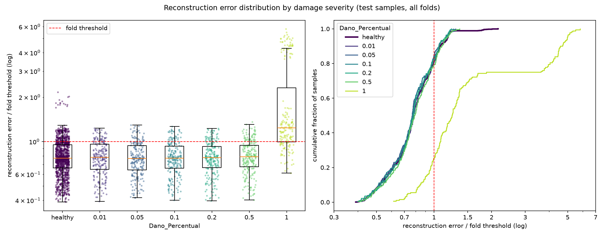

# E001: Baseline no domínio do tempo

| Campo | Valor |
|---|---|
| Status | Concluído (registro retroativo) |
| Pai (base de comparação) | — |
| Proposto em | 2026-10-08 (implementação inicial do pipeline) |
| Executado em | 2026-10-12 (`run_original.log`); repetido com diagnóstico em 2026-10-15 (`run.log`) |
| Registrado em | 2026-10-21 |
| Código | Ver seção 7 |

> **Registro retroativo.** Este experimento foi rodado antes do fluxo de `docs/experiments.md` existir. As seções 1–6 reconstroem o que se sabia e se pretendia na época, sem usar o resultado. Não houve previsões registradas antes do run; o que está na seção 4 é o único risco apontado antes de rodar.

## 1. Motivação

Primeira implementação do autoencoder pedida para o projeto: um Conv1D esparso, treinado só com passagens saudáveis, com limiar simples no erro de reconstrução. Os pipelines anteriores (OCSVM, Isolation Forest) usam 810 features estatísticas por experimento. O autoencoder testa a alternativa de consumir o sinal bruto e aprender a representação.

A escolha de Conv1D foi avaliada e mantida antes de rodar:
- Dano de rigidez altera frequências e formas modais, isto é, padrões locais de oscilação que se repetem no tempo. Convoluções compartilham pesos ao longo do tempo e capturam esse tipo de padrão.
- A primeira camada combina os 16 canais (8 nós × 2 eixos), o que permite capturar relações entre nós (formas modais).
- Um autoencoder denso sobre 29.184 entradas teria milhões de parâmetros para ~1260 saudáveis por fold e tenderia a decorar os dados.

## 2. Hipótese

> Se um autoencoder for treinado para reconstruir apenas passagens saudáveis, então passagens com dano terão erro de reconstrução maior que as saudáveis, porque o dano altera o conteúdo modal do sinal, que o modelo não aprendeu a reproduzir.

## 3. Mudança em relação ao pai

Não há pai: este é o ponto de partida.

## 4. Previsões

Não foram registradas previsões quantitativas antes do run.

Risco apontado antes de rodar: no domínio do tempo, a passagem do trem domina o sinal e depende das EOV (velocidade, peso). O modelo poderia sinalizar variação de condição de operação em vez de dano. Se isso acontecesse, a alternativa seria a entrada espectral (PSD).

Critério de adoção: não se aplica; é a base inicial.

## 5. Configuração e origem de cada escolha

| Parâmetro | Valor | Origem | Justificativa / evidência |
|---|---|---|---|
| `nodes_to_use` | 8 nós (10654, 10659, 10664, 10669, 10658, 10663, 10668, 10673) | Herdado | Mesmos nós dos configs de OCSVM e Isolation Forest |
| `axes_to_use` | X, Y | Herdado | Mesmos eixos dos outros pipelines |
| `filter_type` | `none` | Herdado | Mesmo valor dos outros pipelines. `cutoff_low`/`cutoff_high` (1/20 Hz) existem no config mas não são usados |
| Comprimento do sinal | Recorte em 1824 amostras (7,12 s) | Medido / Físico | Registros têm 1827, 2010 ou 2233 amostras conforme a velocidade. Recorte no menor, arredondado para múltiplo do fator de pooling (32). Não reamostrar, porque isso deslocaria as frequências modais. Custo: perde a vibração livre final das passagens lentas |
| Normalização | Padronização por canal, média e desvio sobre amostras e tempo do treino | Físico | Por canal, e não por coluna, para preservar a forma de onda e equilibrar o peso dos canais no MSE. **Neste run, as estatísticas incluíram os danificados do treino** (ver seção 6) |
| Seleção de features | Nenhuma (`select_features` sem efeito) | Físico | Colunas são instantes de tempo. Filtros de variância/correlação apagariam instantes e quebrariam a continuidade usada pela convolução |
| `encoder_filters` | `[32, 32, 16]` | Arbitrário | Ponto de partida. Justificativa da época apenas qualitativa: vários detectores nas primeiras camadas, gargalo com o mesmo número de canais da entrada |
| `pool_sizes` | `[4, 4, 2]` | Arbitrário | Ponto de partida. Resulta em redução de 32× no tempo (1824 → 57) e gargalo de 912 valores |
| `kernel_size` | 9 | Arbitrário | Ponto de partida. Campo receptivo do encoder ≈ 184 amostras (0,72 s), suficiente para um período dos modos mais baixos; o valor em si não foi derivado |
| `l1_activity` | 1e-4 | Arbitrário | Pretendia ser pequeno perto do MSE (~1); a razão nunca foi medida |
| Ativações e camadas | ReLU nas convoluções; saída linear; `UpSampling1D` + Conv no decoder | Convenção | ReLU produz zeros exatos, o que dá efeito à penalidade L1. Saída linear porque o sinal padronizado assume valores negativos. UpSampling + Conv no lugar de `Conv1DTranspose` para evitar artefatos em "tabuleiro" |
| `learning_rate` | 1e-3 (Adam) | Convenção | Padrão do Adam |
| `epochs` | 100 | Arbitrário | Limite superior; a parada era delegada ao early stopping |
| `early_stopping_patience` | 10 (com `restore_best_weights`) | Convenção | Valor comum |
| `batch_size` | 32 | Convenção | Valor comum |
| `validation_split` | 0,1, após embaralhar os saudáveis | Convenção | O Keras usa as últimas amostras para validação; sem embaralhar, a validação seria só do último arquivo |
| Score de anomalia | MSE médio sobre 1824 × 16 | Convenção | Erro de reconstrução usual em autoencoders |
| Regra do limiar | μ + 1σ do erro dos saudáveis de treino (`threshold_k = 1.0`) | Pedido | Regra simples pedida como ponto de partida. Numa distribuição normal, deixaria ~16% dos saudáveis acima |
| `random_state` | 42 | Convenção | Semente fixa para reprodutibilidade |

## 6. Verificação da premissa não supervisionada

- [ ] Modelo, normalização, filtros e limiar ajustados só com saudáveis do treino. **Não atendido:** modelo e limiar usaram só saudáveis, mas a normalização foi ajustada sobre todo o treino, incluindo danificados. A violação foi corrigida depois, no commit `fdaa4a0`.
- [x] Nenhum parâmetro escolhido com danificados, métricas de teste ou AUC.
- [x] Motivação e critério de adoção usam só saudáveis ou raciocínio físico.

## 7. Execução

| Run | Arquivo | Data | Código |
|---|---|---|---|
| Original | `run_original.log` | 2026-10-12 | Equivalente ao commit `fb5f355` |
| Com diagnóstico | `run.log`, `*_errors.parquet` | 2026-10-15 | `fb5f355` + registro de erros e diagnóstico (equivalentes a `068137a` e `8ab5bd6`), sem `fdaa4a0` e `2e9c48d` |

- Os dois runs deram métricas idênticas (mesma matriz de confusão), então o treino é determinístico e o diagnóstico vale para o run original.
- Nenhum commit reproduz exatamente o estado do código. Rodar este config no código atual não reproduz o E001, por causa da correção da normalização (`fdaa4a0`).
- Duração: cerca de 50 minutos. Os 15 folds foram até a época 100; o early stopping não parou nenhum.
- O `error_distribution.png` foi gerado depois, a partir de `test_errors.parquet`.

Comando equivalente no fluxo atual:

```powershell
.venv\Scripts\python.exe src\test_autoencoders.py outputs\autoencoders\E001_baseline-tempo *> outputs\autoencoders\E001_baseline-tempo\run.log
```

## 8. Resultados

### 8.1 Critérios só com saudáveis

| Critério | Valor |
|---|---|
| `val_loss` final (folds 1–3) | 0,330; 0,348; 0,324, ainda caindo na época 100 |
| Erro médio dos saudáveis de treino | 0,309 (MSE em unidades padronizadas; ~31% da energia não reconstruída) |
| Saudáveis de treino acima do limiar | 15,9% (14,9%–17,1% por fold), perto dos ~16% pretendidos |
| Assimetria do erro dos saudáveis de treino | 0,82 |

η² do log-erro dos saudáveis de treino (média dos folds):

| Fator | η² | Erro médio por nível |
|---|---|---|
| Velocidade | 0,631 | 45 km/h: 0,226 · 50: 0,312 · 55: 0,389 |
| Peso_Vagao | 0,202 | 0,90: 0,272 · 0,95: 0,273 · 1,00: 0,296 · 1,05: 0,322 · 1,10: 0,381 |
| Irregularidade | 0,027 | 1: 0,305 · 2: 0,420 |
| Modulo_Elasticidade | 0,008 | desprezível |

### 8.2 Métricas globais

| Métrica | Valor |
|---|---|
| Acurácia | 0,5454 ± 0,0162 |
| Recall | 0,2544 ± 0,1809 |
| FPR | 0,1733 (234 de 1350) |
| AUC agregada | 0,5487 |
| Matriz de confusão | TN 1116 · FP 234 · FN 973 · TP 332 |

### 8.3 Por severidade

| Severidade | n | Recall | FPR | Recall − FPR | AUC (média ± desvio entre folds) |
|---|---|---|---|---|---|
| 0,01 | 225 | 0,187 | 0,173 | +0,013 | 0,507 ± 0,025 |
| 0,05 | 225 | 0,151 | 0,173 | −0,022 | 0,476 ± 0,039 |
| 0,10 | 225 | 0,160 | 0,173 | −0,013 | 0,470 ± 0,033 |
| 0,20 | 225 | 0,178 | 0,173 | +0,004 | 0,497 ± 0,040 |
| 0,50 | 225 | 0,204 | 0,173 | +0,031 | 0,534 ± 0,025 |
| 1,00 | 180 | 0,744 | 0,173 | +0,571 | 0,903 ± 0,039 |

FPR por irregularidade: 16,4% na 1 e 44,4% na 2 (20 de 45).

### 8.4 Distribuição dos erros



## 9. Análise

**Hipótese (seção 2): refutada para danos até 0,5, confirmada só para 1,0.**
- Até a severidade 0,5, o erro dos danificados tem a mesma distribuição dos saudáveis: AUC entre 0,47 e 0,53, recall no nível do FPR e erro mediano danificado ÷ saudável entre 0,98 e 1,02.
- Na severidade 1,0, o erro é ~53% maior e a AUC é 0,90.

**Risco apontado antes do run (seção 4): confirmado.** O erro dos saudáveis depende mais das EOV que o dano pequeno. Verificado depois, só com saudáveis:
- **Velocidade (η² = 0,63) é sobretudo escala.** A energia do sinal cresce 47% de 45 para 55 km/h e o erro, 73%. Dividindo o erro pela energia, o η² cai para 0,16.
- **Peso (η² = 0,20) não é escala.** A energia muda 8% entre 0,90 e 1,10, mas o erro muda 40%. O peso altera a forma da resposta, e o modelo reconstrói pior os vagões pesados. A causa não foi determinada.
- **O peso explica o vaivém do FPR entre folds** (0% a 50%). Cada fold de teste tem um único peso, e o erro dos saudáveis de teste acompanha o erro que aquele peso tem no treino. O limiar global de ~0,40 corta metade dos saudáveis de peso 1,10.
- **A irregularidade 2 é rara no treino** (~3% dos saudáveis) e é mal reconstruída: FPR de 44%.

**O limiar se comportou como pretendido.** 15,9% dos saudáveis de treino ficaram acima, e a distribuição do erro é pouco assimétrica. A falha está no score, não na regra do limiar: com AUC ≈ 0,5, nenhum limiar separa os danos até 0,5.

**Onde está o erro (análise posterior, só com saudáveis).** O fold 1 foi treinado de novo com a mesma configuração e só arquivos saudáveis; por isso a normalização desse modelo já usou só saudáveis. O espectro do resíduo de reconstrução mostrou:

| Faixa | Fração da energia de entrada | Fração do erro total | Parte da faixa não reconstruída |
|---|---|---|---|
| ≤ 16 Hz | 79% | 25% | 6–10% |
| 16–64 Hz | 2% | 7% | 74–123% |
| 64–128 Hz | 19% | 68% | ~100% |

O modelo funciona como um passa-baixas de ~16 Hz. A faixa de 64–128 Hz não é reconstruída e responde por ~2/3 do score, enquanto a banda modal (picos entre 4 e 15,5 Hz) é bem reconstruída, mas pesa só ~1/4. A energia criada em 32–64 Hz provavelmente vem dos "degraus" do `UpSampling1D`.

**Hipótese de mecanismo refutada durante a análise.** A primeira explicação para o efeito do peso foi "um vagão mais pesado gera um sinal proporcionalmente maior". Uma medição do RMS dos saudáveis, sem modelo, refutou isso: o peso muda a amplitude em só 2,3%, e a velocidade explica 96% da variação do log-RMS.

**Convergência.** O `val_loss` ainda caía na época 100 em todos os folds, sem sinal de overfitting (treino 0,311 contra validação 0,330 no fold 1).

## 10. Decisão e próximos passos

- **Decisão:** base inicial da sequência de experimentos.
- **E002, mais épocas** (100 → 200): o `val_loss` ainda caía na época 100.
- **E003, passa-banda de 1–20 Hz:** a faixa de 64–128 Hz não é reconstruída e domina o score, e a banda modal fica abaixo de 20 Hz. Proposto depois do E002.
- **Pendente:** a normalização deve usar só saudáveis (feito em `fdaa4a0`, a partir do E003).

## Notas posteriores

- 2026-10-21: registro retroativo criado a partir de `run.log`, `run_original.log`, dos parquets e das análises feitas durante as sessões de 2026-10-12 a 2026-10-20.
