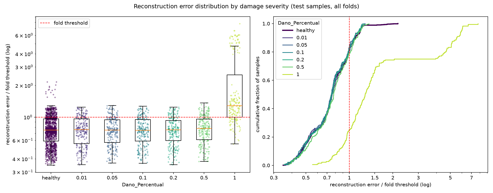

# E002: 200 épocas

| Campo | Valor |
|---|---|
| Status | Concluído (registro retroativo) |
| Pai (base de comparação) | [E001](../E001_baseline-tempo/README.md) |
| Proposto em | 2026-10-15 |
| Executado em | 2026-10-15 |
| Registrado em | 2026-10-21 |
| Código | Igual ao `run.log` do E001 (ver seção 7) |

> **Registro retroativo.** Rodado antes do fluxo de `docs/experiments.md`. As seções 1–6 reconstroem o que se sabia antes do run. A expectativa registrada na seção 4 foi dita antes do run, mas não como previsão formal.

## 1. Motivação

No E001, o `val_loss` ainda caía na época 100 em todos os folds, e o early stopping nunca parou o treino. No fold 1, o `val_loss` foi de 0,367 na época 50 para 0,330 na época 100. O modelo não tinha convergido e deixava ~31% da energia do sinal sem reconstruir.

## 2. Hipótese

> Se o treino durar até 200 épocas, então o erro dos saudáveis cai e o modelo converge (o early stopping passa a agir), porque no E001 o `val_loss` ainda caía na última época.

## 3. Mudança em relação ao pai

| Item | E001 | E002 |
|---|---|---|
| `epochs` | 100 | 200 |

Sem mudanças de código.

## 4. Previsões

Não foram registradas previsões quantitativas antes do run.

Expectativa apontada antes do run, ao analisar o E001: treinar mais poderia melhorar a reconstrução, mas não deveria resolver a dependência do erro em relação às EOV nem a separação dos danos pequenos. Mais épocas só valeriam a pena depois de atacar o score.

Critério de adoção: não definido na época. Critério aplicado neste registro, só com saudáveis: `val_loss` menor que o do E001 e sinal de convergência (early stopping agindo).

## 5. Configuração e origem de cada escolha

Igual ao E001, exceto a linha marcada.

| Parâmetro | Valor | Origem | Justificativa / evidência |
|---|---|---|---|
| `nodes_to_use` | 8 nós (10654, 10659, 10664, 10669, 10658, 10663, 10668, 10673) | Herdado | Mesmos nós dos configs de OCSVM e Isolation Forest |
| `axes_to_use` | X, Y | Herdado | Mesmos eixos dos outros pipelines |
| `filter_type` | `none` | Herdado | Mesmo valor dos outros pipelines |
| Comprimento do sinal | Recorte em 1824 amostras (7,12 s) | Medido / Físico | Menor registro (1827), arredondado para múltiplo do fator de pooling (32); sem reamostrar |
| Normalização | Padronização por canal sobre todo o treino | Físico | Preserva a forma de onda. **Incluiu danificados do treino** (ver seção 6) |
| Seleção de features | Nenhuma | Físico | Colunas são instantes de tempo |
| `encoder_filters` | `[32, 32, 16]` | Arbitrário | Ponto de partida do E001 |
| `pool_sizes` | `[4, 4, 2]` | Arbitrário | Ponto de partida do E001; redução de 32× |
| `kernel_size` | 9 | Arbitrário | Ponto de partida do E001 |
| `l1_activity` | 1e-4 | Arbitrário | Ponto de partida do E001; razão em relação ao MSE nunca medida |
| Ativações e camadas | ReLU; saída linear; `UpSampling1D` + Conv | Convenção | Ver E001 |
| `learning_rate` | 1e-3 (Adam) | Convenção | Padrão do Adam |
| ★ `epochs` | 200 | Medido | `val_loss` do E001 ainda caía na época 100 em todos os folds |
| `early_stopping_patience` | 10 (com `restore_best_weights`) | Convenção | Valor comum |
| `batch_size` | 32 | Convenção | Valor comum |
| `validation_split` | 0,1, após embaralhar os saudáveis | Convenção | Ver E001 |
| Score de anomalia | MSE médio sobre 1824 × 16 | Convenção | Erro de reconstrução usual |
| Regra do limiar | μ + 1σ do erro dos saudáveis de treino | Pedido | Ponto de partida pedido |
| `random_state` | 42 | Convenção | Semente fixa |

## 6. Verificação da premissa não supervisionada

- [ ] Modelo, normalização, filtros e limiar ajustados só com saudáveis do treino. **Não atendido:** a normalização incluiu os danificados do treino, como no E001. Corrigido em `fdaa4a0`, a partir do E003.
- [x] Nenhum parâmetro escolhido com danificados, métricas de teste ou AUC.
- [x] Motivação e critério de adoção usam só saudáveis ou raciocínio físico.

## 7. Execução

- Run de 2026-10-15, iniciado pelo autor do projeto, com o mesmo código do `run.log` do E001: `fb5f355` mais o registro de erros e o diagnóstico (equivalentes a `068137a` e `8ab5bd6`), sem `fdaa4a0` e `2e9c48d`. Nenhum commit reproduz esse estado exato.
- Arquivos de origem: `autoencoders_run_3.log` e `autoencoders_*_errors_3.parquet`. O `error_distribution.png` foi gerado depois, a partir do parquet.
- Duração: cerca de 1h40.
- O early stopping parou 3 dos 15 folds: fold 6 na época 171, fold 9 na 188 e fold 14 na 172. Os outros 12 foram até a época 200.

## 8. Resultados

### 8.1 Critérios só com saudáveis

| Critério | E001 | E002 |
|---|---|---|
| `val_loss` final, fold 1 | 0,330 | 0,312 (0,318 na época 150) |
| `val_loss` final, folds 2 e 3 | 0,348; 0,324 | 0,321; 0,307 |
| Folds com early stopping | 0 de 15 | 3 de 15 |
| Erro médio dos saudáveis de treino | 0,309 | 0,290 |
| Saudáveis de treino acima do limiar | 15,9% | 16,3% (14,8%–17,9%) |
| Assimetria do erro dos saudáveis de treino | 0,82 | 0,57 |

η² do log-erro dos saudáveis de treino:

| Fator | E001 | E002 | Erro médio por nível no E002 |
|---|---|---|---|
| Velocidade | 0,631 | 0,669 | 45 km/h: 0,198 · 50: 0,291 · 55: 0,380 |
| Peso_Vagao | 0,202 | 0,217 | 0,90: 0,242 · 0,95: 0,254 · 1,00: 0,279 · 1,05: 0,307 · 1,10: 0,367 |
| Irregularidade | 0,027 | 0,019 | 1: 0,286 · 2: 0,390 |
| Modulo_Elasticidade | 0,008 | 0,006 | desprezível |

### 8.2 Métricas globais

| Métrica | E001 | E002 | Δ |
|---|---|---|---|
| Acurácia | 0,5454 ± 0,0162 | 0,5446 ± 0,0120 | −0,0008 |
| Recall | 0,2544 ± 0,1809 | 0,2605 ± 0,1720 | +0,0061 |
| FPR | 0,1733 | 0,1807 | +0,0074 |
| AUC agregada | 0,5487 | 0,5517 | +0,0030 |
| Matriz de confusão | TN 1116 · FP 234 · FN 973 · TP 332 | TN 1106 · FP 244 · FN 965 · TP 340 | |

### 8.3 Por severidade

| Severidade | n | Recall | FPR | Recall − FPR | AUC E002 | AUC E001 |
|---|---|---|---|---|---|---|
| 0,01 | 225 | 0,191 | 0,181 | +0,010 | 0,500 ± 0,022 | 0,507 |
| 0,05 | 225 | 0,160 | 0,181 | −0,021 | 0,483 ± 0,032 | 0,476 |
| 0,10 | 225 | 0,173 | 0,181 | −0,007 | 0,481 ± 0,034 | 0,470 |
| 0,20 | 225 | 0,178 | 0,181 | −0,003 | 0,496 ± 0,034 | 0,497 |
| 0,50 | 225 | 0,209 | 0,181 | +0,028 | 0,545 ± 0,023 | 0,534 |
| 1,00 | 180 | 0,750 | 0,181 | +0,569 | 0,906 ± 0,034 | 0,903 |

FPR por irregularidade: 17,2% na 1 e 42,2% na 2. FPR por peso de vagão do fold: 0–3% em 0,90 e 0,95; 3–18% em 1,00; 33–36% em 1,05; 37–48% em 1,10.

### 8.4 Distribuição dos erros

## 9. Análise

**Hipótese (seção 2): confirmada em parte.**
- O erro dos saudáveis caiu (0,309 → 0,290) e o `val_loss` também (0,330 → 0,312 no fold 1).
- A convergência ficou incompleta: o early stopping agiu em só 3 folds, e nos outros 12 o `val_loss` ainda caía na época 200, com ganho pequeno (−0,006 entre as épocas 150 e 200 no fold 1).

**Expectativa da seção 4: confirmada.**
- A separação dos danos não mudou: as AUCs por severidade variaram menos de 0,02, abaixo do desvio entre folds.
- A dependência das EOV ficou igual ou um pouco maior (η² da velocidade 0,63 → 0,67). O mesmo padrão de FPR por peso do E001 se repete.
- A reconstrução melhorou de forma parecida para saudáveis e danificados, então a diferença entre eles continuou a mesma.

**Interpretação.** Treinar mais não muda o que o modelo reconstrói, só reconstrói um pouco melhor o mesmo. O limite do E001 não está no tempo de treino. Isso é consistente com a análise espectral do resíduo (E001, seção 9): o erro é dominado pela faixa de 64–128 Hz, que o modelo não reconstrói em nenhuma das duas durações de treino.

**Pergunta lateral avaliada neste run.** Foi analisado se um limiar mais baixo, perto do erro médio dos saudáveis de treino, separaria melhor os danos. A leitura da ROC mostrou que não: com o limiar na média do treino, o TPR das severidades até 0,5 sobe junto com o FPR (para ~0,50), porque as distribuições se sobrepõem. A análise foi só diagnóstica e não alterou nenhum parâmetro.

## 10. Decisão e próximos passos

- **Decisão:** adotada como nova base, pelo critério só com saudáveis da seção 4 (`val_loss` menor que o do E001 e early stopping passando a agir em parte dos folds). O ganho é pequeno e o custo de tempo dobra; o limite de 200 épocas fica como teto, com a parada delegada ao early stopping.
- **E003, passa-banda de 1–20 Hz:** atacar a faixa de 64–128 Hz que domina o erro, conforme a análise espectral do resíduo do E001.

## Notas posteriores

- 2026-10-21: registro retroativo criado a partir de `run.log`, dos parquets e das análises feitas durante as sessões.
