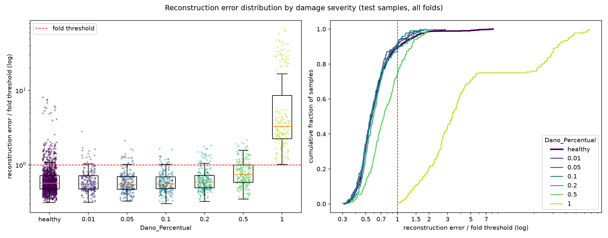

# E003: Passa-banda de 1–20 Hz

| Campo | Valor |
|---|---|
| Status | Concluído (registro retroativo) |
| Pai (base de comparação) | [E002](../E002_200-epocas/README.md) |
| Proposto em | 2026-10-15 |
| Executado em | 2026-10-15 |
| Registrado em | 2026-10-21 |
| Código | Equivalente ao commit `8ab5bd6` (ver seção 7) |

> **Registro retroativo.** Rodado antes do fluxo de `docs/experiments.md`. As seções 1–6 reconstroem o que foi proposto antes do run. As expectativas da seção 4 foram ditas antes do run, mas não como previsões formais.

## 1. Motivação

Duas medições, ambas só com saudáveis, apontaram a faixa de alta frequência como o problema do score:

**Espectro dos saudáveis** (PSD dos 1350 saudáveis, mesma entrada do modelo):

| Faixa (Hz) | ≤ 2 | 2–4 | 4–8 | 8–16 | 16–64 | 64–128 |
|---|---|---|---|---|---|---|
| Fração da energia | 4% | 8% | 18% | 49% | 2% | 19% |

- Picos principais entre 4 e 15,5 Hz e um grupo em 104–110 Hz.
- Picos em ~4; 12,5 e 14 Hz aparecem nas 3 velocidades e são candidatos a modos da ponte. Os que mudam com a velocidade indicam excitação do trem. Não é uma identificação modal formal.

**Espectro do resíduo de reconstrução** (fold 1 retreinado com a configuração do E001, só saudáveis; detalhes no E001, seção 9):
- O modelo reconstrói 90–94% da energia abaixo de 16 Hz e nada da faixa de 64–128 Hz.
- A faixa de 64–128 Hz responde por ~68% do erro total. A banda modal, onde um dano de rigidez deve aparecer, responde por ~25%.

O dano fica afogado num score dominado por uma faixa que o modelo não modela. O E002 mostrou que treinar mais não muda isso.

## 2. Hipótese

> Se a entrada for filtrada em 1–20 Hz, então o erro de reconstrução passa a medir a banda modal, e a separação dos danos melhora, porque hoje ~2/3 do score vêm de uma faixa que o modelo não reconstrói e que não contém os modos da ponte.

## 3. Mudança em relação ao pai

| Item | E002 | E003 |
|---|---|---|
| `filter_type` | `none` | `both` (passa-banda 1–20 Hz) |
| Normalização | Ajustada sobre todo o treino, incluindo danificados | Ajustada só com saudáveis do treino |
| Ordem filtro/recorte | Sem efeito (sem filtro) | Filtro no registro completo, depois recorte |

Mudanças de código:
- `fdaa4a0`: `BridgeDefectPipeline.run()` descarta os danificados do treino antes de qualquer ajuste quando `supervised = False`. Corrige a violação da premissa nos três pipelines não supervisionados.
- `2e9c48d`: `extract_features` filtra o registro completo e só depois recorta, evitando o transiente de borda do `filtfilt` no ponto de corte.

**Mudanças confundidas.** A correção da normalização entrou junto porque era uma violação da premissa e não fazia sentido continuar rodando com ela. Por isso, o efeito do filtro não pode ser separado do efeito da normalização só com saudáveis. A expectativa é que o segundo seja pequeno: os danificados são ~1/2 do treino, mas a normalização é só uma média e um desvio por canal. Isso não foi verificado.

## 4. Previsões

Não foram registradas previsões quantitativas antes do run.

Expectativas apontadas antes do run:
- O erro passaria a medir a banda modal, e não a faixa de 64–128 Hz.
- A dependência da velocidade poderia cair, se a excitação de alta frequência crescesse com ela. Isso não tinha sido verificado por velocidade.
- Danos pequenos poderiam continuar invisíveis, se o efeito deles na banda modal fosse menor que o resíduo restante.

Critério de adoção: não definido na época. Critério aplicado neste registro, só com saudáveis: a fração não reconstruída do sinal e a dependência do erro em relação às EOV caem em relação ao E002.

## 5. Configuração e origem de cada escolha

Igual ao E002, exceto as linhas marcadas.

| Parâmetro | Valor | Origem | Justificativa / evidência |
|---|---|---|---|
| `nodes_to_use` | 8 nós (10654, 10659, 10664, 10669, 10658, 10663, 10668, 10673) | Herdado | Mesmos nós dos configs de OCSVM e Isolation Forest |
| `axes_to_use` | X, Y | Herdado | Mesmos eixos dos outros pipelines |
| ★ `filter_type` | `both` (Butterworth ordem 4, `filtfilt`, fase zero) | Medido | Espectro do resíduo do E001: faixa de 64–128 Hz não reconstruída e dominante no erro. `filtfilt` não desloca o tempo dos eventos |
| ★ `cutoff_low` | 1 Hz | Herdado / Físico | Já estava no config. Remove a deflexão quase estática da passagem da carga, que depende de peso e velocidade e não é vibração modal |
| ★ `cutoff_high` | 20 Hz | Herdado / Medido | Já estava no config. Cobre os picos modais (4–15,5 Hz) com margem |
| ★ Ordem filtro/recorte | Filtra o registro completo, depois recorta | Físico | Evita o transiente de borda do filtro no ponto de corte |
| Comprimento do sinal | Recorte em 1824 amostras (7,12 s) | Medido / Físico | Menor registro (1827), arredondado para múltiplo do fator de pooling (32); sem reamostrar |
| ★ Normalização | Padronização por canal, só com saudáveis do treino | Físico / premissa | Preserva a forma de onda. Corrige a violação da premissa do E001 e E002 |
| Seleção de features | Nenhuma | Físico | Colunas são instantes de tempo |
| `encoder_filters` | `[32, 32, 16]` | Arbitrário | Ponto de partida do E001 |
| `pool_sizes` | `[4, 4, 2]` | Arbitrário | Ponto de partida do E001; redução de 32×. Com o sinal limitado a 20 Hz, o latente (taxa de 8 amostras/s) fica abaixo da banda de interesse |
| `kernel_size` | 9 | Arbitrário | Ponto de partida do E001 |
| `l1_activity` | 1e-4 | Arbitrário | Ponto de partida do E001; razão em relação ao MSE nunca medida |
| Ativações e camadas | ReLU; saída linear; `UpSampling1D` + Conv | Convenção | Ver E001 |
| `learning_rate` | 1e-3 (Adam) | Convenção | Padrão do Adam |
| `epochs` | 200 | Medido | Adotado no E002 |
| `early_stopping_patience` | 10 (com `restore_best_weights`) | Convenção | Valor comum |
| `batch_size` | 32 | Convenção | Valor comum |
| `validation_split` | 0,1, após embaralhar os saudáveis | Convenção | Ver E001 |
| Score de anomalia | MSE médio sobre 1824 × 16 | Convenção | Erro de reconstrução usual |
| Regra do limiar | μ + 1σ do erro dos saudáveis de treino | Pedido | Ponto de partida pedido |
| `random_state` | 42 | Convenção | Semente fixa |

## 6. Verificação da premissa não supervisionada

- [x] Modelo, normalização, filtros e limiar ajustados só com saudáveis do treino. Primeiro experimento a atender este item.
- [x] Nenhum parâmetro escolhido com danificados, métricas de teste ou AUC. Os cortes de 1 e 20 Hz vieram do config e do espectro dos saudáveis.
- [x] Motivação e critério de adoção usam só saudáveis ou raciocínio físico.

## 7. Execução

- Run de 2026-10-15 (terminou às 11:43). Chamado de "experimento A" nas sessões. Arquivos de origem: `autoencoders_run.log` e `autoencoders_*_errors.parquet`. O `error_distribution.png` foi gerado depois, a partir do parquet.
- **Código:** o código do modelo é o do commit `8ab5bd6`. O script de teste da época ainda imprimia a seção antiga "PERFORMANCE BY DAMAGE PERCENTAGE"; a tabela nova por severidade (`severity_report`) e o gráfico entraram depois, só como relatório.
- **Config:** o `config.yaml` do commit `2c27520` tem `epochs: 100`, porque as 200 épocas eram uma alteração local que ficou fora dos commits. O log confirma que o run usou 200 (`Epoch .../200`), e o `config.yaml` desta pasta registra 200.
- Duração: cerca de 1h40.
- O early stopping parou 7 dos 15 folds: 3 (época 176), 5 (121), 8 (191), 10 (170), 13 (183), 14 (178) e 15 (198). Os outros 8 foram até a época 200.

## 8. Resultados

### 8.1 Critérios só com saudáveis

| Critério | E002 | E003 |
|---|---|---|
| Erro médio dos saudáveis de treino (≈ fração não reconstruída) | 0,290 | 0,056 |
| Faixa do erro médio de treino entre folds | — | 0,036 a 0,070 |
| `val_loss` final, folds 1–3 | 0,312; 0,321; 0,307 | 0,057; 0,082; 0,085 |
| Folds com early stopping | 3 de 15 | 7 de 15 |
| Saudáveis de treino acima do limiar | 16,3% | 5,2% (2,1%–8,3% por fold) |
| Idem, por irregularidade | — | 1: 4,1% · 2: 38,4% |
| Assimetria do erro dos saudáveis de treino | 0,57 | 8,31 |

O erro está em unidades do sinal padronizado, e cada experimento padroniza a própria entrada. Como a variância de cada canal é 1 nos dois casos, o MSE é aproximadamente a fração da energia não reconstruída. No E003, isso vale para a energia da banda de 1–20 Hz.

η² do log-erro dos saudáveis de treino:

| Fator | E002 | E003 | Erro médio por nível no E003 |
|---|---|---|---|
| Velocidade | 0,669 | 0,098 | 45 km/h: 0,064 · 50: 0,056 · 55: 0,049 |
| Peso_Vagao | 0,217 | 0,239 | 0,90: 0,080 · 0,95: 0,053 · 1,00: 0,049 · 1,05: 0,048 · 1,10: 0,051 |
| Irregularidade | 0,019 | 0,110 | 1: 0,053 · 2: 0,158 |
| Modulo_Elasticidade | 0,006 | 0,043 | 0,975: 0,066 · 1,00: 0,050 · 1,025: 0,052 |

Erro mediano dos saudáveis de treino (irregularidade 1) por peso: 0,90: 0,069 · 0,95: 0,046 · 1,00: 0,044 · 1,05: 0,044 · 1,10: 0,048.

### 8.2 Métricas globais

| Métrica | E002 | E003 | Δ |
|---|---|---|---|
| Acurácia | 0,5446 ± 0,0120 | 0,5759 ± 0,0266 | +0,0313 |
| Recall | 0,2605 ± 0,1720 | 0,2467 ± 0,1461 | −0,0138 |
| FPR | 0,1807 | 0,1059 | −0,0748 |
| AUC agregada | 0,5517 | 0,6018 | +0,0501 |
| Matriz de confusão | TN 1106 · FP 244 · FN 965 · TP 340 | TN 1207 · FP 143 · FN 983 · TP 322 | |

### 8.3 Por severidade

| Severidade | n | Recall | FPR | Recall − FPR | AUC E003 | AUC E002 |
|---|---|---|---|---|---|---|
| 0,01 | 225 | 0,080 | 0,106 | −0,026 | 0,498 ± 0,072 | 0,500 |
| 0,05 | 225 | 0,089 | 0,106 | −0,017 | 0,470 ± 0,054 | 0,483 |
| 0,10 | 225 | 0,098 | 0,106 | −0,008 | 0,476 ± 0,067 | 0,481 |
| 0,20 | 225 | 0,111 | 0,106 | +0,005 | 0,554 ± 0,072 | 0,496 |
| 0,50 | 225 | 0,253 | 0,106 | +0,147 | 0,723 ± 0,084 | 0,545 |
| 1,00 | 180 | 1,000 | 0,106 | +0,894 | 0,989 ± 0,011 | 0,906 |

FPR por irregularidade: 9,5% na 1 e 42,2% na 2 (19 de 45).

FPR e TPR por peso de vagão do fold:

| Peso | FPR | TPR |
|---|---|---|
| 0,90 (folds 10–12) | 0,34–0,53 | 0,52–0,54 |
| 0,95 | 0,01–0,04 | 0,15–0,24 |
| 1,00 | 0,00–0,03 | 0,15–0,20 |
| 1,05 | 0,00–0,03 | 0,14–0,20 |
| 1,10 | 0,00–0,03 | 0,14–0,22 |

### 8.4 Distribuição dos erros

## 9. Análise

**Hipótese (seção 2): confirmada para as severidades 0,5 e 1,0; refutada até 0,1.**
- Severidade 0,5: AUC de 0,55 para 0,72 (d de Cohen ≈ 0,87; erro mediano 34% maior que o dos saudáveis).
- Severidade 1,0: AUC de 0,91 para 0,99, com recall de 100%.
- Severidade 0,2: sinal fraco (AUC 0,55).
- Severidades até 0,1: continuam invisíveis (AUC entre 0,47 e 0,50; erro mediano igual ao dos saudáveis).

**Expectativas da seção 4:**
- *Erro medindo a banda modal:* confirmada. A fração não reconstruída caiu de ~29% para ~6%.
- *Queda da dependência da velocidade:* confirmada. O η² caiu de 0,67 para 0,10, então o efeito da velocidade vinha da faixa de alta frequência.
- *Danos pequenos invisíveis:* confirmada para as severidades até 0,1.

**Problemas novos, todos visíveis só com saudáveis:**
- **A fração de saudáveis acima do limiar mudou sem ter sido escolhida.** Com a mesma regra μ + 1σ, ela foi de 16,3% no E002 para 5,2% no E003, porque o formato da distribuição do erro mudou: a assimetria subiu de 0,57 para 8,3. A causa é a irregularidade 2: são ~3% dos saudáveis, com erro ~3× maior, e inflam o σ (no fold 1, o σ cai de 0,028 para 0,013 sem elas). O limiar ficou mais alto: o FPR caiu, e o recall dos folds normais ficou em 14–24%. Nenhum dos dois pontos (16% ou 5%) é melhor em si; o problema é que a fração de alarmes depende do formato da distribuição, e não de uma escolha. Parte da queda do FPR em relação ao E002 vem desse efeito da regra, e não do modelo.
- **A irregularidade 2 é mal reconstruída.** η² de 0,03 para 0,11; 38% dos saudáveis de treino dessa condição ficam acima do limiar, e o FPR de teste nela é 42%.
- **O peso 0,90 é mais difícil de reconstruir.** Mesmo no treino, o erro mediano dele é 0,069, contra ~0,045 nos outros pesos. Quando ele vai para o teste (folds 10–12), o limiar vem só dos pesos mais fáceis, e o FPR chega a 34–53%. No E002, o peso difícil era o 1,10. Não se sabe por que o filtro inverteu isso.
- **A qualidade do treino varia muito entre folds.** O erro médio dos saudáveis de treino vai de 0,036 a 0,070, e essa variação passa direto para o limiar.

**Normalização só com saudáveis.** O efeito dela não foi isolado (seção 3). Nada no resultado indica que tenha sido relevante, mas isso não foi testado.

## 10. Decisão e próximos passos

- **Decisão:** adotada como nova base, pelo critério só com saudáveis da seção 4. A fração não reconstruída caiu de ~29% para ~6%, e o η² da velocidade, de 0,67 para 0,10. A regra do limiar fica marcada para revisão, porque a fração de alarmes que ela produz depende do formato da distribuição (evidência só com saudáveis: assimetria de 8,3; 5,2% acima do limiar, contra 16,3% no E002 com a mesma regra).
- **Regra do limiar por percentil:** um percentil do erro dos saudáveis garante a fração de alarmes escolhida para qualquer distribuição. Depende de o autor definir a fração de falsos alarmes aceitável (α). Calibrar nos 10% de validação, e não nos saudáveis usados no ajuste dos pesos.
- **Sobreamostrar a irregularidade 2 no treino:** o modelo não aprendeu essa condição saudável.
- **Arquitetura ajustada à banda (proposto antes do E003 como "experimento B"):** kernel ~13 (um período de 20 Hz a 256 Hz) e redução total de 4–8× no lugar de 32×. A escolha entre variantes sairia do `val_loss`.

## Notas posteriores

- 2026-10-21: registro retroativo criado a partir de `run.log`, dos parquets e das análises feitas durante as sessões.
- 2026-10-21: a seção 9 dizia que o limiar "deixou de funcionar como pretendido", supondo uma intenção de 16% de alarmes. Essa intenção nunca existiu: 16% é só a fração que μ + 1σ deixa acima numa distribuição normal, e o k = 1 foi pedido como ponto de partida simples. Texto corrigido.
- 2026-10-21: adicionado `residual_spectrum.txt`, o espectro do resíduo do fold 1 medido com `src/residual_spectrum.py` (só saudáveis de treino). O limiar do fold 1 reproduz o do run (0,0753). Principais números: erro relativo de 4,4%; 8% do resíduo acima de 20 Hz, onde a entrada não tem energia; 37% da faixa de 16–20 Hz não reconstruída; 88,6% de zeros no latente; penalidade L1 = 10% do MSE.
