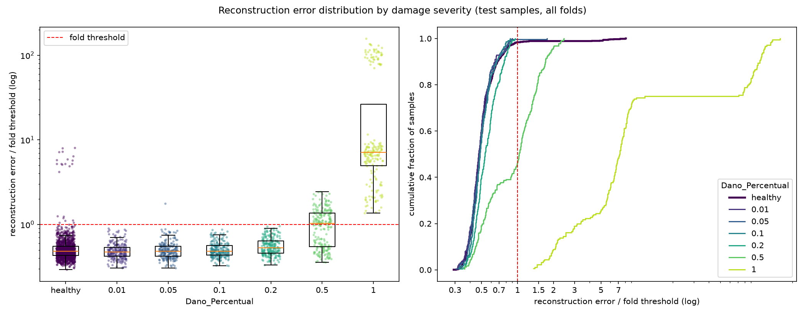

# E004: Menos redução no tempo (pooling 2 × 2 × 2)

| Campo | Valor |
|---|---|
| Status | Concluído |
| Pai (base de comparação) | [E003](../E003_passa-banda-1-20hz/README.md) |
| Proposto em | 2026-10-21 |
| Executado em | 2026-10-21 |
| Código | commit `218e457` |

## 1. Motivação

No E003, os valores de `pool_sizes`, `kernel_size` e `encoder_filters` continuam sendo os pontos de partida arbitrários do E001. Com a entrada agora limitada a 1–20 Hz, eles podem ser confrontados com a banda do sinal. Duas evidências, ambas só com saudáveis:

**1. O espaço latente tem resolução temporal muito abaixo da banda.** A redução no tempo é de 32× (`[4, 4, 2]`): o latente tem 57 instantes em 7,12 s, ou 8 amostras por segundo. A banda de entrada vai até 20 Hz. O decoder precisa recriar oscilações de 8–20 Hz a partir de um sinal amostrado a 8 Hz, ampliando ×4, ×4 e ×2 com `UpSampling1D`, que repete valores e gera "degraus".

**2. O decoder cria energia fora da banda.** O espectro do resíduo de reconstrução do E003 (fold 1, só saudáveis de treino, medido com `src/residual_spectrum.py`; ver `../E003_passa-banda-1-20hz/residual_spectrum.txt`):

| Faixa (Hz) | Fração da entrada | Fração do resíduo | Parte da faixa não reconstruída |
|---|---|---|---|
| 1–16 | 96,7% | 83,4% | 3–6% |
| 16–20 | 0,7% | 5,7% | 37% |
| 20–128 | ~0% | 8,0% | (sem entrada: energia criada pelo modelo) |

- O erro relativo total é 4,4%.
- Dentro de 1–16 Hz, o modelo já reconstrói 94–97% da energia.
- **8% do resíduo está acima de 20 Hz, onde a entrada não tem energia nenhuma.** Essa parte do score é criada pelo próprio decoder. Os "degraus" do `UpSampling1D` são a explicação mais provável: um degrau tem energia em alta frequência, e degraus maiores (×4) espalham mais energia. Essa explicação não foi verificada.
- A faixa de 16–20 Hz, perto da resolução que o latente consegue sustentar, é a mais mal reconstruída da banda (37%).

Outras medições do mesmo diagnóstico: 88,6% das ativações do latente são zero (14 dos 16 canais ativos), e a penalidade L1 equivale a 10% do MSE.

## 2. Hipótese

> Se a redução no tempo cair de 32× para 8× (`[2, 2, 2]`), mantendo a compressão total em 32× (latente de 912 valores) e o campo receptivo do encoder, então a energia criada fora da banda e o erro em 12–20 Hz diminuem, porque o decoder passa a ampliar o sinal em passos de ×2 a partir de um latente a 32 amostras/s, e não em passos de ×4 a partir de 8 amostras/s.

## 3. Mudança em relação ao pai

| Item | E003 | E004 |
|---|---|---|
| `pool_sizes` | `[4, 4, 2]` (redução de 32× no tempo; latente a 8 amostras/s) | `[2, 2, 2]` (redução de 8× no tempo; latente a 32 amostras/s) |
| `encoder_filters` | `[32, 32, 16]` | `[32, 32, 4]` |
| `kernel_size` | 9 | 19 |
| `epochs` | 200 | 100 |

Sem mudanças de código no modelo.

### Por que a arquitetura muda em três parâmetros

A mudança testada é uma só: onde a compressão acontece, no tempo ou nos canais. O tamanho do latente é o número de instantes vezes o número de canais do latente, que é o número de filtros da última camada do encoder (o último valor de `encoder_filters`):

| | Instantes no latente | Canais do latente | Total | Compressão total |
|---|---|---|---|---|
| E003 | 1824 ÷ 32 = 57 | 16 | 912 | 29.184 ÷ 912 = 32× |
| Só trocando os pools | 1824 ÷ 8 = 228 | 16 | 3648 | 8× |
| E004 | 1824 ÷ 8 = 228 | 4 | 912 | 32× |

Os outros dois parâmetros mudam para manter constantes duas grandezas que, de outro modo, mudariam junto e confundiriam o resultado:

| Grandeza mantida | E003 | E004 | Como |
|---|---|---|---|
| Tamanho do latente (compressão total) | 912 valores (32×) | 912 valores (32×) | Canais do latente: 16 → 4 |
| Campo receptivo do encoder ≥ 2 períodos do modo mais baixo (~4 Hz, 128 amostras) | 200 amostras (0,78 s) | 134 amostras (0,52 s) | `kernel_size`: 9 → 19 |

- Sem reduzir os canais do latente, o latente ficaria 4× maior. Isso mudaria também quanto o modelo comprime, e menos compressão pode fazer o modelo reconstruir também o dano.
- Sem aumentar o kernel, o campo receptivo cairia para 64 amostras (0,25 s), só um período do modo de ~4 Hz.
- O campo receptivo não fica idêntico (200 → 134), só acima do mesmo critério. Não dá para igualar os dois com pools de 2 e um kernel único sem uma camada a mais.

**Efeito confundido: menos canais no latente.** Cada instante do latente passa a ter 4 valores, em vez de 16, para descrever o estado dos 16 canais de entrada. É uma aposta de que as formas modais (como os nós vibram juntos) cabem em poucos canais. Se o resultado piorar, isso pode vir da falta de canais, e não da resolução no tempo; os dois efeitos não podem ser separados neste experimento.

### Por que 100 épocas

Pedido do autor: o custo por época fica ~2,8× maior, e 100 épocas permitem avaliar o resultado mais rápido. É uma segunda mudança, e ela interfere na comparação: no E003, ir de 100 para 200 épocas reduziu a mediana do melhor `val_loss` de 0,0907 para 0,0726 (−20%).

Para comparar só a arquitetura, as referências do E003 passam a ser as de 100 épocas:
- **`val_loss`:** o melhor valor de cada fold do E003 até a época 100, lido do `run.log` do E003. É uma referência exata: o treino é determinístico, e nenhum fold do E003 parou antes da época 100 (a primeira parada foi na 121). Mediana: 0,0907.
- **Espectro do resíduo:** o fold 1 do E003 foi retreinado com 100 épocas (`residual_spectrum_ref_E003_100ep.txt`).
- **AUC e demais métricas de teste:** não há run do E003 com 100 épocas. A comparação de AUC entre E003 e E004 fica confundida com as épocas, mas isso não afeta o critério de adoção, que usa só as duas referências acima.

**Diferença em relação ao "experimento B" discutido antes do E003.** O B previa kernel ~13 e redução de 4–8×, com latente de ~1824 valores. Refazendo as contas para este registro:
- Com pools `[2, 2, 2]` e kernel 13, o campo receptivo do encoder seria 92 amostras (0,36 s), abaixo de 2 períodos do modo de ~4 Hz.
- Um latente de 1824 valores dobraria o tamanho do latente, que é uma segunda mudança, com efeito próprio.

Por isso o kernel foi para 19 (que também atende a regra de cobrir ≥ 1 período da maior frequência da banda, 13 amostras) e o latente ficou em 912.

**Outros efeitos colaterais conhecidos:**
- Parâmetros: 39.344 → 63.688. Custo de cálculo por época: ~2,8× (26 → 73 milhões de multiplicações por amostra).
- O peso relativo da penalidade L1 pode mudar, porque a magnitude das ativações do latente muda. Será medido.

## 4. Previsões (escritas antes de rodar)

### 4.1 Critérios só com saudáveis

Referência: E003 com 100 épocas (ver seção 3). Medidos no fold 1 com `src/residual_spectrum.py`, salvo onde indicado:

| Critério | E003, 100 épocas | E003, 200 épocas | Previsão para o E004 (100 épocas) |
|---|---|---|---|
| Fração do resíduo acima de 20 Hz | 6,7% | 8,0% | Menor que 3,5% (cerca de metade) |
| Parte não reconstruída de 12–16 Hz | 9,0% | 6,1% | Menor que 9,0% |
| Parte não reconstruída de 16–20 Hz | 49,8% | 37% | Menor que 49,8% |
| Erro relativo total | 6,3% | 4,4% | Menor que 6,3% |
| Mediana do melhor `val_loss` dos 15 folds (`run.log`) | 0,0907 | 0,0726 | Menor que 0,0907 |
| η² da velocidade e do peso (`run.log`) | — | 0,10; 0,24 | Sem previsão de direção |

### 4.2 Avaliação (só reporte)

Sem previsão firme de direção.
- Se a energia criada fora da banda estiver mascarando o dano, a AUC das severidades 0,2 e 0,5 pode subir um pouco.
- Se a reconstrução melhorar igualmente para saudáveis e danificados, como no E002, a AUC fica igual.
- Severidades até 0,1 devem continuar com AUC ~0,5: nada no diagnóstico do E003 indica que o problema delas seja a arquitetura.

FPR e recall continuam afetados pela regra μ + 1σ, cuja fração de alarmes depende do formato da distribuição (ver E003, seção 9). A comparação deve se apoiar na AUC, que não depende do limiar, lembrando que ela também fica confundida com as épocas (seção 3).

### 4.3 Critério de adoção

Adotar a arquitetura se as duas condições valerem, contra o E003 com 100 épocas:
1. A fração do resíduo acima de 20 Hz no fold 1 cair em relação a 6,7%.
2. A mediana do melhor `val_loss` dos 15 folds não piorar em relação a 0,0907.

Se adotada, a nova base usa a arquitetura do E004 com 200 épocas (adotadas no E002), salvo decisão em contrário. O tempo de execução não entra no critério, mas será registrado.

## 5. Configuração e origem de cada escolha

Igual ao E003, exceto as linhas marcadas.

| Parâmetro | Valor | Origem | Justificativa / evidência |
|---|---|---|---|
| `nodes_to_use` | 8 nós (10654, 10659, 10664, 10669, 10658, 10663, 10668, 10673) | Herdado | Mesmos nós dos configs de OCSVM e Isolation Forest |
| `axes_to_use` | X, Y | Herdado | Mesmos eixos dos outros pipelines |
| `filter_type`, `cutoff_low`, `cutoff_high` | Passa-banda 1–20 Hz (Butterworth ordem 4, `filtfilt`) | Medido / Físico | Ver E003 |
| Ordem filtro/recorte | Filtra o registro completo, depois recorta | Físico | Ver E003 |
| Comprimento do sinal | Recorte em 1824 amostras (7,12 s) | Medido / Físico | 1824 é múltiplo de 8, então o recorte não muda com os novos pools |
| Normalização | Padronização por canal, só com saudáveis do treino | Físico / premissa | Ver E003 |
| Seleção de features | Nenhuma | Físico | Colunas são instantes de tempo |
| ★ `pool_sizes` | `[2, 2, 2]` | Medido / Físico | Latente a 32 amostras/s, mais perto da banda de 20 Hz. Ampliação em passos de ×2. Motivado pela energia criada fora da banda no E003 (seção 1) |
| ★ `encoder_filters` | `[32, 32, 4]` | Arbitrário / controle | 32 nas duas primeiras camadas: mantido do E003 (arbitrário). 4 canais no latente: escolhido só para manter o latente em 912 valores |
| ★ `kernel_size` | 19 | Físico (heurística) | Menor kernel que mantém o campo receptivo do encoder ≥ 2 períodos do modo de ~4 Hz (128 amostras). O fator "2 períodos" é uma escolha. Também cobre ≥ 1 período da maior frequência da banda (20 Hz → 13 amostras) |
| `l1_activity` | 1e-4 | Arbitrário | Ponto de partida do E001. Medido no E003: a penalidade equivale a 10% do MSE |
| Ativações e camadas | ReLU; saída linear; `UpSampling1D` + Conv | Convenção | Ver E001. O `UpSampling1D` é mantido de propósito: trocá-lo seria mais uma mudança |
| `learning_rate` | 1e-3 (Adam) | Convenção | Padrão do Adam |
| ★ `epochs` | 100 | Pedido | Custo por época ~2,8× maior; avaliação mais rápida. Comparação feita contra o E003 com 100 épocas (seção 3) |
| `early_stopping_patience` | 10 (com `restore_best_weights`) | Convenção | Valor comum |
| `batch_size` | 32 | Convenção | Valor comum |
| `validation_split` | 0,1, após embaralhar os saudáveis | Convenção | Ver E001 |
| Score de anomalia | MSE médio sobre 1824 × 16 | Convenção | Erro de reconstrução usual |
| Regra do limiar | μ + 1σ do erro dos saudáveis de treino | Pedido | Mantida para não misturar mudanças; revisão pendente (E003, seção 10) |
| `random_state` | 42 | Convenção | Semente fixa |

## 6. Verificação da premissa não supervisionada

- [x] Modelo, normalização, filtros e limiar ajustados só com saudáveis do treino.
- [x] Nenhum parâmetro escolhido com danificados, métricas de teste ou AUC. Os novos valores vêm do espectro dos saudáveis, de regras sobre a banda do sinal e de um pedido de tempo de execução.
- [x] Motivação e critério de adoção usam só saudáveis ou raciocínio físico.

## 7. Execução

Comandos (depois de commitar o código e esta pasta):

```powershell
.venv\Scripts\python.exe src\test_autoencoders.py outputs\autoencoders\E004_pooling-2x2x2 *> outputs\autoencoders\E004_pooling-2x2x2\run.log
.venv\Scripts\python.exe src\residual_spectrum.py outputs\autoencoders\E004_pooling-2x2x2
```

Duração estimada: 1,5–2,5 h para o run principal. O E003 levou ~2,1 s por época; com custo ~2,8× maior, são ~6 s por época, e no máximo 1500 épocas (15 folds × 100). Não medido. O diagnóstico do resíduo leva cerca de 15 min.

**Execução real (2026-10-21):**
- Código: commit `218e457`, sem alterações pendentes em `src/` (registrado no `run.log`).
- Run principal: das 10:55 às 12:36 (~1h40). Diagnóstico do resíduo: mais 8 min (`residual_spectrum.txt`; a saída do treino do diagnóstico está em `residual_spectrum.log`).
- O early stopping parou só 2 dos 15 folds: 13 (época 99) e 14 (época 84). Os outros 13 foram até a época 100, com o `val_loss` ainda caindo (fold 1: 0,0169 na época 50, 0,0121 na época 100).
- Sem erros. Os avisos no log são os de sempre: conjunto de teste desbalanceado em cada fold (90 saudáveis contra 87 danificados).

## 8. Resultados

### 8.1 Critérios só com saudáveis

Espectro do resíduo, fold 1 (`residual_spectrum.txt`):

| Critério | E003, 100 épocas | E003, 200 épocas | Previsão | E004, 100 épocas | Resultado |
|---|---|---|---|---|---|
| Fração do resíduo acima de 20 Hz | 6,7% | 8,0% | < 3,5% | 4,7% | Refutada no tamanho; abaixo de 6,7% |
| Parte não reconstruída de 12–16 Hz | 9,0% | 6,1% | < 9,0% | 1,1% | Confirmada |
| Parte não reconstruída de 16–20 Hz | 49,8% | 37% | < 49,8% | 8,3% | Confirmada |
| Erro relativo total | 6,3% | 4,4% | < 6,3% | 0,81% | Confirmada |
| Mediana do melhor `val_loss` dos 15 folds | 0,0907 | 0,0726 | < 0,0907 | 0,0134 | Confirmada |

A fração acima de 20 Hz é uma fração do resíduo, e o resíduo total encolheu 7,7×. Em energia absoluta, relativa à energia de entrada, a energia criada acima de 20 Hz caiu de 0,42% (E003, 100 épocas) para 0,038%, cerca de 11× menos.

Parte não reconstruída por faixa, fold 1:

| Faixa (Hz) | 0–1 | 1–4 | 4–8 | 8–12 | 12–16 | 16–20 |
|---|---|---|---|---|---|---|
| E003, 100 épocas | 7,5% | 5,0% | 5,5% | 4,7% | 9,0% | 49,8% |
| E004, 100 épocas | 0,9% | 0,7% | 0,9% | 0,5% | 1,1% | 8,3% |

Outras medições só com saudáveis:

| Critério | E003, 200 épocas | E004, 100 épocas |
|---|---|---|
| Melhor `val_loss` por fold | 0,048–0,084 | 0,012–0,016 |
| Erro médio dos saudáveis de treino | 0,056 (0,036–0,070 entre folds) | 0,0095 (0,0087–0,0106 entre folds) |
| Saudáveis de treino acima do limiar | 5,2% | 1,4% (irregularidade 1: 0,3% · irregularidade 2: 33%) |
| Assimetria do erro dos saudáveis de treino | 8,3 | 9,6 |
| Zeros no latente (fold 1) | 88,6% | 54,4% |
| Canais ativos no latente (fold 1) | 14 de 16 | 3 de 4 |
| Penalidade L1 ÷ MSE (fold 1) | 0,10 | 0,29 |

η² do log-erro dos saudáveis de treino:

| Fator | E003 | E004 | Erro médio por nível no E004 |
|---|---|---|---|
| Velocidade | 0,098 | 0,062 | 45 km/h: 0,0103 · 50: 0,0089 · 55: 0,0092 |
| Peso_Vagao | 0,239 | 0,124 | 0,90: 0,0115 · 0,95: 0,0088 · 1,00: 0,0087 · 1,05: 0,0089 · 1,10: 0,0095 |
| Modulo_Elasticidade | 0,043 | 0,084 | 0,975: 0,0119 · 1,00: 0,0080 · 1,025: 0,0085 |
| Irregularidade | 0,110 | 0,174 | 1: 0,0086 · 2: 0,0356 (4,1×) |

### 8.2 Métricas globais

A comparação de métricas de teste é com o E003 de 200 épocas, o único run de teste do E003. Ela fica confundida com as épocas (seção 3); como o E004 usou menos épocas, a confusão joga contra o E004.

| Métrica | E003 (200 épocas) | E004 (100 épocas) | Δ |
|---|---|---|---|
| Acurácia | 0,5759 ± 0,0266 | 0,6136 ± 0,0092 | +0,0377 |
| Recall | 0,2467 ± 0,1461 | 0,2307 ± 0,0165 | −0,0160 |
| FPR | 0,1059 | 0,0163 (22 de 1350) | −0,0896 |
| AUC agregada | 0,6018 | 0,6409 | +0,0391 |
| Matriz de confusão | TN 1207 · FP 143 · FN 983 · TP 322 | TN 1328 · FP 22 · FN 1004 · TP 301 | |

### 8.3 Por severidade

| Severidade | n | Recall | FPR | Recall − FPR | AUC E004 | AUC E003 | d de Cohen E004 | Erro mediano danificado ÷ saudável E004 |
|---|---|---|---|---|---|---|---|---|
| 0,01 | 225 | 0,000 | 0,016 | −0,016 | 0,464 ± 0,062 | 0,498 | −0,18 | 0,98 |
| 0,05 | 225 | 0,004 | 0,016 | −0,012 | 0,493 ± 0,039 | 0,470 | −0,06 | 1,00 |
| 0,10 | 225 | 0,000 | 0,016 | −0,016 | 0,525 ± 0,055 | 0,476 | 0,05 | 1,01 |
| 0,20 | 225 | 0,000 | 0,016 | −0,016 | 0,664 ± 0,066 | 0,554 | 0,59 | 1,13 |
| 0,50 | 225 | 0,533 | 0,016 | +0,517 | 0,832 ± 0,055 | 0,723 | 1,44 | 2,21 |
| 1,00 | 180 | 1,000 | 0,016 | +0,984 | 0,996 ± 0,006 | 0,989 | 0,94 | 14,7 |

O d de Cohen e a razão de medianas comparam com os saudáveis de irregularidade 1, porque os danificados só existem nela.

FPR por irregularidade: 0,5% na 1 (7 de 1305) e 33% na 2 (15 de 45). FPR por peso de vagão do fold: 0–4% em todos os pesos; TPR de 20–25% em todos os pesos.

### 8.4 Distribuição dos erros



## 9. Análise

**Hipótese (seção 2): confirmada, com um efeito muito maior do que o previsto.**
- A energia criada fora da banda caiu ~11× em valor absoluto. A previsão de que a fração do resíduo acima de 20 Hz cairia abaixo de 3,5% foi refutada (ficou em 4,7%). Ela foi mal escolhida: como o resíduo dentro da banda encolheu ainda mais, a fração fora da banda cai menos que a energia fora da banda.
- O erro em 12–20 Hz caiu, como previsto: 12–16 Hz de 9,0% para 1,1% e 16–20 Hz de 49,8% para 8,3%.
- **Surpresa:** a melhora não ficou no topo da banda. A reconstrução melhorou ~5–10× em todas as faixas, inclusive em 1–8 Hz, e o `val_loss` caiu 6,8×. A hipótese focava nos "degraus" do `UpSampling1D` e no topo da banda; o resultado indica que a resolução de 8 amostras/s do latente limitava a reconstrução da banda inteira, e não só das frequências altas. Isso é uma interpretação, não foi verificado.

**Os 4 canais no latente (efeito confundido, seção 3) não impediram a melhora.** Só 3 dos 4 canais estão ativos no fold 1, então o latente útil tem ~684 valores, e não 912. Mesmo assim, a reconstrução é muito melhor. Não dá para saber quanto da melhora vem da resolução no tempo e quanto viria de outra distribuição de canais.

**Expectativas da avaliação (seção 4.2):**
- "AUC igual, se a reconstrução melhorar igualmente para saudáveis e danificados": refutada. A reconstrução melhorou muito mais para saudáveis. O erro mediano da severidade 0,5 passou de 1,34× para 2,21× o dos saudáveis; o da 1,0, de 5,6× para 14,7×. As AUCs subiram em 0,2 (0,55 → 0,66) e 0,5 (0,72 → 0,83). Como o E004 teve menos épocas que o E003 usado na comparação, a direção da melhora não deve vir das épocas.
- "Severidades até 0,1 continuam com AUC ~0,5": confirmada (0,46–0,53; d entre −0,18 e 0,05).

**Por que aqui a reconstrução melhor ajudou e no E002 não.** No E002, mais épocas melhoraram a reconstrução do mesmo jeito para todos os sinais. Aqui, a arquitetura passou a reproduzir com muito mais detalhe a estrutura do sinal saudável. O dano de 0,5 e 1,0 foge dessa estrutura e não é reconstruído com a mesma precisão, então a diferença relativa cresce.

**Efeitos das EOV caíram, exceto a irregularidade.**
- O η² do peso caiu pela metade (0,24 → 0,12), e o padrão de FPR por peso do E003 sumiu: todos os folds têm FPR de 0–4% e TPR de 20–25%. O erro mediano dos saudáveis de teste do peso 0,90 ainda é ~30% maior (0,0113 contra ~0,0086).
- O erro médio de treino ficou estável entre folds (0,0087–0,0106, contra 0,036–0,070 no E003).
- A irregularidade 2 piorou em termos relativos: erro 4,1× o da irregularidade 1 (era 3×), η² 0,17, e 15 dos 22 falsos positivos de teste.

**Limiar.** Com a mesma regra μ + 1σ, a fração de saudáveis de treino acima do limiar caiu de novo, de 5,2% para 1,4% (0,3% na irregularidade 1). A cauda da irregularidade 2 domina o σ ainda mais (assimetria de 9,6). O resultado é um detector muito conservador: FPR de 1,6%, mas recall de 0% na severidade 0,2 (AUC 0,66) e de 53% na 0,5 (AUC 0,83). A regra continua produzindo uma fração de alarmes que ninguém escolheu.

**Penalidade L1.** Ela passou de 10% para 29% do MSE, porque o MSE caiu ~8× e a penalidade não acompanhou. Um dos 4 canais do latente está morto no fold 1. A penalidade pode estar forte demais para esta arquitetura. Isso não foi testado.

**Convergência.** 13 dos 15 folds foram até a época 100 com o `val_loss` ainda caindo. Com 200 épocas, a reconstrução provavelmente melhora mais.

## 10. Decisão e próximos passos

- **Decisão:** adotada. As duas condições do critério 4.3 valem: a fração do resíduo acima de 20 Hz caiu de 6,7% para 4,7%, e a mediana do melhor `val_loss` caiu de 0,0907 para 0,0134. Pela seção 4.3, a nova base usa a arquitetura do E004 com 200 épocas, salvo decisão em contrário. Esse config ainda não foi rodado; a base com resultados medidos é o E004 com 100 épocas.
- **Variantes avaliadas nos folds de teste até aqui:** 4.

Próximos experimentos possíveis, cada um motivado só por saudáveis:
- **Regra do limiar por percentil.** A mais urgente: a regra μ + 1σ deixou 1,4% dos saudáveis de treino acima do limiar, e o recall das severidades 0,2 e 0,5 está limitado pelo limiar, não pela separação. Depende de o autor escolher a fração de falsos alarmes aceitável (α). Não exige retreino: o limiar pode ser recalculado a partir de `train_errors.parquet`, desde que a calibração use os saudáveis de treino (ou, melhor, a validação).
- **Irregularidade 2.** Erro 4× maior e 33% de FPR. Sobreamostrá-la no treino.
- **Penalidade L1.** Passou a 29% do MSE, com um canal morto no latente. Testar um coeficiente menor (por exemplo 1e-5).
- **200 épocas.** O `val_loss` ainda caía na época 100 em 13 de 15 folds. Custo estimado: ~3h20.
- **Energia fora da banda.** Ainda é 4,7% do resíduo. Trocar o `UpSampling1D` ou filtrar o resíduo em 1–20 Hz antes de calcular o score.

## Notas posteriores

- 2026-10-21: a seção 9 trata a irregularidade 2 como mal reconstruída em geral. Medição posterior nos saudáveis de treino (`train_errors.parquet`) mostra que o erro alto está só na combinação irregularidade 2 × módulo de elasticidade 0,975: no fold 1, essas 12 passagens têm erro de 0,071 a 0,108, enquanto as outras 30 da irregularidade 2 ficam em ≤ 0,013, como o resto. São 15 passagens no dataset (uma por velocidade × peso). Por decisão do autor, a causa não será investigada por enquanto.
