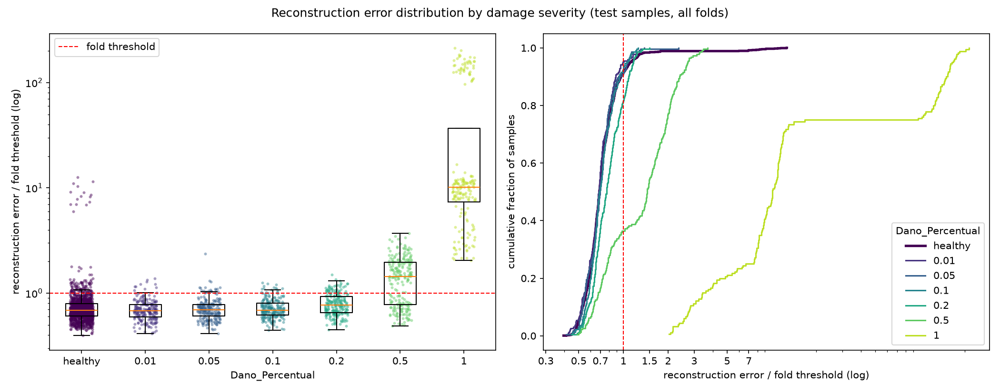

# E005: Limiar no percentil 95 dos saudáveis de treino

| Campo | Valor |
|---|---|
| Status | Concluído |
| Pai (base de comparação) | [E004](../E004_pooling-2x2x2/README.md) |
| Proposto em | 2026-10-21 |
| Executado em | 2026-10-21 |
| Código | commit `2291195` |

## 1. Motivação

A regra do limiar μ + 1σ não define a fração de alarmes falsos: essa fração depende do formato da distribuição do erro dos saudáveis. Com a mesma regra, a fração de saudáveis de treino acima do limiar foi de 15,9% (E001), 16,3% (E002), 5,2% (E003) e 1,4% (E004), sem que ninguém escolhesse esses valores.

No E004, a causa é um grupo de 15 passagens saudáveis (irregularidade 2 × módulo de elasticidade 0,975) com erro 7–11× maior que o resto (ver E004, Notas posteriores). Esse grupo infla o σ, e a assimetria do erro chega a 9,6. Medido só nos saudáveis de treino do E004:

| Regra | Limiar (faixa entre folds) | Saudáveis de treino acima |
|---|---|---|
| μ + 1σ (E004) | 0,0166–0,0215 | 1,4% (irregularidade 1: 0,3%) |
| Percentil 99 | ~0,021 em 5 folds; 0,056–0,073 nos outros 10 | 1% |
| Percentil 95 | 0,0121–0,0149 | 5% |

O percentil 99 foi descartado antes de rodar, porque o 1% superior (~13 passagens) é praticamente o grupo das 15. O valor dele salta de patamar conforme 12 ou 15 dessas passagens caem no treino do fold, e o intervalo de 95% por bootstrap no fold 1 vai de 0,016 a 0,079. O percentil 95 fica abaixo do grupo e é estável entre folds.

## 2. Hipótese

> Se o limiar de cada fold for o percentil 95 do erro dos saudáveis de treino, então a fração de saudáveis de treino acima do limiar passa a ser 5% em todos os folds, independentemente do formato da distribuição, porque o percentil é definido diretamente sobre essa fração.

A hipótese vale por construção. O objetivo do experimento é medir e reportar o efeito de fixar o α em 5% no detector do E004, cujo score separa as severidades 0,2 e 0,5 melhor do que o limiar μ + 1σ aproveitava.

## 3. Mudança em relação ao pai

| Item | E004 | E005 |
|---|---|---|
| Regra do limiar | μ + 1σ dos saudáveis de treino | Percentil 95 dos saudáveis de treino (`threshold_rule: "percentile"`, `threshold_percentile: 95`) |

Nada mais muda: o modelo, o pré-processamento e os erros de reconstrução são os do E004.

Mudanças de código:
- `src/autoencoders_pipeline.py`: função `compute_threshold` com as regras `"mean_std"` e `"percentile"`, lidas do config. Configs anteriores, sem `threshold_rule`, continuam usando μ + kσ.
- `src/rethreshold.py`: reavalia um experimento com outra regra de limiar a partir dos erros salvos do pai, sem retreinar. Ele recusa configs que difiram do pai em algo além das chaves do limiar.
- `src/test_autoencoders.py`: o relatório por severidade e o diagnóstico viraram a função `print_error_report`, usada pelos dois scripts. A saída não muda.

**Por que não retreinar.** O erro de reconstrução de cada amostra não depende do limiar, e o treino é determinístico. Um run completo reproduziria os mesmos erros do E004 e só mudaria o limiar. Verificado antes do run: reavaliar o E004 com a própria regra (μ + 1σ) pelo `rethreshold.py` reproduz exatamente os limiares, as predições e as métricas do E004.

## 4. Previsões (escritas antes de rodar)

### 4.1 Critérios só com saudáveis

| Critério | E004 | Previsão para o E005 |
|---|---|---|
| Saudáveis de treino acima do limiar | 1,4% (1,0%–1,7% por fold) | 5,0% em todos os folds (63 de 1260) |
| Limiar por fold | 0,0166–0,0215 | 0,0121–0,0149 |
| Passagens do grupo irregularidade 2 × módulo 0,975 acima do limiar, no treino | todas | todas (12 ou 15 por fold, das 63 acima) |

### 4.2 Avaliação (só reporte)

- **AUC: idêntica à do E004, por construção.** Os scores são os mesmos; só o limiar muda.
- **FPR de teste: entre 4% e 8%.** Deve ficar perto de 5%, mas o erro dos saudáveis de teste não tem a mesma distribuição do treino em todos os folds:
  - nos folds de peso 0,90 (10–12), o erro mediano dos saudáveis de teste é ~30% maior que o dos outros pesos, então o FPR deve ser maior ali;
  - nos folds com módulo 0,975 no teste (1, 4, 7, 10 e 13), as 3 passagens do grupo irregularidade 2 × módulo 0,975 de cada um devem virar falsos positivos (+3,3 pontos de FPR nesses folds).
- **Recall:** maior que no E004 nas severidades 0,2 e 0,5. Para a 0,5, acima dos 53% do E004.
- **Severidades até 0,1:** recall perto do FPR, porque a AUC delas é ~0,5.
- **Severidade 1,0:** recall continua 100%.

### 4.3 Critério de adoção

A escolha do α = 5% é do autor do projeto (Pedido), baseada na estabilidade da estimativa nos saudáveis de treino (seção 1). O critério só com saudáveis é a regra entregar a fração escolhida: 5% dos saudáveis de treino acima do limiar em todos os folds. Ele vale por construção, então a adoção é, na prática, uma decisão de projeto. As métricas de teste são reportadas e não entram nessa decisão.

## 5. Configuração e origem de cada escolha

Igual ao E004, exceto a linha marcada.

| Parâmetro | Valor | Origem | Justificativa / evidência |
|---|---|---|---|
| `nodes_to_use` | 8 nós (10654, 10659, 10664, 10669, 10658, 10663, 10668, 10673) | Herdado | Mesmos nós dos configs de OCSVM e Isolation Forest |
| `axes_to_use` | X, Y | Herdado | Mesmos eixos dos outros pipelines |
| `filter_type`, `cutoff_low`, `cutoff_high` | Passa-banda 1–20 Hz (Butterworth ordem 4, `filtfilt`) | Medido / Físico | Ver E003 |
| Ordem filtro/recorte | Filtra o registro completo, depois recorta | Físico | Ver E003 |
| Comprimento do sinal | Recorte em 1824 amostras (7,12 s) | Medido / Físico | Ver E001 |
| Normalização | Padronização por canal, só com saudáveis do treino | Físico / premissa | Ver E003 |
| Seleção de features | Nenhuma | Físico | Colunas são instantes de tempo |
| `pool_sizes` | `[2, 2, 2]` | Medido / Físico | Adotado no E004 |
| `encoder_filters` | `[32, 32, 4]` | Arbitrário / controle | Adotado no E004 |
| `kernel_size` | 19 | Físico (heurística) | Adotado no E004 |
| `l1_activity` | 1e-4 | Arbitrário | Ponto de partida do E001. Medido no E004: 29% do MSE |
| Ativações e camadas | ReLU; saída linear; `UpSampling1D` + Conv | Convenção | Ver E001 |
| `learning_rate` | 1e-3 (Adam) | Convenção | Padrão do Adam |
| `epochs` | 100 | Pedido | Mantido do E004, porque os erros são reaproveitados |
| `early_stopping_patience` | 10 (com `restore_best_weights`) | Convenção | Valor comum |
| `batch_size` | 32 | Convenção | Valor comum |
| `validation_split` | 0,1, após embaralhar os saudáveis | Convenção | Ver E001 |
| Score de anomalia | MSE médio sobre 1824 × 16 | Convenção | Erro de reconstrução usual |
| ★ Regra do limiar | Percentil 95 do erro dos saudáveis de treino de cada fold | Pedido / Medido | α = 5% escolhido pelo autor. Percentil 99 descartado por instabilidade medida nos saudáveis (seção 1). Calibrado nos saudáveis de treino, e não na validação: com 126 amostras de validação, o percentil seria muito instável; e no E004 o modelo quase não sobreajusta (fold 1: perda de treino 0,0120, `val_loss` 0,0121) |
| `random_state` | 42 | Convenção | Semente fixa |

## 6. Verificação da premissa não supervisionada

- [x] Modelo, normalização, filtros e limiar ajustados só com saudáveis do treino. O limiar é um percentil dos erros dos saudáveis de treino de cada fold.
- [x] Nenhum parâmetro escolhido com danificados, métricas de teste ou AUC. O α foi escolhido pelo autor; o descarte do percentil 99 usou só a estabilidade nos saudáveis de treino.
- [x] Motivação e critério de adoção usam só saudáveis ou raciocínio físico.

## 7. Execução

Comando (depois de commitar o código e esta pasta), em menos de um minuto:

```powershell
.venv\Scripts\python.exe src\rethreshold.py outputs\autoencoders\E004_pooling-2x2x2 outputs\autoencoders\E005_limiar-percentil-95 *> outputs\autoencoders\E005_limiar-percentil-95\run.log
```

**Execução real (2026-10-21):** commit `2291195`, sem alterações pendentes em `src/`. Menos de um minuto, sem erros. Os parquets desta pasta têm os mesmos erros do E004, com a coluna `threshold` recalculada.

## 8. Resultados

### 8.1 Critérios só com saudáveis

| Critério | E004 | Previsão | E005 | Resultado |
|---|---|---|---|---|
| Saudáveis de treino acima do limiar | 1,4% (1,0%–1,7%) | 5,0% em todos os folds | 5,0% em todos os folds | Confirmada |
| Limiar por fold | 0,0166–0,0215 | 0,0121–0,0149 | 0,0121–0,0149 | Confirmada |
| Grupo irregularidade 2 × módulo 0,975 acima do limiar, no treino | todas | todas | todas (12 ou 15 por fold) | Confirmada |

### 8.2 Métricas globais

| Métrica | E004 | E005 | Δ |
|---|---|---|---|
| Acurácia | 0,6136 ± 0,0092 | 0,6196 ± 0,0168 | +0,0060 |
| Recall | 0,2307 ± 0,0165 | 0,3149 ± 0,1067 | +0,0842 |
| FPR | 0,0163 (22 de 1350) | 0,0859 (116 de 1350) | +0,0696 |
| AUC agregada | 0,6409 | 0,6409 | 0 (por construção) |
| Matriz de confusão | TN 1328 · FP 22 · FN 1004 · TP 301 | TN 1234 · FP 116 · FN 894 · TP 411 | |

### 8.3 Por severidade

As AUCs são idênticas às do E004, porque os scores são os mesmos.

| Severidade | n | Recall E004 | Recall E005 | FPR E005 | Recall − FPR E005 | AUC |
|---|---|---|---|---|---|---|
| 0,01 | 225 | 0,000 | 0,049 | 0,086 | −0,037 | 0,464 ± 0,062 |
| 0,05 | 225 | 0,004 | 0,084 | 0,086 | −0,002 | 0,493 ± 0,039 |
| 0,10 | 225 | 0,000 | 0,076 | 0,086 | −0,010 | 0,525 ± 0,055 |
| 0,20 | 225 | 0,000 | 0,182 | 0,086 | +0,096 | 0,664 ± 0,066 |
| 0,50 | 225 | 0,533 | 0,636 | 0,086 | +0,550 | 0,832 ± 0,055 |
| 1,00 | 180 | 1,000 | 1,000 | 0,086 | +0,914 | 0,996 ± 0,006 |

### 8.4 Falsos positivos por fold

| Peso (folds) | FPR por fold | Falsos positivos | TPR por fold |
|---|---|---|---|
| 0,90 (10–12) | 20%–43% | 84 de 116 | 45%–57% |
| 0,95 (13–15) | 1%–3% | 6 | 24%–28% |
| 1,00 (1–3) | 0%–3% | 5 | 24%–28% |
| 1,05 (4–6) | 0%–6% | 7 | 24%–28% |
| 1,10 (7–9) | 1%–12% | 14 | 24%–41% |

- As 15 passagens do grupo irregularidade 2 × módulo 0,975 são todas falsos positivos: 3 em cada fold com módulo 0,975 no teste (1, 4, 7, 10 e 13).
- FPR por irregularidade: 7,7% na 1 (100 de 1305) e 35,6% na 2 (16 de 45).
- Sem os folds de peso 0,90 e sem o grupo das 15, o FPR é 1,9%.
- FPR por velocidade: 18,7% a 45 km/h, 3,8% a 50 e 3,3% a 55. A concentração em 45 km/h não foi decomposta por peso.

### 8.5 Distribuição dos erros



## 9. Análise

**Hipótese (seção 2): confirmada, por construção.** 5,0% dos saudáveis de treino ficaram acima do limiar em todos os folds.

**Previsões de avaliação (seção 4.2):**
- AUC idêntica: confirmada.
- FPR entre 4% e 8%: refutada por pouco (8,6%). Os dois mecanismos previstos estavam certos, mas um deles foi muito maior do que o esperado:
  - o grupo das 15 passagens gerou exatamente os 3 falsos positivos previstos em cada fold com módulo 0,975;
  - os folds de peso 0,90 tiveram FPR de 20–43%, e não apenas "maior": eles concentram 84 dos 116 falsos positivos.
- Recall maior nas severidades 0,2 e 0,5: confirmada (0 → 18% e 53% → 64%).
- Severidades até 0,1 com recall perto do FPR: confirmada (5–8% contra 8,6%).
- Severidade 1,0 em 100%: confirmada.

**O que o limiar mais baixo revelou: o peso 0,90 está fora da distribuição de treino.**
- Quando o peso 0,90 vai para o teste, o treino daquele fold não tem nenhuma passagem com esse peso. O limiar é calculado só com os pesos 0,95 a 1,10, que o modelo reconstrói melhor. Os saudáveis de peso 0,90 têm erro mediano ~30% maior (E004, seção 9), e uma boa parte passa do limiar.
- Com μ + 1σ, o limiar era alto o bastante (0,017–0,022) para esconder esse deslocamento. Com o percentil 95 (~0,013), ele aparece.
- O peso 1,10, o outro extremo, também fica fora do treino quando vai para o teste, mas o efeito nele é pequeno (FPR de 1–12%). O deslocamento é assimétrico; a causa não foi determinada. No E003, o peso 0,90 também era o mais difícil.

**Parte do recall vem do mesmo deslocamento.** Nos folds de peso 0,90, o TPR sobe para 45–57%, contra 24–28% nos outros folds. Os danificados desses folds também têm peso 0,90, e o erro deles sobe junto. Esse ganho não é detecção de dano. O ganho real se lê melhor no recall − FPR por severidade, ou na AUC, que não muda.

**Fora do peso 0,90, o detector ficou mais conservador que o α escolhido.** Sem os folds 10–12 e sem o grupo das 15, o FPR de teste é 1,9%, abaixo dos 5% do treino. O treino de cada fold contém o peso 0,90, mais difícil, e isso empurra o percentil para cima.

## 10. Decisão e próximos passos

- **Decisão:** adotada. A regra entrega o α escolhido (5%) em todos os folds, que é o critério da seção 4.3. A adoção é uma decisão de projeto do autor.
- **Nova base:** arquitetura do E004 com limiar no percentil 95. A questão das épocas da base (100 ou 200) continua aberta (E004, seção 10).
- **Variantes avaliadas nos folds de teste até aqui:** 5.

Próximos experimentos possíveis, motivados só por saudáveis ou por raciocínio físico:
- **Deslocamento do peso 0,90.** É o maior problema agora: 72% dos falsos positivos. Mesmo quando está no treino (E004), o peso 0,90 tem erro ~30% maior. Duas direções:
  - limiar condicionado ao peso, ajustado só com saudáveis, o que pressupõe que o peso seria medido em operação (pesagem em movimento);
  - melhorar a reconstrução do peso 0,90 (mais épocas, por exemplo), o que é verificável só com saudáveis, comparando o erro por peso no treino.
- **Grupo irregularidade 2 × módulo 0,975:** 15 falsos positivos garantidos. Investigação adiada por decisão do autor.
- **Penalidade L1** (29% do MSE, um canal morto), **200 épocas** e **substituição do `UpSampling1D`**: continuam pendentes (E004, seção 10).

## Notas posteriores
