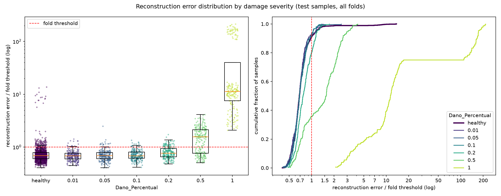

# E006: 200 épocas na arquitetura do E004

| Campo | Valor |
|---|---|
| Status | Concluído |
| Pai (base de comparação) | [E005](../E005_limiar-percentil-95/README.md) |
| Proposto em | 2026-10-22 |
| Executado em | 2026-11-07 |
| Código | commit `91c31ea` |

## 1. Motivação

**1. O treino do E004 não convergiu.** Os erros do E005 são os do E004, treinado com 100 épocas para avaliar a arquitetura mais rápido (E004, seção 3). No E004:
- O early stopping parou só 2 dos 15 folds (épocas 84 e 99); os outros 13 foram até a época 100.
- O `val_loss` ainda caía: no fold 1, 0,0169 na época 50 e 0,0121 na época 100.
- O E004 já previa que, se a arquitetura fosse adotada, a base voltaria a 200 épocas (E004, seção 4.3).

**2. Há precedente de ganho com mais épocas na mesma situação.** No E003, ir de 100 para 200 épocas reduziu a mediana do melhor `val_loss` dos 15 folds de 0,0907 para 0,0726 (−20%) e o erro relativo do fold 1 de 6,3% para 4,4%.

**3. O peso 0,90 determina o limiar.** Medido só nos saudáveis de treino do E005 (E005, Notas posteriores): das 63 passagens acima do percentil 95 em cada fold, em média 40 são de peso 0,90, 14 são do grupo irregularidade 2 × módulo 0,975 e só ~9 são dos outros pesos. Os pesos 0,95–1,10 operam, na prática, com α ≈ 1%, o que aumenta os falsos negativos nesses pesos. O erro mediano dos saudáveis de treino de peso 0,90 é 1,29× o dos outros pesos (E004; excluindo o grupo das 15). Se mais treino reduzisse essa diferença, o limiar desceria para os outros pesos sem precisar medir o peso em operação.

**Evidência contra o item 3.** A única comparação de 100 contra 200 épocas com erros por amostra salvos é E001 → E002. Nela, a diferença entre o peso mais difícil e os outros não diminuiu:
- peso 1,10 (o mais difícil na época) ÷ mediana dos outros: 1,35 → 1,40;
- peso 0,90 ÷ outros: 0,93 → 0,89.

Os dois experimentos têm outra arquitetura e não têm filtro, então a evidência é fraca para este caso, mas é a única disponível.

## 2. Hipótese

> Se o treino durar até 200 épocas, então o erro de reconstrução dos saudáveis cai e o early stopping passa a parar a maior parte dos folds, porque no E004 o `val_loss` ainda caía na época 100 em 13 dos 15 folds.

Pergunta em aberto, sem hipótese de direção: a diferença de erro entre o peso 0,90 e os outros pesos diminui com mais treino?

## 3. Mudança em relação ao pai

| Item | E005 | E006 |
|---|---|---|
| `epochs` | 100 | 200 |

Sem mudanças de código. A regra do limiar (percentil 95) é a mesma do E005.

O E005 não treinou modelo nenhum: ele reaproveitou os erros do E004. Na prática, o E006 é o E004 com 200 épocas e o limiar do E005. As referências do E005 de erro, `val_loss` e espectro do resíduo são, portanto, as do E004.

## 4. Previsões (escritas antes de rodar)

### 4.1 Critérios só com saudáveis

| Critério | E004/E005 (100 épocas) | Previsão para o E006 |
|---|---|---|
| Mediana do melhor `val_loss` dos 15 folds | 0,0134 | Menor; entre 0,010 e 0,013 (queda de 3% a 25%, tendo como teto o −20% do E003) |
| Folds parados pelo early stopping | 2 de 15 | Maioria (≥ 8 de 15) |
| Erro relativo total, fold 1 (`residual_spectrum.txt`) | 0,81% | Menor |
| Parte não reconstruída de 16–20 Hz, fold 1 | 8,3% | Menor, mas ainda a pior faixa (limite do Nyquist do latente, 16 Hz) |
| Erro mediano do peso 0,90 ÷ outros pesos, saudáveis de treino | 1,29 (1,26–1,42) | Sem previsão de direção (ver seção 1) |
| Saudáveis de treino acima do limiar, por grupo (média por fold) | 14 do grupo das 15; 40 de peso 0,90; ~9 dos outros | Sem previsão de direção; o grupo das 15 deve continuar todo acima |
| Saudáveis de treino acima do limiar | 5,0% | 5,0% em todos os folds, por construção |

### 4.2 Avaliação (só reporte)

- **AUC por severidade:** sem previsão firme. No E002, mais épocas melhoraram a reconstrução igualmente para saudáveis e danificados, e a AUC não mudou. No E004, a melhora da reconstrução aumentou a separação, mas veio de uma mudança de arquitetura. Severidades até 0,1 devem continuar com AUC ≈ 0,5.
- **Falsos negativos:** só devem cair nas severidades 0,2 e 0,5, e só se a diferença do peso 0,90 diminuir (limiar menor para os outros pesos) ou se a AUC dessas severidades subir.
- **FPR de teste:** deve continuar concentrado nos folds de peso 0,90 (10–12).

### 4.3 Critério de adoção

Adotar 200 épocas como padrão da base se a mediana do melhor `val_loss` dos 15 folds for menor que a do E004 (0,0134). É o mesmo critério do E002. O tempo de execução não entra no critério, mas será registrado.

## 5. Configuração e origem de cada escolha

Igual ao E005, exceto a linha marcada.

| Parâmetro | Valor | Origem | Justificativa / evidência |
|---|---|---|---|
| `nodes_to_use` | 8 nós (10654, 10659, 10664, 10669, 10658, 10663, 10668, 10673) | Herdado / Pedido | Mesmos nós dos pipelines OCSVM e Isolation Forest; mantidos para comparação direta com o artigo que os usa |
| `axes_to_use` | X, Y | Herdado / Pedido | Idem |
| `filter_type`, `cutoff_low`, `cutoff_high` | Passa-banda 1–20 Hz (Butterworth ordem 4, `filtfilt`) | Medido / Físico | Ver E003 |
| Ordem filtro/recorte | Filtra o registro completo, depois recorta | Físico | Ver E003 |
| Comprimento do sinal | Recorte em 1824 amostras (7,12 s) | Medido / Físico | Ver E001 |
| Normalização | Padronização por canal, só com saudáveis do treino | Físico / premissa | Ver E003 |
| Seleção de features | Nenhuma | Físico | Colunas são instantes de tempo |
| `pool_sizes` | `[2, 2, 2]` | Medido / Físico | Adotado no E004 |
| `encoder_filters` | `[32, 32, 4]` | Arbitrário / controle | Adotado no E004 |
| `kernel_size` | 19 | Físico (heurística) | Adotado no E004 |
| `l1_activity` | 1e-4 | Arbitrário | Ponto de partida do E001. Medido no E004: 29% do MSE |
| Ativações e camadas | ReLU; saída linear; `UpSampling1D` + Conv | Convenção | Ver E001 |
| `learning_rate` | 1e-3 (Adam) | Convenção | Padrão do Adam |
| ★ `epochs` | 200 | Medido / Pedido | `val_loss` do E004 ainda caía na época 100 em 13 de 15 folds; padrão adotado no E002, com a parada delegada ao early stopping |
| `early_stopping_patience` | 10 (com `restore_best_weights`) | Convenção | Valor comum |
| `batch_size` | 32 | Convenção | Valor comum |
| `validation_split` | 0,1, após embaralhar os saudáveis | Convenção | Ver E001 |
| Score de anomalia | MSE médio sobre 1824 × 16 | Convenção | Erro de reconstrução usual |
| Regra do limiar | Percentil 95 do erro dos saudáveis de treino de cada fold | Pedido / Medido | Adotada no E005 (α = 5%, escolha do autor) |
| `random_state` | 42 | Convenção | Semente fixa |

## 6. Verificação da premissa não supervisionada

- [x] Modelo, normalização, filtros e limiar ajustados só com saudáveis do treino.
- [x] Nenhum parâmetro escolhido com danificados, métricas de teste ou AUC. As 200 épocas vêm do `val_loss`, que usa só saudáveis.
- [x] Motivação e critério de adoção usam só saudáveis ou raciocínio físico.

## 7. Execução

Comandos (depois de commitar esta pasta):

```powershell
.venv\Scripts\python.exe src\test_autoencoders.py outputs\autoencoders\E006_200-epocas-pooling-2x2x2 *> outputs\autoencoders\E006_200-epocas-pooling-2x2x2\run.log
.venv\Scripts\python.exe src\residual_spectrum.py outputs\autoencoders\E006_200-epocas-pooling-2x2x2 *> outputs\autoencoders\E006_200-epocas-pooling-2x2x2\residual_spectrum.log
```

Duração estimada: até ~3h20 para o run principal (o E004 levou ~1h40 para ~1480 épocas, ~4 s por época; aqui são até 3000 épocas), menos se o early stopping agir cedo. O diagnóstico do resíduo leva cerca de 16 min.

**Execução real (2026-11-07 a 08), em outra máquina do autor:**
- Código: commit `91c31ea`, sem alterações pendentes em `src/` (registrado no `run.log`).
- Run principal: das 18:22 de 07/11 às 00:41 de 08/11 (~6h20; máquina diferente, então o tempo não é comparável ao estimado).
- **Falha parcial:** o `run.log` termina num `ModuleNotFoundError` ao gerar o gráfico, porque o `matplotlib` não estava declarado no `pyproject.toml`. O treino, as métricas globais, a tabela por severidade e os parquets foram gravados antes da falha; o gráfico e o diagnóstico do erro (AUC agregada, tabela por fold, η²) não.
- **Recuperação:** o gráfico e o diagnóstico foram gerados depois a partir dos parquets, sem retreino, e estão em `report.log` e `error_distribution.png`. A tabela por severidade do `report.log` é idêntica à do `run.log`. O `matplotlib` foi declarado no projeto.
- O early stopping parou os 15 folds, entre as épocas 85 e 189: 148, 106, 134, 182, 110, 97, 150, 85, 169, 189, 167, 112, 165, 102, 156.
- Diagnóstico do resíduo (`residual_spectrum.txt`), rodado pelo autor: o limiar do fold 1 (0,0106) é igual ao do run, então o retreino reproduziu o fold 1.

## 8. Resultados

### 8.1 Critérios só com saudáveis

| Critério | E004/E005 | Previsão | E006 | Resultado |
|---|---|---|---|---|
| Mediana do melhor `val_loss` dos 15 folds | 0,0134 | 0,010–0,013 | 0,0117 (0,0100–0,0160), −13% | Confirmada |
| Folds parados pelo early stopping | 2 de 15 | ≥ 8 de 15 | 15 de 15 | Confirmada |
| Erro relativo total, fold 1 | 0,81% | Menor | 0,64% | Confirmada |
| Parte não reconstruída de 16–20 Hz, fold 1 | 8,3% | Menor, ainda a pior faixa | 7,1%, ainda a pior faixa | Confirmada |
| Erro mediano do peso 0,90 ÷ outros pesos | 1,29 (1,26–1,42) | Sem previsão | 1,31 (1,26–1,48) | Não mudou |
| Acima do limiar no treino, por fold (grupo das 15 / peso 0,90 / outros) | 14 / 40 / ~9 | Sem previsão | 14 / 40,6 / 8,4 | Não mudou |
| Saudáveis de treino acima do limiar | 5,0% | 5,0% | 5,0% | Confirmada (por construção) |

Parte não reconstruída por faixa, fold 1:

| Faixa (Hz) | 0–1 | 1–4 | 4–8 | 8–12 | 12–16 | 16–20 |
|---|---|---|---|---|---|---|
| E004 (100 épocas) | 0,9% | 0,7% | 0,9% | 0,5% | 1,1% | 8,3% |
| E006 (200 épocas) | 0,8% | 0,6% | 0,7% | 0,4% | 0,9% | 7,1% |

Outras medições, fold 1:

| Critério | E004 | E006 |
|---|---|---|
| Fração do resíduo acima de 20 Hz | 4,7% | 5,1% |
| Zeros no latente | 54,4% | 53,3% |
| Canais ativos no latente | 3 de 4 | 2 de 4 |
| Penalidade L1 ÷ MSE | 0,29 | 0,29 |

η² do log-erro dos saudáveis de treino (E004 → E006): velocidade 0,062 → 0,068; peso 0,124 → 0,129; módulo 0,084 → 0,086; irregularidade 0,174 → 0,169.

### 8.2 Métricas globais

| Métrica | E005 | E006 | Δ |
|---|---|---|---|
| Acurácia | 0,6196 ± 0,0168 | 0,6215 ± 0,0127 | +0,0019 |
| Recall | 0,3149 ± 0,1067 | 0,3211 ± 0,1160 | +0,0062 |
| FPR | 0,0859 (116) | 0,0881 (119) | +0,0022 |
| AUC agregada | 0,6409 | 0,6454 | +0,0045 |
| Matriz de confusão | TN 1234 · FP 116 · FN 894 · TP 411 | TN 1231 · FP 119 · FN 886 · TP 419 | |

### 8.3 Por severidade

| Severidade | n | Recall E005 | Recall E006 | FPR E006 | AUC E005 | AUC E006 | FN E006 |
|---|---|---|---|---|---|---|---|
| 0,01 | 225 | 0,049 | 0,062 | 0,088 | 0,464 | 0,468 ± 0,057 | 211 |
| 0,05 | 225 | 0,084 | 0,076 | 0,088 | 0,493 | 0,491 ± 0,040 | 208 |
| 0,10 | 225 | 0,076 | 0,084 | 0,088 | 0,525 | 0,518 ± 0,059 | 206 |
| 0,20 | 225 | 0,182 | 0,196 | 0,088 | 0,664 | 0,683 ± 0,066 | 181 |
| 0,50 | 225 | 0,636 | 0,644 | 0,088 | 0,832 | 0,835 ± 0,057 | 80 |
| 1,00 | 180 | 1,000 | 1,000 | 0,088 | 0,996 | 0,997 ± 0,005 | 0 |

FPR por peso de vagão do fold: 0,90 (folds 10–12) 21%–43%; demais pesos 0%–10%. Os folds 10–12 têm 90 dos 119 falsos positivos. O grupo irregularidade 2 × módulo 0,975 gerou os mesmos 15 falsos positivos. FPR na irregularidade 1: 8,0%.

### 8.4 Distribuição dos erros



Os erros da severidade 1,0 vão de ~2× a ~200× o limiar; o eixo do painel da direita foi ajustado para mostrar essa faixa.

## 9. Análise

**Hipótese (seção 2): confirmada.** O erro dos saudáveis caiu (mediana do melhor `val_loss` −13%; erro relativo do fold 1 de 0,81% para 0,64%), e o early stopping parou os 15 folds. Com 200 épocas, o treino agora termina por convergência, e não pelo limite de épocas.

**Pergunta em aberto (peso 0,90): resposta negativa.** A razão de erro entre o peso 0,90 e os outros pesos ficou igual (1,29 → 1,31), e a composição do que fica acima do limiar no treino também (40 de peso 0,90 por fold). O resultado repete o precedente E001 → E002: mais treino melhora todos os pesos na mesma proporção, sem fechar a diferença. Por isso o limiar continua decidido pelo peso 0,90, e os pesos 0,95–1,10 continuam operando com α efetivo ≈ 1%.

**Avaliação (seção 4.2): previsões confirmadas.**
- AUC praticamente igual em todas as severidades (variações ≤ 0,02, dentro do desvio entre folds). Como no E002, a reconstrução melhorou na mesma medida para saudáveis e danificados.
- Falsos negativos: 894 → 886, quase iguais, como esperado se a diferença do peso 0,90 não caísse. 625 dos 886 são das severidades até 0,1 (AUC ≈ 0,5).
- FPR continua concentrado nos folds de peso 0,90.

**Canais do latente.** No fold 1, só 2 dos 4 canais ficaram ativos (eram 3 no E004), com a penalidade L1 ainda em 29% do MSE. O latente útil caiu para ~456 valores, e a reconstrução ainda assim melhorou. Mais treino deu mais tempo para a penalidade matar canais. Medido só no fold 1.

## 10. Decisão e próximos passos

- **Decisão:** adotada. A mediana do melhor `val_loss` (0,0117) é menor que a do E004 (0,0134), que é o critério da seção 4.3. A base passa a ser a arquitetura do E004, com limiar no percentil 95 e 200 épocas com early stopping.
- **Variantes avaliadas nos folds de teste até aqui:** 6.

O E006 confirma que mais reconstrução não muda a separação nem o problema do peso 0,90. Para reduzir FN, a mudança precisa alterar o que o score mede ou a regra do limiar. Candidatos, motivados só por saudáveis ou por raciocínio físico:
- **Penalidade L1** (29% do MSE; 2 de 4 canais mortos no fold 1). Um run com `l1_activity` menor ou 0 testa se os canais revivem e quanto da esparsidade vem da penalidade. Efeito nos FN imprevisível.
- **Nyquist do latente.** A faixa de 16–20 Hz continua a pior (7,1%), acima do Nyquist do latente (16 Hz). Reduzir o tempo só 4× levaria o Nyquist a 32 Hz.
- **Limiar por peso de vagão:** reservado pelo autor como alternativa futura.
- **Entrada espectral (PSD):** reservada pelo autor para depois do domínio do tempo.

## Notas posteriores
