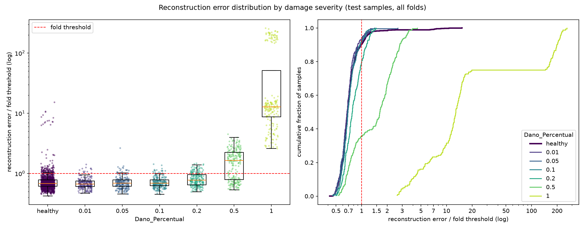

# E007: Sem penalidade L1 no latente

| Campo | Valor |
|---|---|
| Status | Concluído (não adotado) |
| Pai (base de comparação) | [E006](../E006_200-epocas-pooling-2x2x2/README.md) |
| Proposto em | 2026-11-08 |
| Executado em | 2026-11-08 |
| Código | commit `c7551b7` |

## 1. Motivação

O coeficiente `l1_activity = 1e-4` é um ponto de partida arbitrário do E001 e nunca foi testado. Três medições, todas só com saudáveis, indicam que ele pesa mais do que se pretendia na arquitetura atual:

| Medição | E003 | E004 | E006 |
|---|---|---|---|
| Penalidade L1 ÷ MSE (fold 1, `residual_spectrum.txt`) | 0,10 | 0,29 | 0,29 |
| Canais ativos no latente (fold 1) | 14 de 16 | 3 de 4 | 2 de 4 |
| Zeros no latente (fold 1) | 88,6% | 54,4% | 53,3% |

- **A penalidade triplicou em relação ao MSE.** Da E003 para a E004, o MSE caiu ~8× e a penalidade não acompanhou. A intenção do E001 era uma penalidade pequena perto do MSE.
- **Canais estão morrendo.** No E006, metade do latente (2 de 4 canais) está sempre em zero no fold 1. O latente útil cai de 912 para ~456 valores. Mais épocas (E004 → E006) mataram mais um canal.
- **Não se sabe quanto da esparsidade vem da L1.** A ReLU, sozinha, já produz zeros exatos. Os 53% de zeros podem ser, em parte ou quase todos, efeito da ReLU.

**A perda reportada pelo Keras inclui a penalidade.** Medido no `run.log` e nos parquets do E006: a perda de treino na melhor época é 1,22–1,38× o MSE puro dos saudáveis de treino (mediana do MSE 0,0077; da perda 0,0102). Por isso, o `val_loss` não serve para comparar o E006 com o E007: sem a L1, ele cairia ~25% mesmo com a reconstrução igual. As comparações entre E002 e E006 foram justas, porque todos usavam o mesmo coeficiente.

**Por que 0, e não um valor menor como 1e-5.** O objetivo principal é medir quanto da esparsidade e dos canais mortos vem da penalidade. Com 0, a resposta é direta: o que sobrar de zeros é da ReLU. Um valor intermediário responderia "um pouco menos de penalidade" e não separaria os dois efeitos.

## 2. Hipótese

> Se a penalidade L1 for removida (`l1_activity = 0`), então os canais mortos do latente voltam a ser usados e o erro de reconstrução dos saudáveis cai, porque hoje a penalidade, equivalente a ~29% do MSE, empurra ativações úteis para zero e mata canais inteiros.

## 3. Mudança em relação ao pai

| Item | E006 | E007 |
|---|---|---|
| `l1_activity` | 1e-4 | 0 |

Sem mudanças de código. A camada `ActivityRegularization` continua no modelo, mas com coeficiente 0 ela não acrescenta nada à perda; a arquitetura, os parâmetros e o limiar (percentil 95) são os mesmos do E006.

**O modelo deixa de ser "esparso" no sentido do pedido inicial.** O projeto pediu um autoencoder Conv1D esparso, e a penalidade L1 é o que torna o latente esparso por objetivo. Sem ela, o latente ainda tem zeros (pela ReLU), mas a esparsidade deixa de ser buscada pelo treino. Se o resultado indicar adoção, isso precisa ser uma decisão explícita do autor (seção 4.3).

## 4. Previsões (escritas antes de rodar)

### 4.1 Critérios só com saudáveis

O critério de reconstrução é o **MSE puro**, calculado a partir de `train_errors.parquet` (média por fold dos saudáveis de treino), e não o `val_loss`.

| Critério | E006 | Previsão para o E007 |
|---|---|---|
| Mediana, entre folds, do MSE médio dos saudáveis de treino | 0,0077 | Menor (mais capacidade útil no latente) |
| Canais ativos no latente (fold 1) | 2 de 4 | 4 de 4 |
| Zeros no latente (fold 1) | 53,3% | Menor, mas acima de 0% (a ReLU continua) |
| Penalidade L1 ÷ MSE (fold 1) | 0,29 | 0 (por construção) |
| Erro relativo total, fold 1 | 0,64% | Menor |
| Parte não reconstruída de 16–20 Hz, fold 1 | 7,1% | Menor; ainda a pior faixa |
| Erro do peso 0,90 ÷ outros pesos | 1,31 | Sem previsão de direção |
| Folds parados pelo early stopping | 15 de 15 | Maioria |

### 4.2 Avaliação (só reporte)

Sem previsão de direção para a AUC e os falsos negativos. Há dois cenários plausíveis:
- **Mais capacidade ajuda a separar:** como no E004, o modelo passa a reproduzir com mais detalhe a estrutura saudável, e o dano fica relativamente pior reconstruído. AUC das severidades 0,2 e 0,5 sobe.
- **Mais capacidade reconstrói também o dano:** o modelo fica mais perto de copiar a entrada, e a diferença entre saudáveis e danificados diminui. AUC cai.

Severidades até 0,1 devem continuar com AUC ≈ 0,5.

### 4.3 Critério de adoção

Adotar `l1_activity = 0` na base se as duas condições valerem:
1. A mediana, entre folds, do MSE médio dos saudáveis de treino for menor que a do E006 (0,0077).
2. O fold 1 tiver mais canais ativos no latente que o E006 (mais que 2 de 4).

Como a adoção remove a esparsidade buscada pelo treino, que fazia parte do pedido inicial, ela também depende de confirmação do autor. Se o critério não for atendido, a L1 permanece e o resultado é registrado como diagnóstico (quanto da esparsidade vem da ReLU).

**Limite conhecido do critério.** Menor MSE dos saudáveis não garante melhor detecção (E002 e E006 mostraram isso). Não existe critério só com saudáveis que antecipe se mais capacidade vai separar mais ou reconstruir também o dano. A métrica de teste é só reportada e não decide.

## 5. Configuração e origem de cada escolha

Igual ao E006, exceto a linha marcada.

| Parâmetro | Valor | Origem | Justificativa / evidência |
|---|---|---|---|
| `nodes_to_use` | 8 nós (10654, 10659, 10664, 10669, 10658, 10663, 10668, 10673) | Herdado / Pedido | Mesmos nós dos pipelines OCSVM e Isolation Forest, para comparação direta |
| `axes_to_use` | X, Y | Herdado / Pedido | Idem |
| `filter_type`, `cutoff_low`, `cutoff_high` | Passa-banda 1–20 Hz (Butterworth ordem 4, `filtfilt`) | Medido / Físico | Ver E003 |
| Ordem filtro/recorte | Filtra o registro completo, depois recorta | Físico | Ver E003 |
| Comprimento do sinal | Recorte em 1824 amostras (7,12 s) | Medido / Físico | Ver E001 |
| Normalização | Padronização por canal, só com saudáveis do treino | Físico / premissa | Ver E003 |
| Seleção de features | Nenhuma | Físico | Colunas são instantes de tempo |
| `pool_sizes` | `[2, 2, 2]` | Medido / Físico | Adotado no E004 |
| `encoder_filters` | `[32, 32, 4]` | Arbitrário / controle | Adotado no E004 |
| `kernel_size` | 19 | Físico (heurística) | Adotado no E004 |
| ★ `l1_activity` | 0 | Medido | Penalidade em 29% do MSE e 2 de 4 canais mortos no E006 (seção 1). Valor 0 para isolar o efeito da penalidade |
| Ativações e camadas | ReLU; saída linear; `UpSampling1D` + Conv | Convenção | Ver E001 |
| `learning_rate` | 1e-3 (Adam) | Convenção | Padrão do Adam |
| `epochs` | 200 | Medido / Pedido | Adotado no E006, com early stopping |
| `early_stopping_patience` | 10 (com `restore_best_weights`) | Convenção | Valor comum. Monitora o `val_loss`, que, com L1 = 0, passa a ser o MSE puro de validação |
| `batch_size` | 32 | Convenção | Valor comum |
| `validation_split` | 0,1, após embaralhar os saudáveis | Convenção | Ver E001 |
| Score de anomalia | MSE médio sobre 1824 × 16 | Convenção | Erro de reconstrução usual; nunca incluiu a penalidade |
| Regra do limiar | Percentil 95 do erro dos saudáveis de treino de cada fold | Pedido / Medido | Adotada no E005 (α = 5%) |
| `random_state` | 42 | Convenção | Semente fixa |

## 6. Verificação da premissa não supervisionada

- [x] Modelo, normalização, filtros e limiar ajustados só com saudáveis do treino.
- [x] Nenhum parâmetro escolhido com danificados, métricas de teste ou AUC. O coeficiente 0 vem das medições do latente e da penalidade nos saudáveis.
- [x] Motivação e critério de adoção usam só saudáveis ou raciocínio físico.

## 7. Execução

Comandos (depois de commitar esta pasta):

```powershell
.venv\Scripts\python.exe src\test_autoencoders.py outputs\autoencoders\E007_sem-penalidade-l1 *> outputs\autoencoders\E007_sem-penalidade-l1\run.log
.venv\Scripts\python.exe src\residual_spectrum.py outputs\autoencoders\E007_sem-penalidade-l1 *> outputs\autoencoders\E007_sem-penalidade-l1\residual_spectrum.log
```

Antes de rodar em outra máquina: `uv sync`, para instalar o `matplotlib` declarado no `pyproject.toml`.

Duração estimada: parecida com a do E006, que levou ~6h20 na outra máquina. O teto é de 3000 épocas no total (15 folds × 200 épocas), mas o early stopping costuma parar antes: no E006, os 15 folds somaram 2072 épocas (paradas entre as épocas 85 e 189). Sem a L1, o ponto de parada pode mudar, então a duração real pode ficar acima ou abaixo da do E006. O diagnóstico do resíduo leva ~20–30 min.

**Limitação:** canais ativos, zeros e o espectro do resíduo são medidos só no fold 1 (ver discussão no E006). O critério 4.3 (2) depende dessa medição única.

**Execução real (2026-11-08), em outra máquina do autor:**
- Código: commit `c7551b7`, sem alterações pendentes em `src/` (registrado no `run.log`).
- Run principal e diagnóstico do resíduo completos, sem erros; o gráfico foi gerado normalmente.
- O `run.log` começa às 01:31; a duração exata não foi registrada (os arquivos de saída foram gravados na pasta às 12:00, possivelmente na cópia entre máquinas).
- O early stopping parou os 15 folds, entre as épocas 87 e 152: 112, 147, 152, 148, 87, 107, 114, 103, 146, 91, 104, 141, 121, 149, 106 (1828 épocas no total, contra 2072 no E006).
- O limiar do fold 1 no diagnóstico do resíduo (0,0070) é igual ao do run, então o retreino reproduziu o fold 1.

## 8. Resultados

### 8.1 Critérios só com saudáveis

| Critério | E006 | Previsão | E007 | Resultado |
|---|---|---|---|---|
| Mediana, entre folds, do MSE médio dos saudáveis de treino | 0,0077 (0,0071–0,0103) | Menor | 0,0050 (0,0043–0,0060), −35% | Confirmada |
| Canais ativos no latente (fold 1) | 2 de 4 | 4 de 4 | 4 de 4 | Confirmada |
| Zeros no latente (fold 1) | 53,3% | Menor, acima de 0% | 22,7% | Confirmada |
| Penalidade L1 ÷ MSE (fold 1) | 0,29 | 0 | 0 | Confirmada (por construção) |
| Erro relativo total, fold 1 | 0,64% | Menor | 0,41% | Confirmada |
| Parte não reconstruída de 16–20 Hz, fold 1 | 7,1% | Menor; ainda a pior faixa | 5,2%; ainda a pior faixa | Confirmada |
| Erro do peso 0,90 ÷ outros pesos | 1,31 (1,26–1,48) | Sem previsão | 1,35 (1,29–1,51) | Não mudou (leve alta) |
| Folds parados pelo early stopping | 15 de 15 | Maioria | 15 de 15 | Confirmada |

Com `l1_activity = 0`, o `val_loss` passa a ser o MSE puro de validação: mediana do melhor valor dos 15 folds 0,0053. Não é comparável ao 0,0117 do E006, que incluía a penalidade (seção 1).

Parte não reconstruída por faixa, fold 1:

| Faixa (Hz) | 0–1 | 1–4 | 4–8 | 8–12 | 12–16 | 16–20 |
|---|---|---|---|---|---|---|
| E006 | 0,8% | 0,6% | 0,7% | 0,4% | 0,9% | 7,1% |
| E007 | 0,6% | 0,4% | 0,4% | 0,2% | 0,6% | 5,2% |

Energia criada acima de 20 Hz, fold 1: 9,6% do resíduo (era 5,1%). Relativa à energia de entrada: 0,039% (era 0,032%), uma leve alta.

Outras medições só com saudáveis:

| Critério | E006 | E007 |
|---|---|---|
| Acima do limiar no treino, por fold (grupo das 15 / peso 0,90 / outros) | 14 / 40,6 / 8,4 | 14 / 40,8 / 8,2 |
| Assimetria do erro dos saudáveis de treino | 9,65 | 9,51 |
| η² velocidade / peso / módulo / irregularidade | 0,068 / 0,129 / 0,086 / 0,169 | 0,044 / 0,142 / 0,091 / 0,162 |

### 8.2 Métricas globais

| Métrica | E006 | E007 | Δ |
|---|---|---|---|
| Acurácia | 0,6215 ± 0,0127 | 0,6173 ± 0,0229 | −0,0042 |
| Recall | 0,3211 ± 0,1160 | 0,3211 ± 0,1225 | 0 |
| FPR | 0,0881 (119) | 0,0963 (130) | +0,0082 |
| AUC agregada | 0,6454 | 0,6437 | −0,0017 |
| Matriz de confusão | TN 1231 · FP 119 · FN 886 · TP 419 | TN 1220 · FP 130 · FN 886 · TP 419 | |

### 8.3 Por severidade

| Severidade | n | Recall E006 | Recall E007 | FPR E007 | AUC E006 | AUC E007 | FN E007 | Erro mediano danificado ÷ saudável E007 |
|---|---|---|---|---|---|---|---|---|
| 0,01 | 225 | 0,062 | 0,067 | 0,096 | 0,468 | 0,452 ± 0,061 | 210 | 1,00 |
| 0,05 | 225 | 0,076 | 0,076 | 0,096 | 0,491 | 0,486 ± 0,054 | 208 | 1,01 |
| 0,10 | 225 | 0,084 | 0,080 | 0,096 | 0,518 | 0,541 ± 0,060 | 207 | 1,02 |
| 0,20 | 225 | 0,196 | 0,196 | 0,096 | 0,683 | 0,697 ± 0,065 | 181 | 1,17 |
| 0,50 | 225 | 0,644 | 0,644 | 0,096 | 0,835 | 0,855 ± 0,060 | 80 | 2,47 |
| 1,00 | 180 | 1,000 | 1,000 | 0,096 | 0,997 | 0,997 ± 0,004 | 0 | 19,5 |

A razão de medianas compara com os saudáveis de irregularidade 1, no mesmo fold. No E006, ela era 1,16 (sev. 0,2), 2,33 (0,5) e 16,8 (1,0).

FPR por peso de vagão do fold: 0,90 (folds 10–12) 23%–50%; demais pesos 0%–6%. Os folds 10–12 têm 104 dos 130 falsos positivos (eram 90 de 119). O grupo irregularidade 2 × módulo 0,975 gerou os mesmos 15 falsos positivos. FPR na irregularidade 1: 8,7%.

### 8.4 Distribuição dos erros



## 9. Análise

**Hipótese (seção 2): confirmada.** Sem a penalidade, os 4 canais do latente voltaram a ser usados no fold 1 e o MSE dos saudáveis de treino caiu 35% (0,0077 → 0,0050), com queda em todas as faixas da banda.

**Quanto da esparsidade vinha da L1.** No fold 1, os zeros do latente caíram de 53,3% para 22,7%. Os ~23% restantes vêm só da ReLU; cerca de 30 pontos percentuais (mais da metade dos zeros do E006) eram efeito da penalidade. Era a L1 que matava canais: sem ela, nenhum canal morreu.

**Avaliação (seção 4.2): nenhum dos dois cenários se realizou de forma clara.**
- A separação relativa melhorou um pouco: o erro mediano da severidade 0,5 passou de 2,33× para 2,47× o dos saudáveis, e a AUC das severidades 0,2 (0,68 → 0,70) e 0,5 (0,835 → 0,855) subiu, dentro do desvio entre folds.
- Os falsos negativos não mudaram (886 → 886; recall idêntico em todas as severidades a partir de 0,05). O ganho de separação não se traduziu em detecções, porque o limiar continua decidido pelo peso 0,90.
- Severidades até 0,1 continuam com AUC ≈ 0,5, como previsto.

**O peso 0,90 continua decidindo o limiar.** A razão de erro do peso 0,90 para os outros pesos subiu levemente (1,31 → 1,35), e a composição acima do limiar no treino é a mesma (14 do grupo das 15, ~41 de peso 0,90 e ~8 dos outros, por fold). O FPR dos folds 10–12 subiu (até 50%) e o FPR geral foi de 8,8% para 9,6%. É o terceiro experimento seguido (E004 → E006 → E007) em que melhorar a reconstrução não reduz essa diferença.

**Energia fora da banda.** A energia criada acima de 20 Hz subiu um pouco (0,032% → 0,039% da entrada) e passou a ser 9,6% do resíduo. Sem a penalidade, o decoder recebe ativações maiores e menos esparsas; uma explicação possível é que os degraus do `UpSampling1D` ficam maiores, mas isso não foi verificado.

**Limitação.** Canais ativos, zeros e espectro do resíduo foram medidos só no fold 1. O MSE de treino e a composição acima do limiar cobrem os 15 folds.

## 10. Decisão e próximos passos

- **Critério da seção 4.3: atendido.** O MSE dos saudáveis de treino caiu (0,0050 < 0,0077) e o fold 1 tem mais canais ativos (4 de 4 > 2 de 4).
- **Decisão: não adotada, por decisão do autor (2026-11-08).** O critério só com saudáveis foi atendido, mas adotar `l1_activity = 0` removeria a esparsidade buscada pelo treino, que faz parte do pedido inicial ("Conv1D esparso"). O autor preferiu manter alguma penalidade. O E007 fica como diagnóstico (a L1 de 1e-4 matava canais; a ReLU sozinha dá ~23% de zeros) e a base continua sendo o E006. Próximo passo: penalidade de 1e-5 ([E008](../E008_penalidade-l1-1e-5/README.md)).
- **Variantes avaliadas nos folds de teste até aqui:** 7.

Próximos experimentos possíveis, motivados só por saudáveis ou por raciocínio físico:
- **Penalidade intermediária** (por exemplo 1e-5), se o autor quiser manter um modelo esparso sem matar canais. Critério: canais ativos e MSE dos saudáveis entre os do E006 e os do E007.
- **Nyquist do latente.** A faixa de 16–20 Hz continua a pior (5,2%), acima do Nyquist do latente (16 Hz).
- **Peso 0,90.** Três experimentos de reconstrução não reduziram a diferença; o limiar por peso de vagão continua reservado pelo autor como alternativa futura.
- **Entrada espectral (PSD):** reservada pelo autor para depois do domínio do tempo.

## Notas posteriores
