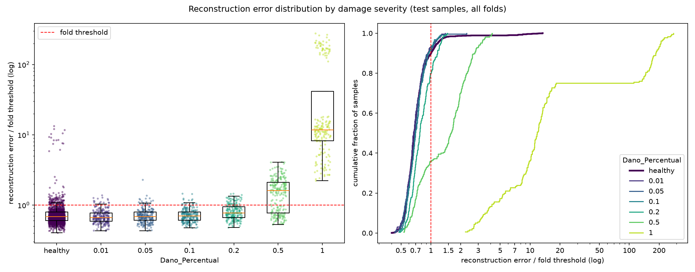

# E008: Penalidade L1 de 1e-5 no latente

| Campo | Valor |
|---|---|
| Status | Concluído |
| Pai (base de comparação) | [E006](../E006_200-epocas-pooling-2x2x2/README.md) |
| Proposto em | 2026-11-08 |
| Executado em | 2026-11-08 |
| Código | commit `38144ed` |

## 1. Motivação

O E007 mostrou, só com saudáveis, que a penalidade `l1_activity = 1e-4` do E006 era forte demais para esta arquitetura:

| Medição (saudáveis) | E006 (L1 = 1e-4) | E007 (L1 = 0) |
|---|---|---|
| Mediana, entre folds, do MSE médio dos saudáveis de treino | 0,0077 | 0,0050 |
| Canais ativos no latente (fold 1) | 2 de 4 | 4 de 4 |
| Zeros no latente (fold 1) | 53,3% | 22,7% |
| Penalidade L1 ÷ MSE (fold 1) | 0,29 | 0 |
| Parte não reconstruída de 16–20 Hz (fold 1) | 7,1% | 5,2% |

- Era a penalidade que matava canais: sem ela, os 4 canais ficaram ativos.
- A ReLU sozinha produz ~23% de zeros; os outros ~30 pontos percentuais de zeros do E006 vinham da L1.

**Por que não adotar o E007.** O projeto pede um autoencoder Conv1D esparso, e o autor decidiu manter alguma penalidade L1, para que a esparsidade continue sendo buscada pelo treino. O E007 fica como diagnóstico e não é adotado; a base continua sendo o E006.

**Por que 1e-5.** É um décimo do coeficiente do E006. Se as ativações do latente tivessem o mesmo tamanho do E006, a penalidade cairia de 29% para ~3% do MSE, abaixo dos 10% do E003 (o único ponto em que a penalidade era pequena perto do MSE). O valor é um passo de uma ordem de grandeza, escolhido pelo autor; não há medição que aponte 1e-5 em vez de, por exemplo, 3e-5.

## 2. Hipótese

> Se a penalidade L1 cair de 1e-4 para 1e-5, então nenhum canal do latente morre e o erro de reconstrução dos saudáveis fica abaixo do E006, enquanto o latente fica mais esparso que no E007, porque a penalidade passa a pesar poucos por cento do MSE: o suficiente para empurrar ativações pequenas a zero, mas não para desligar canais inteiros.

## 3. Mudança em relação ao pai

| Item | E006 | E008 |
|---|---|---|
| `l1_activity` | 1e-4 | 1e-5 |

Sem mudanças de código. Arquitetura, épocas, early stopping e limiar (percentil 95) iguais aos do E006.

**Comparação de perdas.** Como o coeficiente muda, o `val_loss` do Keras (que inclui a penalidade) não é comparável com o do E006 nem com o do E007. A comparação de reconstrução usa o MSE puro de `train_errors.parquet`, como no E007.

## 4. Previsões (escritas antes de rodar)

### 4.1 Critérios só com saudáveis

| Critério | E006 | E007 | Previsão para o E008 |
|---|---|---|---|
| Mediana, entre folds, do MSE médio dos saudáveis de treino | 0,0077 | 0,0050 | Entre os dois, mais perto do E007 |
| Canais ativos no latente (fold 1) | 2 de 4 | 4 de 4 | 4 de 4 |
| Zeros no latente (fold 1) | 53,3% | 22,7% | Entre os dois |
| Penalidade L1 ÷ MSE (fold 1) | 0,29 | 0 | Entre 0,03 e 0,10 (coeficiente 10× menor, compensado em parte por ativações maiores) |
| Parte não reconstruída de 16–20 Hz, fold 1 | 7,1% | 5,2% | Entre os dois; ainda a pior faixa |
| Erro do peso 0,90 ÷ outros pesos | 1,31 | 1,35 | Sem mudança (≈ 1,3) |
| Folds parados pelo early stopping | 15 de 15 | 15 de 15 | 15 de 15 |

### 4.2 Avaliação (só reporte)

O E007 mudou pouco a detecção (FN 886 → 886; AUC sev. 0,2: 0,68 → 0,70; sev. 0,5: 0,835 → 0,855). Como o E008 fica entre E006 e E007, a previsão é que a detecção também fique entre os dois: FN perto de 886 e AUC por severidade dentro do desvio entre folds. Severidades até 0,1 continuam com AUC ≈ 0,5. O limiar continua decidido pelo peso 0,90, então não se espera queda de falsos negativos.

### 4.3 Critério de adoção

Adotar `l1_activity = 1e-5` na base se as duas condições valerem:
1. A mediana, entre folds, do MSE médio dos saudáveis de treino for menor que a do E006 (0,0077).
2. O fold 1 tiver os 4 canais do latente ativos.

Se a condição 2 falhar (algum canal morto), a penalidade ainda é forte demais para esta arquitetura e o próximo passo é um coeficiente menor. Se só a 1 falhar, a L1 de 1e-4 permanece.

**Limite conhecido do critério.** Menor MSE dos saudáveis não garante melhor detecção (E002, E006 e E007 mostraram isso). A métrica de teste é só reportada e não decide.

## 5. Configuração e origem de cada escolha

Igual ao E006, exceto a linha marcada.

| Parâmetro | Valor | Origem | Justificativa / evidência |
|---|---|---|---|
| `nodes_to_use` | 8 nós (10654, 10659, 10664, 10669, 10658, 10663, 10668, 10673) | Herdado / Pedido | Mesmos nós dos pipelines OCSVM e Isolation Forest, para comparação direta |
| `axes_to_use` | X, Y | Herdado / Pedido | Idem |
| `filter_type`, `cutoff_low`, `cutoff_high` | Passa-banda 1–20 Hz (Butterworth ordem 4, `filtfilt`) | Medido / Físico | Ver E003 |
| Ordem filtro/recorte | Filtra o registro completo, depois recorta | Físico | Ver E003 |
| Comprimento do sinal | Recorte em 1824 amostras (7,12 s) | Medido / Físico | Ver E001 |
| Normalização | Padronização por canal, só com saudáveis do treino | Físico / premissa | Ver E003 |
| Seleção de features | Nenhuma | Físico | Colunas são instantes de tempo |
| `pool_sizes` | `[2, 2, 2]` | Medido / Físico | Adotado no E004 |
| `encoder_filters` | `[32, 32, 4]` | Arbitrário / controle | Adotado no E004 |
| `kernel_size` | 19 | Físico (heurística) | Adotado no E004 |
| ★ `l1_activity` | 1e-5 | Pedido / Arbitrário | O autor quer manter a penalidade (seção 1). A ordem de grandeza menor vem do E007 (canais mortos e penalidade em 29% do MSE com 1e-4); o valor exato 1e-5 é arbitrário |
| Ativações e camadas | ReLU; saída linear; `UpSampling1D` + Conv | Convenção | Ver E001 |
| `learning_rate` | 1e-3 (Adam) | Convenção | Padrão do Adam |
| `epochs` | 200 | Medido / Pedido | Adotado no E006, com early stopping |
| `early_stopping_patience` | 10 (com `restore_best_weights`) | Convenção | Monitora o `val_loss`, que inclui a penalidade (pequena com 1e-5) |
| `batch_size` | 32 | Convenção | Valor comum |
| `validation_split` | 0,1, após embaralhar os saudáveis | Convenção | Ver E001 |
| Score de anomalia | MSE médio sobre 1824 × 16 | Convenção | Erro de reconstrução usual; não inclui a penalidade |
| Regra do limiar | Percentil 95 do erro dos saudáveis de treino de cada fold | Pedido / Medido | Adotada no E005 (α = 5%) |
| `random_state` | 42 | Convenção | Semente fixa |

## 6. Verificação da premissa não supervisionada

- [x] Modelo, normalização, filtros e limiar ajustados só com saudáveis do treino.
- [x] Nenhum parâmetro escolhido com danificados, métricas de teste ou AUC. O coeficiente vem da decisão do autor e das medições do latente nos saudáveis (E006, E007).
- [x] Motivação e critério de adoção usam só saudáveis ou raciocínio físico.

## 7. Execução

Comandos (depois de commitar esta pasta):

```powershell
.venv\Scripts\python.exe src\test_autoencoders.py outputs\autoencoders\E008_penalidade-l1-1e-5 *> outputs\autoencoders\E008_penalidade-l1-1e-5\run.log
.venv\Scripts\python.exe src\residual_spectrum.py outputs\autoencoders\E008_penalidade-l1-1e-5 *> outputs\autoencoders\E008_penalidade-l1-1e-5\residual_spectrum.log
```

Antes de rodar em outra máquina: `uv sync`.

Duração estimada: o teto é de 3000 épocas (15 folds × 200), mas o early stopping parou antes nos pais: 2072 épocas no E006 (~6h20 na outra máquina) e 1828 no E007. O diagnóstico do resíduo leva ~20–30 min.

**Limitação:** canais ativos, zeros e o espectro do resíduo são medidos só no fold 1. O critério 4.3 (2) depende dessa medição única.

**Execução real (2026-11-08), em outra máquina do autor:**
- Código: commit `38144ed` (registrado no `run.log`), sem aviso de alterações pendentes em `src/`.
- Run principal e diagnóstico do resíduo completos, sem erros; o gráfico foi gerado normalmente.
- O `run.log` começa às 12:40; a duração exata não foi registrada (os arquivos foram gravados na pasta às 16:19, na cópia entre máquinas).
- Épocas por fold: 80, 146, 100, 140, 97, 113, 141, 114, 111, 136, 200, 115, 198, 102, 146 (1939 no total, contra 2072 no E006 e 1828 no E007). O fold 11 parou exatamente no teto de 200 épocas, com o melhor `val_loss` na época 190, ou seja, o early stopping disparou junto com o teto. Os outros 14 folds pararam antes.
- O limiar do fold 1 no diagnóstico do resíduo (0,0105) é igual ao do run, então o retreino reproduziu o fold 1.

## 8. Resultados

### 8.1 Critérios só com saudáveis

| Critério | E006 | E007 | Previsão | E008 | Resultado |
|---|---|---|---|---|---|
| Mediana, entre folds, do MSE médio dos saudáveis de treino | 0,0077 (0,0071–0,0103) | 0,0050 (0,0043–0,0060) | Entre os dois, mais perto do E007 | 0,0067 (0,0050–0,0079), −13% contra o E006 | Em parte: entre os dois, mas mais perto do E006 |
| Canais ativos no latente (fold 1) | 2 de 4 | 4 de 4 | 4 de 4 | 4 de 4 | Confirmada |
| Zeros no latente (fold 1) | 53,3% | 22,7% | Entre os dois | 45,0% | Confirmada |
| Penalidade L1 ÷ MSE (fold 1) | 0,29 | 0 | Entre 0,03 e 0,10 | 0,23 | Refutada |
| Erro relativo total, fold 1 | 0,64% | 0,41% | — | 0,62% | — |
| Parte não reconstruída de 16–20 Hz, fold 1 | 7,1% | 5,2% | Entre os dois; ainda a pior faixa | 7,6%; ainda a pior faixa | Refutada (pior que o E006, só no fold 1; ver seção 9) |
| Erro do peso 0,90 ÷ outros pesos (mediana entre folds) | 1,30 (1,26–1,46) | 1,34 (1,29–1,50) | ≈ 1,3 | 1,34 (1,26–1,47) | Confirmada |
| Folds parados pelo early stopping | 15 de 15 | 15 de 15 | 15 de 15 | 15 de 15 (fold 11 no teto, época 200) | Confirmada |

A razão do peso 0,90 foi recalculada para os três experimentos com o mesmo método (razão das medianas do erro dos saudáveis de treino, por fold). Por isso os valores do E006 e do E007 diferem em 0,01 dos registrados nos seus READMEs.

O `val_loss` inclui a penalidade: mediana do melhor valor dos 15 folds 0,0088 (0,0068–0,0112). Ele não é comparável ao do E006 (0,0117) nem ao do E007 (0,0053).

**O fold 1 não representa bem este run.** O MSE médio dos saudáveis de treino no fold 1 foi 0,0075, o 13º de 15 folds e quase igual ao do E006 no mesmo fold (0,0077). A mediana dos 15 folds caiu 13%. As medições feitas só no fold 1 (bandas, energia fora da banda, zeros, penalidade) subestimam, portanto, a melhora típica deste run.

Parte não reconstruída por faixa, fold 1:

| Faixa (Hz) | 0–1 | 1–4 | 4–8 | 8–12 | 12–16 | 16–20 |
|---|---|---|---|---|---|---|
| E006 | 0,8% | 0,6% | 0,7% | 0,4% | 0,9% | 7,1% |
| E007 | 0,6% | 0,4% | 0,4% | 0,2% | 0,6% | 5,2% |
| E008 | 0,8% | 0,6% | 0,6% | 0,4% | 0,9% | 7,6% |

Energia criada acima de 20 Hz, fold 1: 6,8% do resíduo (E006 5,1%; E007 9,6%). Relativa à energia de entrada: 0,042% (E006 0,032%; E007 0,039%), a maior dos três.

Outras medições só com saudáveis:

| Critério | E006 | E007 | E008 |
|---|---|---|---|
| Acima do limiar no treino, por fold (grupo das 15 / peso 0,90 / outros) | 14 / 40,6 / 8,4 | 14 / 40,8 / 8,2 | 14 / 40,5 / 8,5 |
| Assimetria do erro dos saudáveis de treino (média entre folds) | 9,65 | 9,51 | 9,36 |
| η² velocidade / peso / módulo / irregularidade | 0,068 / 0,129 / 0,086 / 0,169 | 0,044 / 0,142 / 0,091 / 0,162 | 0,048 / 0,136 / 0,089 / 0,168 |

### 8.2 Métricas globais

| Métrica | E006 | E007 | E008 |
|---|---|---|---|
| Acurácia | 0,6215 ± 0,0127 | 0,6173 ± 0,0229 | 0,6154 ± 0,0210 |
| Recall | 0,3211 ± 0,1160 | 0,3211 ± 0,1225 | 0,3226 ± 0,1241 |
| FPR | 0,0881 (119) | 0,0963 (130) | 0,1015 (137) |
| AUC agregada | 0,6454 | 0,6437 | 0,6483 |
| Matriz de confusão | TN 1231 · FP 119 · FN 886 · TP 419 | TN 1220 · FP 130 · FN 886 · TP 419 | TN 1213 · FP 137 · FN 884 · TP 421 |

### 8.3 Por severidade

| Severidade | n | Recall E006 | Recall E008 | AUC E006 | AUC E007 | AUC E008 | FN E008 | Erro mediano danificado ÷ saudável (E006 / E007 / E008) |
|---|---|---|---|---|---|---|---|---|
| 0,01 | 225 | 0,062 | 0,067 | 0,468 | 0,452 | 0,466 ± 0,048 | 210 | 0,98 / 0,99 / 1,00 |
| 0,05 | 225 | 0,076 | 0,084 | 0,491 | 0,486 | 0,503 ± 0,047 | 206 | 0,99 / 1,00 / 1,00 |
| 0,10 | 225 | 0,084 | 0,080 | 0,518 | 0,541 | 0,544 ± 0,056 | 207 | 1,00 / 1,01 / 1,03 |
| 0,20 | 225 | 0,196 | 0,200 | 0,683 | 0,697 | 0,707 ± 0,073 | 180 | 1,16 / 1,16 / 1,17 |
| 0,50 | 225 | 0,644 | 0,640 | 0,835 | 0,855 | 0,848 ± 0,059 | 81 | 2,35 / 2,43 / 2,40 |
| 1,00 | 180 | 1,000 | 1,000 | 0,997 | 0,997 | 0,997 ± 0,005 | 0 | 17,4 / 19,6 / 17,7 |

FPR de todos os saudáveis de teste no E008: 0,102. A razão de medianas foi recalculada para os três experimentos com o mesmo método: mediana, entre folds, da razão entre o erro mediano dos danificados e o dos saudáveis de irregularidade 1 do mesmo fold. Os valores do E006 e do E007 diferem um pouco dos registrados no README do E007.

FPR por peso de vagão do fold: 0,90 (folds 10–12) 24%–53%; demais pesos 0%–13% (o máximo, 13%, é o fold 7, peso 1,10 × módulo 0,975, que era 10% no E006). Os folds 10–12 têm 103 dos 137 falsos positivos. O grupo irregularidade 2 × módulo 0,975 gerou os mesmos 15 falsos positivos. FPR na irregularidade 1: 9,4%.

### 8.4 Distribuição dos erros



## 9. Análise

**Hipótese (seção 2): confirmada no resultado, refutada no mecanismo.** Com 1e-5, nenhum canal morreu no fold 1 (4 de 4), o MSE dos saudáveis de treino caiu 13% em relação ao E006 (0,0077 → 0,0067) e o latente ficou mais esparso que no E007 (45% de zeros, contra 23%). O mecanismo previsto ("a penalidade passa a pesar poucos por cento do MSE") não ocorreu: a penalidade continuou em 23% do MSE no fold 1, quase o mesmo que os 29% do E006.

**Por que a penalidade quase não diminuiu.** Com o coeficiente 10× menor e o MSE do fold 1 quase igual (erro relativo 0,64% → 0,62%), manter a razão em 0,23 exige que a soma dos valores absolutos do latente tenha crescido ~7,6× (0,23 ÷ 0,29 × 10 × 0,97). Explicação possível, não verificada: a penalidade L1 de atividade depende da escala do latente, e o decoder pode compensar qualquer escala com pesos maiores ou menores. Assim, o coeficiente controla mais o tamanho das ativações do que a fração da perda gasta com a penalidade. Consequência prática: a razão "penalidade ÷ MSE" não cai na proporção do coeficiente, e prever o efeito de um novo coeficiente por regra de três não funciona.

**Esparsidade e canais.** A queda do coeficiente reduziu os zeros de 53% para 45%, e não para perto dos 23% da ReLU sozinha. A penalidade ainda produz cerca de 22 pontos percentuais de zeros, e já não mata canais. Isso é o que o autor pediu: um latente esparso por objetivo, sem perder capacidade.

**Bandas no fold 1.** A faixa de 16–20 Hz ficou um pouco pior que no E006 (7,1% → 7,6%), e a energia criada acima de 20 Hz foi a maior dos três experimentos. As duas medições vêm do fold 1, que neste run quase não melhorou (13º de 15 em MSE). Não dá para concluir que a reconstrução de 16–20 Hz piorou em geral; a medição do resíduo em todos os folds resolveria isso.

**Avaliação (seção 4.2): confirmada.** A detecção ficou entre a do E006 e a do E007, ou praticamente igual a elas: FN 886 → 884, recall por severidade igual dentro de ±1 passagem, AUC das severidades 0,2 (0,707) e 0,5 (0,848) dentro do desvio entre folds. O FPR subiu para 10,2% (era 8,8% no E006), com 103 dos 137 falsos positivos nos folds de peso 0,90. Severidades até 0,1 continuam com AUC ≈ 0,5.

**O peso 0,90 continua decidindo o limiar.** A razão do erro do peso 0,90 para os outros pesos (1,34) e a composição acima do limiar no treino (14 / 40,5 / 8,5 por fold) são as mesmas do E006 e do E007. É o quarto experimento seguido (E004, E006, E007, E008) em que mexer na reconstrução não muda essa diferença.

## 10. Decisão e próximos passos

- **Critério da seção 4.3: atendido.** O MSE dos saudáveis de treino caiu (0,0067 < 0,0077) e o fold 1 tem os 4 canais ativos.
- **Decisão: adotada.** `l1_activity = 1e-5` substitui 1e-4 na base, que passa a ser o E008. O modelo continua esparso por objetivo (45% de zeros no fold 1), sem canais mortos.
- **`config/autoencoders.yaml` está desatualizado:** ainda tem os valores do E001 (pools [4,4,2], kernel 9, filtros [32,32,16], 100 épocas, limiar μ + 1σ). Os experimentos desde o E004 copiaram a configuração do experimento pai. Atualizar esse arquivo para a configuração do E008 fica a critério do autor.
- **Variantes avaliadas nos folds de teste até aqui:** 8.

Próximos experimentos possíveis, motivados só por saudáveis ou por raciocínio físico:
- **Nyquist do latente** (pools `[2, 2, 1]`, filtros da última camada do encoder 4 → 2, latente de 456 × 2 = 912 valores, kernel 19 com campo receptivo de 130 amostras). A faixa de 16–20 Hz continua a pior em todos os experimentos e está acima do Nyquist do latente (16 Hz). Risco: com só 2 canais, um canal morto desliga metade do latente; o E008 mostrou que 1e-5 não matou canais com 4.
- **Espectro do resíduo em todos os folds**, dentro do run principal. O fold 1 deste run foi atípico, e os critérios de canais, zeros e bandas dependem dele.
- **Peso 0,90.** Quatro experimentos de reconstrução não reduziram a diferença; o limiar por peso de vagão continua reservado pelo autor como alternativa futura.
- **Entrada espectral (PSD):** reservada pelo autor para depois do domínio do tempo.

## Notas posteriores
