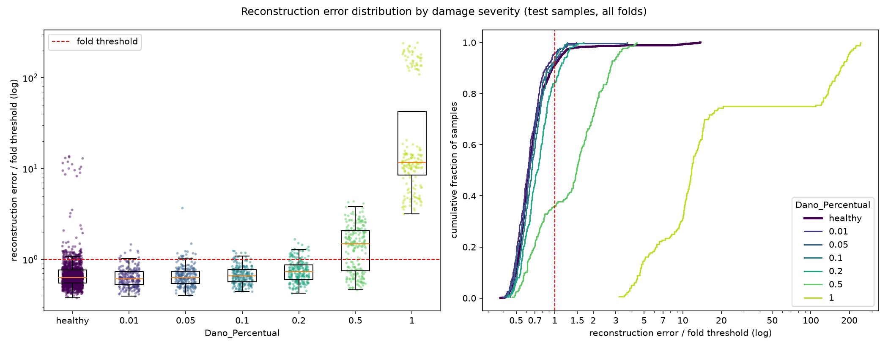

# E009: Latente a 64 amostras/s (Nyquist de 32 Hz)

| Campo | Valor |
|---|---|
| Status | Concluído (não adotado) |
| Pai (base de comparação) | [E008](../E008_penalidade-l1-1e-5/README.md) |
| Proposto em | 2026-11-08 |
| Executado em | 2026-11-08 |
| Código | commit `d6c56ce` |

## 1. Motivação

**A faixa de 16–20 Hz é a pior reconstruída em todos os experimentos desde o E004.** Parte não reconstruída por faixa, fold 1, só saudáveis de treino (`residual_spectrum.txt` de cada experimento):

| Faixa (Hz) | 1–4 | 4–8 | 8–12 | 12–16 | 16–20 |
|---|---|---|---|---|---|
| E006 | 0,6% | 0,7% | 0,4% | 0,9% | 7,1% |
| E007 | 0,4% | 0,4% | 0,2% | 0,6% | 5,2% |
| E008 | 0,6% | 0,6% | 0,4% | 0,9% | 7,6% |

Nas outras faixas a perda fica abaixo de 1%; em 16–20 Hz, ela é 6–10 vezes maior.

**A faixa está acima do Nyquist do latente.** Um sinal amostrado a *f* amostras por segundo só representa sem ambiguidade frequências até *f*/2 (a frequência de Nyquist). Com pools `[2, 2, 2]`, o latente tem 1824 ÷ 8 = 228 instantes em 7,125 s, ou 32 por segundo: o Nyquist é 16 Hz. A faixa de 16–20 Hz só é reconstruída (~93% dela) porque o decoder combina vários canais do latente para recriá-la, e isso custa erro.

**O mesmo mecanismo já funcionou uma vez.** No E004, reduzir menos o tempo (32× → 8×) mantendo o latente em 912 valores reduziu o erro de todas as faixas de 1–20 Hz em 5–10× e a energia criada fora da banda em ~11×.

**O decoder ainda cria energia fora da banda.** No E008, 6,8% do resíduo do fold 1 está acima de 20 Hz, onde a entrada não tem energia (0,042% da energia de entrada). A explicação mais provável, não verificada, são os "degraus" do `UpSampling1D`. Com um passo de ×2 a menos, essa energia deve cair.

## 2. Hipótese

> Se a redução no tempo cair de 8× para 4× (pools `[2, 2, 1]`), mantendo o latente em 912 valores e o campo receptivo do encoder acima de 128 amostras, então a parte não reconstruída de 16–20 Hz e a energia criada acima de 20 Hz diminuem, porque o latente passa a 64 amostras/s (Nyquist de 32 Hz, acima de toda a banda do filtro) e o decoder amplia o sinal em um passo de ×2 a menos.

## 3. Mudança em relação ao pai

| Item | E008 | E009 |
|---|---|---|
| `pool_sizes` | `[2, 2, 2]` (redução de 8× no tempo; latente a 32 amostras/s) | `[2, 2, 1]` (redução de 4×; latente a 64 amostras/s) |
| `encoder_filters` | `[32, 32, 4]` | `[32, 32, 2]` |

Sem mudanças de código. `MaxPooling1D(1)` e `UpSampling1D(1)` não alteram o sinal, então o último bloco do encoder fica só com a convolução. O recorte continua em 1824 amostras (1827 é cortado no múltiplo de 4 mais próximo, que também é 1824).

### Por que dois parâmetros mudam

A mudança testada é uma só, como no E004: onde a compressão acontece, no tempo ou nos canais. Os filtros da última camada do encoder caem de 4 para 2 para manter o tamanho do latente:

| | Instantes no latente | Canais do latente | Total | Valores por segundo |
|---|---|---|---|---|
| E008 | 228 | 4 | 912 | 32 × 4 = 128 |
| Só trocando os pools | 456 | 4 | 1824 | 256 |
| E009 | 456 | 2 | 912 | 64 × 2 = 128 |

**Por que manter 912 valores.** Não há um racional físico para 912: o valor vem dos pontos de partida arbitrários do E001 (57 instantes × 16 canais) e é mantido só como controle. Com o latente fixo, uma diferença no resultado pode ser atribuída à resolução no tempo, e não a um latente maior. Dobrar o latente também mudaria quanto o modelo comprime.

**Campo receptivo.** Com kernel 19, o campo receptivo do encoder vai de 134 para 130 amostras, ainda acima das 128 (2 períodos do modo de ~4 Hz). O kernel não precisa mudar.

**Parâmetros e custo.** O modelo passa de 63.688 para 61.024 parâmetros (contados com `build_model`). As convoluções de 32 filtros rodam nas mesmas resoluções de antes; só a primeira convolução do decoder, que é pequena (2 filtros), roda a 456 instantes em vez de 228. O custo por época deve ficar parecido com o do E008.

**Efeito confundido: 2 canais no latente.** Com 2 canais, cada canal precisa carregar mais da resposta. Há dois riscos:
- **ReLU:** o latente só tem valores positivos. Um sinal que oscila em torno de zero precisa de um deslocamento constante (que a L1 penaliza) ou de dois canais (um para a parte positiva, outro para a negativa). Com 4 canais isso é contornável; com 2, é mais apertado.
- **Canal morto:** se um canal morrer, o latente útil cai pela metade. No E008, com 1e-5, nenhum dos 4 canais morreu.

Há uma evidência de que 2 canais podem bastar: no E006, só 2 dos 4 canais estavam ativos no fold 1 (64 valores por segundo) e o modelo reconstruiu 99,4% da energia. Se o E009 piorar, não dá para separar o efeito da resolução no tempo do efeito de ter só 2 canais.

## 4. Previsões (escritas antes de rodar)

### 4.1 Critérios só com saudáveis

O critério de reconstrução é o MSE puro, de `train_errors.parquet`, e não o `val_loss` (que inclui a penalidade).

| Critério | E008 | Previsão para o E009 |
|---|---|---|
| Mediana, entre folds, do MSE médio dos saudáveis de treino | 0,0067 (0,0050–0,0079) | Menor |
| Parte não reconstruída de 16–20 Hz, fold 1 | 7,6% | Menor; deixa de ser 6–10× pior que as outras faixas |
| Energia criada acima de 20 Hz, relativa à entrada, fold 1 | 0,042% | Menor |
| Canais ativos no latente (fold 1) | 4 de 4 | 2 de 2 |
| Zeros no latente (fold 1) | 45,0% | Menor (cada canal precisa ficar ativo mais vezes) |
| Penalidade L1 ÷ MSE (fold 1) | 0,23 | Sem previsão (o E008 mostrou que essa razão não segue o coeficiente) |
| Erro do peso 0,90 ÷ outros pesos | 1,34 | ≈ 1,3 (quatro experimentos de reconstrução não a mudaram) |
| Folds parados pelo early stopping | 15 de 15 | Maioria |

### 4.2 Avaliação (só reporte)

Sem previsão de direção para a AUC das severidades 0,2 e 0,5. Melhorar 16–20 Hz só ajuda a detectar se o dano mudar essa faixa, e isso não se sabe nem deve ser verificado com os danificados antes da avaliação. Os falsos negativos devem ficar perto de 884, porque o limiar continua decidido pelo peso 0,90.

Severidades até 0,1 devem continuar com AUC ≈ 0,5. Para a severidade 0,01 há agora um motivo direto: o `slightly_damaged`, tratado como saudável, tem dano < 1% (informado pelo autor), e ele forma 93% dos saudáveis de treino. Um dano de 1% está no limite do que o modelo aprende como saudável.

### 4.3 Critério de adoção

Adotar `pool_sizes = [2, 2, 1]` e `encoder_filters = [32, 32, 2]` na base se as duas condições valerem:
1. A mediana, entre folds, do MSE médio dos saudáveis de treino for menor que a do E008 (0,0067).
2. O fold 1 tiver os 2 canais do latente ativos.

A parte não reconstruída de 16–20 Hz e a energia fora da banda testam a hipótese, mas não entram no critério, porque são medidas só no fold 1, que foi atípico no E008 (13º de 15 em MSE).

**Limite conhecido do critério.** Menor MSE dos saudáveis não garante melhor detecção (E002, E006, E007 e E008 mostraram isso). A métrica de teste é só reportada e não decide.

## 5. Configuração e origem de cada escolha

Igual ao E008, exceto as linhas marcadas.

| Parâmetro | Valor | Origem | Justificativa / evidência |
|---|---|---|---|
| `nodes_to_use` | 8 nós (10654, 10659, 10664, 10669, 10658, 10663, 10668, 10673) | Herdado / Pedido | Mesmos nós dos pipelines OCSVM e Isolation Forest, para comparação direta |
| `axes_to_use` | X, Y | Herdado / Pedido | Idem |
| `filter_type`, `cutoff_low`, `cutoff_high` | Passa-banda 1–20 Hz (Butterworth ordem 4, `filtfilt`) | Medido / Físico | Ver E003 |
| Ordem filtro/recorte | Filtra o registro completo, depois recorta | Físico | Ver E003 |
| Comprimento do sinal | Recorte em 1824 amostras (7,12 s) | Medido / Físico | Ver E001 |
| Normalização | Padronização por canal, só com saudáveis do treino | Físico / premissa | Ver E003 |
| Seleção de features | Nenhuma | Físico | Colunas são instantes de tempo |
| ★ `pool_sizes` | `[2, 2, 1]` | Físico / Medido | Nyquist do latente de 32 Hz, acima da banda de 20 Hz; 16–20 Hz é a pior faixa desde o E004 (seção 1) |
| ★ `encoder_filters` | `[32, 32, 2]` | Arbitrário / controle | Último valor ajustado para manter o latente em 912 valores (456 × 2); 912 vem do E001 e é Arbitrário. Os 32 filtros das outras camadas são Herdados do E001 |
| `kernel_size` | 19 | Físico (heurística) | Adotado no E004; campo receptivo de 130 amostras com os novos pools, acima de 128 |
| `l1_activity` | 1e-5 | Pedido / Arbitrário | Adotado no E008 |
| Ativações e camadas | ReLU; saída linear; `UpSampling1D` + Conv | Convenção | Ver E001. O autor preferiu não trocar a ativação do latente por enquanto |
| `learning_rate` | 1e-3 (Adam) | Convenção | Padrão do Adam |
| `epochs` | 200 | Medido / Pedido | Adotado no E006, com early stopping |
| `early_stopping_patience` | 10 (com `restore_best_weights`) | Convenção | Valor comum |
| `batch_size` | 32 | Convenção | Valor comum |
| `validation_split` | 0,1, após embaralhar os saudáveis | Convenção | Ver E001 |
| Score de anomalia | MSE médio sobre 1824 × 16 | Convenção | Erro de reconstrução usual; não inclui a penalidade |
| Regra do limiar | Percentil 95 do erro dos saudáveis de treino de cada fold | Pedido / Medido | Adotada no E005 (α = 5%) |
| `random_state` | 42 | Convenção | Semente fixa |

## 6. Verificação da premissa não supervisionada

- [x] Modelo, normalização, filtros e limiar ajustados só com saudáveis do treino.
- [x] Nenhum parâmetro escolhido com danificados, métricas de teste ou AUC. A motivação vem do espectro do resíduo dos saudáveis e do Nyquist do latente.
- [x] Motivação e critério de adoção usam só saudáveis ou raciocínio físico.

## 7. Execução

Comandos (depois de commitar esta pasta):

```powershell
.venv\Scripts\python.exe src\test_autoencoders.py outputs\autoencoders\E009_nyquist-latente-32hz *> outputs\autoencoders\E009_nyquist-latente-32hz\run.log
.venv\Scripts\python.exe src\residual_spectrum.py outputs\autoencoders\E009_nyquist-latente-32hz *> outputs\autoencoders\E009_nyquist-latente-32hz\residual_spectrum.log
```

Antes de rodar em outra máquina: `uv sync`.

Duração estimada: o teto é de 3000 épocas (15 folds × 200). O E008 somou 1939 épocas; o custo por época deve ser parecido (seção 3), mas o ponto de parada pode mudar. O diagnóstico do resíduo leva ~20–30 min.

**Limitação:** canais ativos, zeros e o espectro do resíduo são medidos só no fold 1. O critério 4.3 (2) depende dessa medição única.

**Execução real (2026-11-08), em outra máquina do autor:**
- Código: commit `d6c56ce` (registrado no `run.log`), sem aviso de alterações pendentes em `src/`.
- Run principal e diagnóstico do resíduo completos, sem erros; o gráfico foi gerado normalmente.
- O run principal começou às 17:08 e o diagnóstico do resíduo às 20:52: o run levou ~3h45 (o E008 não teve a duração registrada).
- Épocas por fold: 200, 200, 119, 110, 163, 152, 109, 176, 125, 159, 180, 200, 127, 200, 178 (2398 no total, contra 1939 no E008). Os folds 1, 2, 12 e 14 chegaram ao teto de 200 épocas sem o early stopping disparar (melhor `val_loss` nas épocas 199, 194, 197 e 192); os outros 11 pararam antes.
- O limiar do fold 1 no diagnóstico do resíduo (0,0088) é igual ao do run, então o retreino reproduziu o fold 1.

## 8. Resultados

### 8.1 Critérios só com saudáveis

| Critério | E008 | Previsão | E009 | Resultado |
|---|---|---|---|---|
| Mediana, entre folds, do MSE médio dos saudáveis de treino | 0,0067 (0,0050–0,0079) | Menor | 0,0076 (0,0063–0,0096), +13% | Refutada |
| Parte não reconstruída de 16–20 Hz, fold 1 | 7,6% | Menor | 5,3% | Confirmada, só no fold 1 (ver abaixo) |
| Energia criada acima de 20 Hz, relativa à entrada, fold 1 | 0,042% | Menor | 0,033% | Confirmada, só no fold 1 |
| Canais ativos no latente (fold 1) | 4 de 4 | 2 de 2 | 1 de 2 | Refutada |
| Zeros no latente (fold 1) | 45,0% | Menor | 51,6% | Refutada (o canal morto sozinho dá 50%) |
| Penalidade L1 ÷ MSE (fold 1) | 0,23 | Sem previsão | 0,19 | — |
| Erro do peso 0,90 ÷ outros pesos (mediana entre folds) | 1,34 (1,26–1,47) | ≈ 1,3 | 1,43 (1,34–1,60) | Refutada (aumentou) |
| Folds parados pelo early stopping | 15 de 15 | Maioria | 11 de 15 | Confirmada |

O `val_loss` inclui a penalidade: mediana do melhor valor dos 15 folds 0,0105 (0,0077–0,0133), contra 0,0088 no E008 com o mesmo coeficiente. Como o coeficiente é igual, essa comparação é justa e concorda com o MSE puro.

**O fold 1 de novo não representa o run, agora no sentido oposto.** O MSE médio dos saudáveis de treino no fold 1 foi 0,0063, o menor dos 15 folds (no E008 o fold 1 era o 13º). As medições só do fold 1 (bandas, energia fora da banda, canais, zeros) comparam um fold atípico do E008 com um fold atípico do E009.

**Os folds que treinaram até o teto são os melhores.** Os 4 folds que chegaram a 200 épocas têm MSE de 0,0063–0,0072; os 11 que pararam antes têm mediana 0,0078.

Parte não reconstruída por faixa, fold 1:

| Faixa (Hz) | 0–1 | 1–4 | 4–8 | 8–12 | 12–16 | 16–20 |
|---|---|---|---|---|---|---|
| E008 | 0,8% | 0,6% | 0,6% | 0,4% | 0,9% | 7,6% |
| E009 | 0,9% | 0,6% | 0,6% | 0,3% | 0,8% | 5,3% |

Energia criada acima de 20 Hz, fold 1: 6,2% do resíduo (E008: 6,8%). Erro relativo total, fold 1: 0,53% (E008: 0,62%).

**Latente do fold 1.** Dos 2 canais, 1 está sempre em zero. Os 51,6% de zeros correspondem a 470 dos 912 valores: 456 vêm do canal morto e só 14 (3,2%) do canal ativo. O canal ativo quase nunca chega a zero.

Outras medições só com saudáveis:

| Critério | E008 | E009 |
|---|---|---|
| Acima do limiar no treino, por fold (grupo das 15 / peso 0,90 / outros) | 14 / 40,5 / 8,5 | 14 / 36,4 / 12,6 |
| Assimetria do erro dos saudáveis de treino (média entre folds) | 9,36 | 9,36 |
| η² velocidade / peso / módulo / irregularidade | 0,048 / 0,136 / 0,089 / 0,168 | 0,033 / 0,144 / 0,083 / 0,162 |
| Erro médio dos saudáveis de treino por módulo (0,975 / 1,000 / 1,025) | 0,0082 / 0,0054 / 0,0059 | 0,0104 / 0,0062 / 0,0069 |

### 8.2 Métricas globais

| Métrica | E008 | E009 | Δ |
|---|---|---|---|
| Acurácia | 0,6154 ± 0,0210 | 0,6132 ± 0,0278 | −0,0022 |
| Recall | 0,3226 ± 0,1241 | 0,3057 ± 0,0929 | −0,0169 |
| FPR | 0,1015 (137) | 0,0896 (121) | −0,0119 |
| AUC agregada | 0,6483 | 0,6359 | −0,0124 |
| Matriz de confusão | TN 1213 · FP 137 · FN 884 · TP 421 | TN 1229 · FP 121 · FN 906 · TP 399 | |

### 8.3 Por severidade

| Severidade | n | Recall E008 | Recall E009 | AUC E008 | AUC E009 | FN E008 | FN E009 | Erro mediano danificado ÷ saudável (E008 / E009) |
|---|---|---|---|---|---|---|---|---|
| 0,01 | 225 | 0,067 | 0,040 | 0,466 | 0,415 ± 0,070 | 210 | 216 | 1,00 / 0,97 |
| 0,05 | 225 | 0,084 | 0,071 | 0,503 | 0,481 ± 0,046 | 206 | 209 | 1,00 / 0,99 |
| 0,10 | 225 | 0,080 | 0,067 | 0,544 | 0,555 ± 0,079 | 207 | 210 | 1,03 / 1,03 |
| 0,20 | 225 | 0,200 | 0,156 | 0,707 | 0,672 ± 0,083 | 180 | 190 | 1,17 / 1,15 |
| 0,50 | 225 | 0,640 | 0,640 | 0,848 | 0,848 ± 0,069 | 81 | 81 | 2,40 / 2,44 |
| 1,00 | 180 | 1,000 | 1,000 | 0,997 | 0,995 ± 0,007 | 0 | 0 | 17,7 / 18,1 |

FPR de todos os saudáveis de teste no E009: 0,090. Razão de medianas: mediana, entre folds, da razão entre o erro mediano dos danificados e o dos saudáveis de irregularidade 1 do mesmo fold (mesmo método do E008).

A AUC da severidade 0,01 abaixo de 0,5 não indica que o dano reduz o erro: os saudáveis de teste incluem as passagens de irregularidade 2, com erro maior, e os danificados só têm irregularidade 1.

FPR por peso de vagão do fold: 0,90 (folds 10–12) 14%–46%; demais pesos 0%–12% (o máximo é o fold 7, peso 1,10 × módulo 0,975). Os folds 10–12 têm 87 dos 121 falsos positivos (eram 103 de 137). O grupo irregularidade 2 × módulo 0,975 gerou os mesmos 15 falsos positivos. FPR na irregularidade 1: 8,0%.

### 8.4 Distribuição dos erros



## 9. Análise

**Hipótese (seção 2): não confirmada.** A parte não reconstruída de 16–20 Hz (7,6% → 5,3%) e a energia criada acima de 20 Hz (0,042% → 0,033%) caíram no fold 1, como previsto. Mas o fold 1 é o melhor fold do E009 e um dos piores do E008, então essa queda não pode ser atribuída à mudança. No conjunto dos 15 folds, a reconstrução piorou: o MSE dos saudáveis subiu 13% (0,0067 → 0,0076), e o `val_loss`, comparável aqui porque o coeficiente L1 é o mesmo, também (0,0088 → 0,0105).

**Um dos 2 canais morreu.** É o risco previsto na seção 3. No fold 1, o latente útil caiu para 456 valores (1 canal a 64 amostras/s), metade do previsto. O canal que sobrou quase nunca chega a zero (3,2% de zeros). Isso é compatível com o argumento da seção 3, embora não seja prova: com ReLU, um único canal só representa uma oscilação em torno de zero se somar um deslocamento constante, e então deixa de ter zeros. A esparsidade desse canal é praticamente nula; os zeros vêm do canal morto.

**Treino mais lento.** O E009 precisou de mais épocas (2398 contra 1939), 4 folds chegaram ao teto ainda melhorando, e esses 4 são justamente os de menor MSE. Parte da piora pode vir de treino incompleto nos folds que pararam antes. Não dá para separar isso da perda de capacidade do canal morto com os dados deste run.

**Efeitos confundidos (seção 3).** O resultado não separa a resolução no tempo dos 2 canais. O que se observa (canal morto, canal ativo sem zeros, reconstrução pior) aponta para o lado dos 2 canais, mas não exclui que a resolução no tempo, sozinha, também não ajude.

**Avaliação (seção 4.2).** A detecção piorou um pouco: FN 884 → 906, com a maior perda na severidade 0,2 (180 → 190 FN; AUC 0,707 → 0,672, dentro do desvio entre folds). A severidade 0,5 ficou igual (81 FN; AUC 0,848). O FPR caiu (10,2% → 9,0%), principalmente nos folds de peso 0,90 (103 → 87 FP).

**O peso 0,90.** A razão de erro do peso 0,90 para os outros subiu (1,34 → 1,43), mas a composição acima do limiar no treino mudou: menos passagens de peso 0,90 (40,5 → 36,4 por fold) e mais dos outros pesos (8,5 → 12,6). O módulo 0,975 ficou pior reconstruído (0,0082 → 0,0104), o que espalha a cauda por outros grupos.

## 10. Decisão e próximos passos

- **Critério da seção 4.3: não atendido.** O MSE dos saudáveis de treino subiu (0,0076 > 0,0067) e o fold 1 tem só 1 dos 2 canais ativos.
- **Decisão: não adotada.** A base continua sendo o E008.
- **Variantes avaliadas nos folds de teste até aqui:** 9.

Próximos experimentos possíveis, motivados só por saudáveis ou por raciocínio físico:
- **Nyquist com 4 canais** (pools `[2, 2, 1]`, `encoder_filters` `[32, 32, 4]`, latente de 456 × 4 = 1824 valores). Separa a resolução no tempo do problema dos 2 canais. Efeito confundido: o latente dobra (compressão 32× → 16×).
- **Espectro do resíduo em todos os folds**, dentro do run principal. O fold 1 foi atípico no E008 e no E009, em sentidos opostos, e os critérios de canais, zeros e bandas dependem dele.
- **Peso 0,90:** o limiar por peso de vagão continua reservado pelo autor como alternativa futura.
- **Entrada espectral (PSD):** reservada pelo autor para depois do domínio do tempo.

## Notas posteriores
