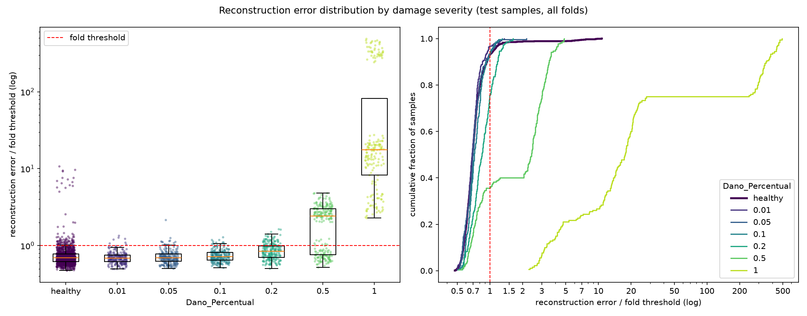

# E010: Latente a 64 amostras/s com 4 canais

| Campo | Valor |
|---|---|
| Status | Concluído |
| Pai (base de comparação) | [E008](../E008_penalidade-l1-1e-5/README.md) |
| Proposto em | 2026-11-08 |
| Executado em | 2026-11-08 |
| Código | commit `de75621` |

## 1. Motivação

**A pergunta do E009 continua aberta.** O E009 testou o latente a 64 amostras/s (Nyquist de 32 Hz, acima da banda de 20 Hz do filtro) e foi rejeitado: o MSE dos saudáveis de treino subiu de 0,0067 para 0,0076. Mas ele mudou duas coisas juntas, a resolução no tempo e os canais do latente (4 → 2), e não dá para separar as duas.

**O que o E009 mediu aponta para os 2 canais** (todas as medições só com saudáveis de treino):
- No fold 1, 1 dos 2 canais morreu. O latente útil caiu para 456 valores.
- O canal que sobrou quase nunca chegou a zero (3,2% de zeros). Isso é compatível com a ReLU: com um canal só, a rede precisa de um deslocamento constante para representar uma oscilação em torno de zero.
- No E008, com 4 canais e o mesmo coeficiente L1, nenhum canal morreu no fold 1.

**A faixa de 16–20 Hz continua a pior.** Em todos os experimentos desde o E004, ela é 6–10 vezes pior reconstruída que as outras faixas (7,6% de perda no fold 1 do E008, contra < 1% nas outras). Ela está acima do Nyquist do latente atual (16 Hz).

**Literatura.** [Manakov et al. (2019)](https://arxiv.org/abs/1911.07460) estudaram autoencoders convolucionais de imagens e concluíram que o tamanho espacial do latente pesa mais na generalização que o número de canais. Aqui, o tamanho espacial corresponde à duração do latente. O estudo não trata de detecção de anomalias e serve só como indicação.

**Primeiro experimento com o diagnóstico em todos os folds.** A partir do commit `fbd41a9`, o run principal mede o espectro do resíduo e o latente nos saudáveis de treino de cada um dos 15 folds. Os experimentos anteriores só têm o fold 1, que foi atípico no E008 (13º de 15 em MSE) e no E009 (1º de 15).

## 2. Hipótese

> Se a redução no tempo cair de 8× para 4× (pools `[2, 2, 1]`) mantendo os 4 canais do latente, então o erro dos saudáveis cai e a parte não reconstruída de 16–20 Hz diminui, porque o latente passa a 64 amostras/s (Nyquist de 32 Hz) sem o gargalo de 2 canais ReLU que derrubou o E009.

## 3. Mudança em relação ao pai

| Item | E008 | E010 |
|---|---|---|
| `pool_sizes` | `[2, 2, 2]` (redução de 8× no tempo; latente a 32 amostras/s) | `[2, 2, 1]` (redução de 4×; latente a 64 amostras/s) |

Sem mudanças de código no modelo. `encoder_filters` continua `[32, 32, 4]`.

**Efeito confundido: o latente dobra.** Ele passa de 228 × 4 = 912 para 456 × 4 = 1824 valores, e a compressão total cai de 32× (29.184 ÷ 912) para 16×. Não dá para manter 912 valores com 4 canais e 456 instantes. A alternativa de manter 912 valores foi o E009, com 2 canais.

| | Instantes no latente | Canais | Total | Valores por segundo | Compressão |
|---|---|---|---|---|---|
| E008 (pai) | 228 | 4 | 912 | 128 | 32× |
| E009 | 456 | 2 | 912 | 128 | 32× |
| E010 | 456 | 4 | 1824 | 256 | 16× |

**Como ler o resultado:**
- **E010 contra E008 (pai):** muda a resolução no tempo e, junto, o tamanho do latente.
- **E010 contra E009:** só os canais do latente mudam (2 → 4), com a mesma resolução no tempo. Essa comparação mostra quanto do resultado do E009 vinha dos 2 canais.

**Risco de reconstruir também o dano.** Um latente maior pode deixar o modelo mais perto de copiar a entrada e reconstruir bem também as passagens danificadas. Duas evidências contra esse risco: no E007, mais capacidade (sem L1) não piorou a detecção; e Manakov et al. não observaram cópia mesmo com latentes do tamanho da entrada. O critério de adoção só com saudáveis não consegue antecipar esse efeito.

**Parâmetros e custo.** O modelo tem os mesmos 63.688 parâmetros do E008 (contados com `build_model`), porque pooling e upsampling não têm parâmetros. A única convolução que passa a rodar com o dobro de instantes é a primeira do decoder, que é pequena (4 → 4 canais). O custo por época deve ficar parecido com o do E008. O campo receptivo do encoder vai de 134 para 130 amostras, ainda acima das 128 (2 períodos do modo de ~4 Hz).

## 4. Previsões (escritas antes de rodar)

### 4.1 Critérios só com saudáveis

As referências do E008 e do E009 para espectro e latente são só do fold 1. No E010, essas medidas passam a ser a mediana dos 15 folds (`residual_spectrum.txt`); a comparação com os pais fica limitada por isso.

| Critério | E008 | E009 | Previsão para o E010 |
|---|---|---|---|
| Mediana, entre folds, do MSE médio dos saudáveis de treino | 0,0067 | 0,0076 | Menor que 0,0067 |
| Parte não reconstruída de 16–20 Hz | 7,6% (fold 1) | 5,3% (fold 1) | Mediana menor que 5% |
| Energia criada fora da banda, relativa à entrada | 0,042% (fold 1) | 0,033% (fold 1) | Mediana menor que 0,042% |
| Canais ativos no latente | 4 de 4 (fold 1) | 1 de 2 (fold 1) | 4 de 4 em todos os folds |
| Zeros no latente | 45,0% (fold 1) | 51,6% (fold 1) | Sem previsão |
| Penalidade L1 ÷ MSE | 0,23 (fold 1) | 0,19 (fold 1) | Sem previsão |
| Erro do peso 0,90 ÷ outros pesos (mediana entre folds) | 1,34 | 1,43 | ≈ 1,3–1,4 |
| Folds parados pelo early stopping | 15 de 15 | 11 de 15 | Maioria |

### 4.2 Avaliação (só reporte)

Sem previsão de direção para a AUC das severidades 0,2 e 0,5. Há dois cenários:
- **O latente mais fino ajuda:** a reconstrução dos saudáveis melhora mais que a dos danificados, como no E004, e a AUC sobe.
- **O latente maior reconstrói também o dano:** a diferença entre saudáveis e danificados diminui e a AUC cai.

Os falsos negativos devem ficar perto dos 884 do E008, porque o limiar continua decidido pelo peso 0,90. Severidades até 0,1 devem continuar com AUC ≈ 0,5; a 0,01 está no limite do dano < 1% do `slightly_damaged`, que forma 93% dos saudáveis de treino.

### 4.3 Critério de adoção

Adotar `pool_sizes = [2, 2, 1]` na base se as duas condições valerem:
1. A mediana, entre folds, do MSE médio dos saudáveis de treino for menor que a do E008 (0,0067).
2. A mediana, entre folds, de canais ativos no latente for 4 de 4.

A parte não reconstruída de 16–20 Hz e a energia fora da banda testam a hipótese, mas não entram no critério, porque as referências dos pais são só do fold 1.

**Limite conhecido do critério.** Menor MSE dos saudáveis não garante melhor detecção (E002, E006, E007 e E008 mostraram isso), e aqui o latente dobra, o que pode facilitar a reconstrução do dano. A métrica de teste é só reportada e não decide.

## 5. Configuração e origem de cada escolha

Igual ao E008, exceto a linha marcada.

| Parâmetro | Valor | Origem | Justificativa / evidência |
|---|---|---|---|
| `nodes_to_use` | 8 nós (10654, 10659, 10664, 10669, 10658, 10663, 10668, 10673) | Herdado / Pedido | Mesmos nós dos pipelines OCSVM e Isolation Forest, para comparação direta |
| `axes_to_use` | X, Y | Herdado / Pedido | Idem |
| `filter_type`, `cutoff_low`, `cutoff_high` | Passa-banda 1–20 Hz (Butterworth ordem 4, `filtfilt`) | Medido / Físico | Ver E003 |
| Ordem filtro/recorte | Filtra o registro completo, depois recorta | Físico | Ver E003 |
| Comprimento do sinal | Recorte em 1824 amostras (7,12 s) | Medido / Físico | Ver E001; 1824 também é múltiplo de 4 |
| Normalização | Padronização por canal, só com saudáveis do treino | Físico / premissa | Ver E003 |
| Seleção de features | Nenhuma | Físico | Colunas são instantes de tempo |
| ★ `pool_sizes` | `[2, 2, 1]` | Físico / Medido | Nyquist do latente de 32 Hz, acima da banda de 20 Hz; 16–20 Hz é a pior faixa desde o E004 (seção 1) |
| `encoder_filters` | `[32, 32, 4]` | Arbitrário / controle | Adotado no E004; os 4 canais são mantidos para isolar o problema dos 2 canais do E009 |
| `kernel_size` | 19 | Físico (heurística) | Adotado no E004; campo receptivo de 130 amostras com os novos pools |
| `l1_activity` | 1e-5 | Pedido / Arbitrário | Adotado no E008 |
| Ativações e camadas | ReLU; saída linear; `UpSampling1D` + Conv | Convenção | Ver E001. O autor preferiu não trocar a ativação do latente por enquanto |
| `learning_rate` | 1e-3 (Adam) | Convenção | Padrão do Adam |
| `epochs` | 200 | Medido / Pedido | Adotado no E006, com early stopping |
| `early_stopping_patience` | 10 (com `restore_best_weights`) | Convenção | Valor comum |
| `batch_size` | 32 | Convenção | Valor comum |
| `validation_split` | 0,1, após embaralhar os saudáveis | Convenção | Ver E001 |
| Score de anomalia | MSE médio sobre 1824 × 16 | Convenção | Erro de reconstrução usual; não inclui a penalidade |
| Regra do limiar | Percentil 95 do erro dos saudáveis de treino de cada fold | Pedido / Medido | Adotada no E005 (α = 5%) |
| `random_state` | 42 | Convenção | Semente fixa |

## 6. Verificação da premissa não supervisionada

- [x] Modelo, normalização, filtros e limiar ajustados só com saudáveis do treino.
- [x] Nenhum parâmetro escolhido com danificados, métricas de teste ou AUC. A motivação vem do espectro do resíduo e do latente dos saudáveis (E008, E009) e do Nyquist do latente.
- [x] Motivação e critério de adoção usam só saudáveis ou raciocínio físico.

## 7. Execução

Comando (depois de commitar esta pasta). O espectro do resíduo de todos os folds sai no mesmo run (`residual_spectrum.txt` e `residual_spectrum.parquet`):

```powershell
.venv\Scripts\python.exe src\test_autoencoders.py outputs\autoencoders\E010_nyquist-latente-4-canais *> outputs\autoencoders\E010_nyquist-latente-4-canais\run.log
```

Antes de rodar em outra máquina: `uv sync`.

Duração estimada: o teto é de 3000 épocas (15 folds × 200). O E008 somou 1939 épocas e o E009, 2398 (~3h45). O custo por época deve ser parecido com o do E008 (seção 3); o diagnóstico em todos os folds acrescenta poucos segundos por fold.

**Execução real (2026-11-08), em outra máquina do autor:**
- Código: commit `de75621` (registrado no `run.log`), sem aviso de alterações pendentes em `src/`.
- Run completo, sem erros; o gráfico e o diagnóstico do resíduo (`residual_spectrum.txt` e `.parquet`) foram gerados normalmente.
- O `run.log` começa às 23:22; a duração exata não foi registrada (os arquivos foram gravados na pasta às 10:02 do dia seguinte, na cópia entre máquinas).
- Épocas por fold: 168, 125, 114, 178, 187, 97, 140, 186, 140, 85, 149, 161, 119, 133, 130 (2112 no total, contra 1939 no E008 e 2398 no E009). O early stopping parou os 15 folds; nenhum chegou ao teto.

## 8. Resultados

### 8.1 Critérios só com saudáveis

As medidas de espectro e latente do E010 são a mediana (mínimo–máximo) dos 15 folds. As do E008 e do E009 são só do fold 1. Para uma comparação justa, a coluna "E010 fold 1" repete a medida no mesmo fold.

| Critério | E008 | E009 | Previsão | E010 (15 folds) | E010 fold 1 | Resultado |
|---|---|---|---|---|---|---|
| Mediana, entre folds, do MSE médio dos saudáveis de treino | 0,0067 (0,0050–0,0079) | 0,0076 | Menor que 0,0067 | 0,0033 (0,0028–0,0047), −51% | 0,0030 | Confirmada |
| Parte não reconstruída de 16–20 Hz | 7,6% (fold 1) | 5,3% (fold 1) | Mediana menor que 5% | 3,1% (2,7–4,4%) | 2,7% | Confirmada |
| Energia criada fora da banda, relativa à entrada | 0,042% (fold 1) | 0,033% (fold 1) | Mediana menor que 0,042% | 0,02% (0,01–0,03%) | 0,02% | Confirmada |
| Canais ativos no latente | 4 de 4 (fold 1) | 1 de 2 (fold 1) | 4 de 4 em todos os folds | 4 de 4 em 13 folds; 3 de 4 nos folds 1 e 4 | 3 de 4 | Refutada |
| Zeros no latente | 45,0% (fold 1) | 51,6% (fold 1) | Sem previsão | 29,3% (26,3–32,1%) | 29,9% | — |
| Penalidade L1 ÷ MSE | 0,23 (fold 1) | 0,19 (fold 1) | Sem previsão | 0,38 (0,35–0,40) | 0,37 | — |
| Erro do peso 0,90 ÷ outros pesos (mediana entre folds) | 1,34 (1,26–1,47) | 1,43 (1,34–1,60) | ≈ 1,3–1,4 | 1,27 (1,23–1,41) | — | Refutada por pouco (abaixo da faixa) |
| Folds parados pelo early stopping | 15 de 15 | 11 de 15 | Maioria | 15 de 15 | — | Confirmada |

O `val_loss` tem o mesmo coeficiente L1 do E008 e do E009, então a comparação é justa: mediana do melhor valor dos 15 folds 0,0050 (0,0040–0,0073), contra 0,0088 no E008 e 0,0105 no E009.

Parte não reconstruída por faixa:

| Faixa (Hz) | 0–1 | 1–4 | 4–8 | 8–12 | 12–16 | 16–20 |
|---|---|---|---|---|---|---|
| E008, fold 1 | 0,8% | 0,6% | 0,6% | 0,4% | 0,9% | 7,6% |
| E010, fold 1 | 0,44% | 0,24% | 0,26% | 0,12% | 0,35% | 2,7% |
| E010, mediana dos 15 folds | 0,49% | 0,29% | 0,29% | 0,14% | 0,37% | 3,1% |

No fold 1, a perda caiu 1,8–3,3× em todas as faixas; em 16–20 Hz, 2,8×. A faixa de 16–20 Hz continua a pior, 6–22 vezes pior que as outras na mediana dos folds.

Erro relativo total: mediana 0,27% (0,22–0,38%); fold 1 0,24% (E008: 0,62%).

**Latente.** Nos folds 1 e 4, um dos 4 canais ficou sempre em zero. No fold 1, os 29,9% de zeros correspondem a 25 pontos do canal morto e ~6,6% de zeros nos 3 canais ativos.

Outras medições só com saudáveis:

| Critério | E008 | E009 | E010 |
|---|---|---|---|
| Acima do limiar no treino, por fold (grupo das 15 / peso 0,90 / outros) | 14 / 40,5 / 8,5 | 14 / 36,4 / 12,6 | 14 / 40,8 / 8,2 |
| Assimetria do erro dos saudáveis de treino (média entre folds) | 9,36 | 9,36 | 9,44 |
| η² velocidade / peso / módulo / irregularidade | 0,048 / 0,136 / 0,089 / 0,168 | 0,033 / 0,144 / 0,083 / 0,162 | 0,043 / 0,124 / 0,089 / 0,172 |
| Erro médio dos saudáveis de treino por módulo (0,975 / 1,000 / 1,025) | 0,0082 / 0,0054 / 0,0059 | 0,0104 / 0,0062 / 0,0069 | 0,0042 / 0,0029 / 0,0031 |

### 8.2 Métricas globais

| Métrica | E008 | E009 | E010 |
|---|---|---|---|
| Acurácia | 0,6154 ± 0,0210 | 0,6132 ± 0,0278 | 0,6301 ± 0,0205 |
| Recall | 0,3226 ± 0,1241 | 0,3057 ± 0,0929 | 0,3172 ± 0,0889 |
| FPR | 0,1015 (137) | 0,0896 (121) | 0,0674 (91) |
| AUC agregada | 0,6483 | 0,6359 | 0,6600 |
| Matriz de confusão | TN 1213 · FP 137 · FN 884 · TP 421 | TN 1229 · FP 121 · FN 906 · TP 399 | TN 1259 · FP 91 · FN 891 · TP 414 |

### 8.3 Por severidade

| Severidade | n | Recall E008 | Recall E010 | AUC E008 | AUC E009 | AUC E010 | FN E008 | FN E010 | Erro mediano danificado ÷ saudável (E008 / E009 / E010) |
|---|---|---|---|---|---|---|---|---|---|
| 0,01 | 225 | 0,067 | 0,031 | 0,466 | 0,415 | 0,456 ± 0,055 | 210 | 218 | 1,00 / 0,97 / 0,98 |
| 0,05 | 225 | 0,084 | 0,062 | 0,503 | 0,481 | 0,499 ± 0,044 | 206 | 211 | 1,00 / 0,99 / 1,01 |
| 0,10 | 225 | 0,080 | 0,062 | 0,544 | 0,555 | 0,598 ± 0,061 | 207 | 211 | 1,03 / 1,03 / 1,07 |
| 0,20 | 225 | 0,200 | 0,240 | 0,707 | 0,672 | 0,746 ± 0,073 | 180 | 171 | 1,17 / 1,15 / 1,26 |
| 0,50 | 225 | 0,640 | 0,644 | 0,848 | 0,848 | 0,846 ± 0,048 | 81 | 80 | 2,40 / 2,44 / 3,72 |
| 1,00 | 180 | 1,000 | 1,000 | 0,997 | 0,995 | 0,998 ± 0,004 | 0 | 0 | 17,7 / 18,1 / 26,2 |

FPR de todos os saudáveis de teste no E010: 0,067. Razão de medianas: mediana, entre folds, da razão entre o erro mediano dos danificados e o dos saudáveis de irregularidade 1 do mesmo fold (mesmo método do E008 e do E009).

FPR por peso de vagão do fold: 0,90 (folds 10–12) 10%–39% (eram 24%–53% no E008); demais pesos 0%–6% (o fold 7, que tinha 13% no E008, caiu para 4%). Os folds 10–12 têm 68 dos 91 falsos positivos. O grupo irregularidade 2 × módulo 0,975 gerou os mesmos 15 falsos positivos. FPR na irregularidade 1: 5,8% (era 9,4%).

### 8.4 Distribuição dos erros



## 9. Análise

**Hipótese (seção 2): confirmada no resultado; o mecanismo do Nyquist não foi isolado.** O MSE dos saudáveis caiu pela metade (0,0067 → 0,0033) e a perda em 16–20 Hz caiu para 3,1% (mediana dos folds). Mas, no fold 1, a queda foi parecida em todas as faixas (1,8–3,3×), e não concentrada acima de 16 Hz, e a faixa de 16–20 Hz continua 6–22 vezes pior que as outras. A melhora parece vir da resolução no tempo e do latente maior em geral, e não especificamente de o Nyquist ter passado de 16 para 32 Hz. O latente dobrou junto (seção 3), então os dois efeitos continuam confundidos.

**O problema do E009 eram os 2 canais.** Com a mesma resolução no tempo, passar de 2 para 4 canais (E009 → E010) levou o MSE de 0,0076 para 0,0033. A piora do E009 vinha do gargalo de 2 canais ReLU, e não da resolução no tempo.

**Canais mortos voltaram em 2 folds.** Nos folds 1 e 4, um canal ficou sempre em zero, o que a previsão (4 de 4 em todos) não esperava. A penalidade L1 passou a pesar mais em relação ao MSE (0,23 → 0,38 no fold 1), porque o MSE caiu mais que a soma das ativações. Com 1e-5, a penalidade ainda mata canais em parte dos folds. Mesmo com um canal morto, esses dois folds estão entre os de menor MSE (0,0030 e 0,0029).

**Avaliação (seção 4.2): o cenário "o latente mais fino ajuda" se realizou.** A separação entre danificados e saudáveis aumentou em todas as severidades a partir de 0,1: o erro mediano da severidade 0,5 passou de 2,40× para 3,72× o dos saudáveis, e o da 0,2, de 1,17× para 1,26×. Não houve sinal de que o latente maior reconstrua melhor o dano. A AUC subiu na severidade 0,1 (0,544 → 0,598) e na 0,2 (0,707 → 0,746), as duas dentro de ~1 desvio entre folds, e a agregada foi a maior até aqui (0,660).

**Falsos negativos.** O total ficou praticamente igual (884 → 891). A severidade 0,2 ganhou 9 detecções (180 → 171 FN); as severidades até 0,1 perderam 17, onde a AUC continua ≈ 0,5 e a detecção é efetivamente sorteio. O que mudou foi o ponto de operação: o FPR caiu de 10,2% para 6,7%, mais perto dos 5% definidos no treino, e a queda veio principalmente dos folds de peso 0,90 (103 → 68 falsos positivos). Com a mesma regra de limiar (α = 5%), a melhor separação virou menos alarmes falsos, e não mais detecções.

**O peso 0,90.** Pela primeira vez a razão de erro do peso 0,90 para os outros pesos caiu (1,34 → 1,27), e o FPR dos folds 10–12 caiu junto. A composição acima do limiar no treino não mudou (14 / 40,8 / 8,2 por fold): o limiar continua na cauda do peso 0,90, mas essa cauda ficou mais perto dos outros pesos.

**Ressalva sobre múltiplas variantes.** Este é o 10º modelo avaliado nos mesmos folds de teste. Os ganhos de AUC estão dentro do desvio entre folds e precisam ser lidos com isso em mente.

## 10. Decisão e próximos passos

- **Critério da seção 4.3: atendido.** O MSE dos saudáveis de treino caiu (0,0033 < 0,0067) e a mediana de canais ativos é 4 de 4.
- **Decisão: adotada.** `pool_sizes = [2, 2, 1]` substitui `[2, 2, 2]` na base, que passa a ser o E010 (latente de 456 × 4 = 1824 valores, compressão de 16×).
- **Variantes avaliadas nos folds de teste até aqui:** 10.

Próximos experimentos possíveis, motivados só por saudáveis ou por raciocínio físico:
- **Canais mortos com L1 = 1e-5.** Dois folds perderam um canal, e a penalidade passou a 38% do MSE. Um coeficiente menor (por exemplo 3e-6) testaria se os canais param de morrer mantendo o latente esparso.
- **Filtros graduais no encoder** (`[32, 16, 4]`), discutido antes: distribui a compressão entre os blocos 2 e 3.
- **A faixa de 16–20 Hz** continua 6–22 vezes pior que as outras. Ela tem só 0,7% da energia de entrada, então pesa pouco no MSE total; não está claro se vale atacá-la diretamente.
- **Ponto de operação.** O FPR caiu para 6,7% sem ganho de FN. A escolha de α (hoje 5%) é do autor, e a relação entre α e FN pode ser avaliada sem retreino com `src/rethreshold.py`.
- **Peso 0,90** (limiar por peso) e **entrada espectral (PSD)** continuam reservados pelo autor.

## Notas posteriores
