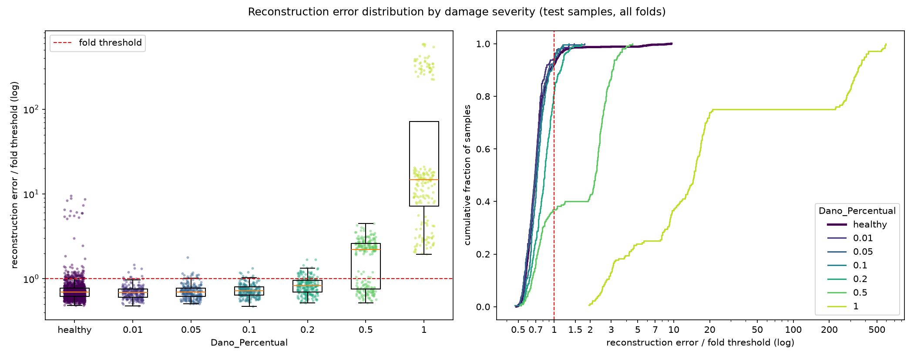

# E011: Filtros graduais no encoder (32 → 16 → 4)

| Campo | Valor |
|---|---|
| Status | Concluído (não adotado) |
| Pai (base de comparação) | [E010](../E010_nyquist-latente-4-canais/README.md) (configuração); [E012](../E012_e010-na-gpu/README.md) (mesma configuração na GPU, referência numérica) |
| Proposto em | 2026-11-09 (ajustado antes do run em 2026-11-09: execução na GPU, comparação com o E012) |
| Executado em | 2026-11-09 |
| Código | commit `2b252e3` |

**Ajuste antes do run (2026-11-09).** Uma primeira execução na CPU foi interrompida pelo autor antes de terminar, sem resultados registrados. O experimento passa a rodar na GPU (WSL2), e a referência numérica deixa de ser o E010 (CPU) e passa a ser o E012, que roda a configuração do E010 na GPU. Os valores do E010 continuam nas tabelas como contexto. A mudança testada, a hipótese e a configuração não mudaram; só a referência de comparação, o critério da seção 4.3 e o comando da seção 7.

**Segundo ajuste (2026-11-09), com o run na GPU já em andamento e antes de qualquer resultado ser visto.** A pedido do autor, entra um critério secundário só com saudáveis, a largura relativa da distribuição do erro (razão p95 ÷ mediana, seção 4.3). Ele é testado e reportado, mas não decide a adoção; o critério principal não mudou.

## 1. Motivação

**A compressão do encoder está concentrada no último bloco.** Os filtros `[32, 32, 16]` vieram do E001 como pontos de partida arbitrários, e o último valor caiu para 4 no E004 só para manter o tamanho do latente. Valores que saem de cada bloco do encoder no E010 (base):

| Etapa | Formato | Valores | Redução |
|---|---|---|---|
| Entrada | 1824 × 16 | 29.184 | — |
| Bloco 1 (32 filtros, pool 2) | 912 × 32 | 29.184 | 1× |
| Bloco 2 (32 filtros, pool 2) | 456 × 32 | 14.592 | 2× |
| Bloco 3 (4 filtros, pool 1) | 456 × 4 | 1824 | **8×** |

A última convolução do encoder precisa passar de 32 para 4 canais de uma vez, e o decoder faz o mesmo salto ao contrário (4 → 32).

**Os canais mortos aparecem justamente nessa camada.** No E010, um dos 4 canais do latente ficou sempre em zero nos folds 1 e 4 (diagnóstico só com saudáveis de treino, `residual_spectrum.txt`). O mesmo aconteceu no E004, no E006 e no E009. Não há medição que ligue os canais mortos à queda abrupta; é só onde eles aparecem.

**Literatura (pesquisada a pedido do autor).**
- A distribuição mais comum em CNNs é a pirâmide (dobrar os filtros cada vez que o pooling divide a resolução por 2), mas ela é uma heurística: [Izquierdo-Cordova e Mayol-Cuevas (2021)](https://arxiv.org/html/2104.08446v1) mostraram que distribuições alternativas igualam ou superam a pirâmide com bem menos parâmetros.
- Em CNNs 1D para detecção de falhas, 16 ou 32 filtros por camada costumam ser a melhor escolha ([Hudson et al., 2024](https://arxiv.org/abs/2411.15191)).
- Nenhuma fonte encontrada justifica ou condena uma queda abrupta antes do gargalo.

## 2. Hipótese

> Se a compressão do encoder for dividida igualmente entre os blocos 2 e 3 (filtros `[32, 16, 4]`, 4× em cada bloco), mantendo o latente em 456 × 4 e o campo receptivo, então o erro dos saudáveis não aumenta e nenhum canal do latente morre, com 34% menos parâmetros, porque nenhuma camada precisa comprimir 8× de uma vez.

A hipótese é de parcimônia: o modelo gradual reconstrói tão bem quanto o abrupto com menos parâmetros. Ela é refutada se o MSE dos saudáveis subir ou se canais continuarem morrendo.

## 3. Mudança em relação ao pai

| Item | E010 | E011 |
|---|---|---|
| `encoder_filters` | `[32, 32, 4]` | `[32, 16, 4]` |

Sem mudanças de código. O decoder é o espelho do encoder, então ele também fica gradual (4 → 16 → 32, em vez de 4 → 32 → 32).

| Etapa | E010 | E011 |
|---|---|---|
| Bloco 1 | 912 × 32 = 29.184 (1×) | 912 × 32 = 29.184 (1×) |
| Bloco 2 | 456 × 32 = 14.592 (2×) | 456 × 16 = 7296 (4×) |
| Bloco 3 (latente) | 456 × 4 = 1824 (8×) | 456 × 4 = 1824 (4×) |

**Por que 16.** É o único valor que divide igualmente a compressão de 16× entre os blocos 2 e 3: de 29.184 para 7296 (4×) e de 7296 para 1824 (4×). A regra "dividir igualmente" é uma escolha de projeto, não uma medição. Ela também coincide com a faixa de 16–32 filtros que Hudson et al. encontraram em CNNs 1D de falhas.

**O que se mantém.** O latente continua com 456 × 4 = 1824 valores, e o campo receptivo do encoder continua em 130 amostras, porque ele só depende do kernel e dos pools.

**Efeito confundido: menos parâmetros.** O modelo cai de 63.688 para 41.768 parâmetros (−34%, contados com `build_model`). A diferença vem de duas camadas: a segunda convolução do encoder (19.488 → 9744) e a penúltima do decoder (19.488 → 9760); as camadas ligadas ao latente também diminuem um pouco (2436 → 1220 e 2464 → 1232). Se o erro subir, não dá para separar o efeito da distribuição dos filtros do efeito de ter menos capacidade. Manter os parâmetros iguais exigiria aumentar os filtros do primeiro bloco, o que mudaria mais uma coisa.

**Custo.** As duas camadas que encolhem rodam a 912 instantes, então o custo por época deve cair um pouco em relação ao E010.

## 4. Previsões (escritas antes de rodar)

### 4.1 Critérios só com saudáveis

Todas as medidas de espectro e latente vêm de `residual_spectrum.txt` (mediana e faixa dos 15 folds). A coluna abaixo traz os valores do E010 (CPU) como contexto; a comparação que decide é com o E012 (mesma configuração na GPU), que roda antes. As previsões relativas ("igual", "até 10% maior") valem em relação ao E012.

| Critério | E010 (CPU) | Previsão para o E011 |
|---|---|---|
| Mediana, entre folds, do MSE médio dos saudáveis de treino | 0,0033 (0,0028–0,0047) | Igual ou até 10% maior (≤ 0,0036) |
| Canais ativos no latente | 4 de 4 em 13 folds; 3 de 4 nos folds 1 e 4 | 4 de 4 em todos os folds |
| Parte não reconstruída de 16–20 Hz | 3,1% (2,7–4,4%) | Sem previsão de direção |
| Energia criada fora da banda, relativa à entrada | 0,02% (0,01–0,03%) | Sem previsão de direção |
| Zeros no latente | 29,3% (26,3–32,1%) | Sem previsão |
| Penalidade L1 ÷ MSE | 0,38 (0,35–0,40) | Sem previsão |
| Erro do peso 0,90 ÷ outros pesos (mediana entre folds) | 1,27 (1,23–1,41) | ≈ 1,3 |
| Folds parados pelo early stopping | 15 de 15 | Maioria |
| Razão p95 ÷ mediana do erro dos saudáveis de treino (mediana entre folds; acrescentada no segundo ajuste) | 1,547 (E012: 1,568) | Sem previsão de direção |

O `val_loss` usa o mesmo coeficiente L1 do E010 e pode ser comparado diretamente.

### 4.2 Avaliação (só reporte)

Sem previsão de direção para a AUC e os falsos negativos. Se a reconstrução dos saudáveis ficar igual, a detecção deve ficar perto da do E010 (FN 891, FPR 6,7%, AUC sev. 0,2 0,75). Severidades até 0,05 devem continuar com AUC ≈ 0,5.

### 4.3 Critério de adoção

Adotar `encoder_filters = [32, 16, 4]` na base se as duas condições valerem:
1. A mediana, entre folds, do MSE médio dos saudáveis de treino não for maior que a do E012 somada à margem de variação de execução medida no E012 (diferença entre as medianas do E010 e do E012).
2. A mediana, entre folds, de canais ativos no latente for 4 de 4.

Se o E012 mostrar uma variação de execução acima de 10% (seção 4.3 do E012), este critério é rediscutido com o autor antes de rodar o E011.

A adoção se justifica por parcimônia: mesmo erro com 34% menos parâmetros. Se o MSE subir além da margem, o E010 continua a base, mesmo que os canais mortos desapareçam.

Com os valores do E012 (seção 9 do E012), o critério 1 fica: mediana do MSE dos saudáveis ≤ 0,00324 + 0,00010 = **0,00334**.

**Critério secundário (testado, não decide; acrescentado no segundo ajuste).** O limiar é o percentil 95 do erro dos saudáveis de treino. Uma passagem danificada só é detectada se o dano multiplicar o erro dela por mais que a razão p95 ÷ mediana dos saudáveis. Quanto mais estreita essa razão, menor o aumento de erro que basta para detectar. A medida usa só saudáveis e está mais ligada aos falsos negativos que o nível do MSE.
- Cálculo: em cada fold, p95 ÷ mediana do erro dos 1260 saudáveis de treino; depois, a mediana entre os 15 folds.
- Margem de variação de execução, pelo mesmo método do critério 1: diferença entre as medianas do E010 (1,547) e do E012 (1,568), 0,021 (1,3%). A razão é bem mais estável entre execuções que o MSE: fold a fold, ela mudou no máximo 6% (mediana 1,6%), contra até 42% do MSE.
- O teste: a razão do E011 fica ≤ 1,568 + 0,021 = **1,589**?
- **Limite.** A razão só descreve os saudáveis; ela não diz quanto o dano aumenta o erro. O E001 e o E002 tinham razão baixa (1,54–1,59) e detecção ruim, porque, sem filtro, o erro era dominado pela faixa de 64–128 Hz, que o dano não altera. Uma razão menor só ajuda se o quanto o dano aumenta o erro não piorar junto. Valores dos experimentos anteriores, para contexto (mediana entre folds): E003 2,03; E004–E005 1,59; E006 1,61; E007 1,62; E008 1,61; E009 1,72; E010 1,55; E012 1,57.

**Limite conhecido do critério.** O MSE dos saudáveis não antecipa a detecção (E002, E006, E007 e E008). A margem vem de uma única comparação CPU × GPU, e não de várias sementes, então é só uma primeira estimativa da variação entre treinos. A métrica de teste é só reportada e não decide.

## 5. Configuração e origem de cada escolha

Igual ao E010, exceto a linha marcada.

| Parâmetro | Valor | Origem | Justificativa / evidência |
|---|---|---|---|
| `nodes_to_use` | 8 nós (10654, 10659, 10664, 10669, 10658, 10663, 10668, 10673) | Herdado / Pedido | Mesmos nós dos pipelines OCSVM e Isolation Forest, para comparação direta |
| `axes_to_use` | X, Y | Herdado / Pedido | Idem |
| `filter_type`, `cutoff_low`, `cutoff_high` | Passa-banda 1–20 Hz (Butterworth ordem 4, `filtfilt`) | Medido / Físico | Ver E003 |
| Ordem filtro/recorte | Filtra o registro completo, depois recorta | Físico | Ver E003 |
| Comprimento do sinal | Recorte em 1824 amostras (7,12 s) | Medido / Físico | Ver E001 |
| Normalização | Padronização por canal, só com saudáveis do treino | Físico / premissa | Ver E003 |
| Seleção de features | Nenhuma | Físico | Colunas são instantes de tempo |
| `pool_sizes` | `[2, 2, 1]` | Físico / Medido | Adotado no E010 |
| ★ `encoder_filters` | `[32, 16, 4]` | Pedido / Arbitrário | Pedido do autor (filtros graduais). O 16 vem da regra de dividir a compressão igualmente entre os blocos 2 e 3 (seção 3); a regra é uma escolha de projeto. O 32 do primeiro bloco e o 4 do latente são herdados (E001 e E004) |
| `kernel_size` | 19 | Físico (heurística) | Adotado no E004; campo receptivo de 130 amostras |
| `l1_activity` | 1e-5 | Pedido / Arbitrário | Adotado no E008 |
| Ativações e camadas | ReLU; saída linear; `UpSampling1D` + Conv | Convenção | Ver E001. O autor preferiu não trocar a ativação do latente por enquanto |
| `learning_rate` | 1e-3 (Adam) | Convenção | Padrão do Adam |
| `epochs` | 200 | Medido / Pedido | Adotado no E006, com early stopping |
| `early_stopping_patience` | 10 (com `restore_best_weights`) | Convenção | Valor comum |
| `batch_size` | 32 | Convenção | Valor comum |
| `validation_split` | 0,1, após embaralhar os saudáveis | Convenção | Ver E001 |
| Score de anomalia | MSE médio sobre 1824 × 16 | Convenção | Erro de reconstrução usual; não inclui a penalidade |
| Regra do limiar | Percentil 95 do erro dos saudáveis de treino de cada fold | Pedido / Medido | Adotada no E005 (α = 5%) |
| `random_state` | 42 | Convenção | Semente fixa |

## 6. Verificação da premissa não supervisionada

- [x] Modelo, normalização, filtros e limiar ajustados só com saudáveis do treino.
- [x] Nenhum parâmetro escolhido com danificados, métricas de teste ou AUC. A mudança vem do pedido do autor, da distribuição da compressão entre as camadas e dos canais mortos medidos nos saudáveis.
- [x] Motivação e critério de adoção usam só saudáveis ou raciocínio de projeto.

## 7. Execução

Rodar depois do E012 e de commitar esta pasta. No terminal do Ubuntu (WSL2); o espectro do resíduo de todos os folds sai no mesmo run:

```bash
cd /mnt/c/Users/vitor/OneDrive/Documentos/GitHub/ifd-bridge-defects-detection
GIT_CONFIG_COUNT=1 GIT_CONFIG_KEY_0=core.autocrlf GIT_CONFIG_VALUE_0=true \
  ~/venvs/ifd-bridge-gpu/bin/python src/test_autoencoders.py outputs/autoencoders/E011_filtros-graduais \
  > outputs/autoencoders/E011_filtros-graduais/run.log 2>&1
```

A linha `Device:` do `run.log` deve dizer `GPU [...], op determinism on`. Preparação do ambiente: `docs/experiments.md`, seção "Na GPU (WSL2)".

Duração estimada: o teto é de 3000 épocas (15 folds × 200); o E010 somou 2112. Na GPU com determinismo, o modelo `[32, 16, 4]` levou 1,6 s/época na medição com dados sintéticos (contra 4,6 s na CPU do notebook): ~1 h para ~2100 épocas, mais ~3–4 min de carregamento dos dados.

**Primeira tentativa (2026-11-09):** iniciada na CPU e interrompida pelo autor antes de terminar, para passar a rodar na GPU. Nenhum resultado foi gravado.

**Execução real (2026-11-09), no notebook do autor (WSL2, GTX 1650):**
- Código: commit `2b252e3` (registrado no `run.log`), o mesmo do E012, sem aviso de alterações pendentes em `src/`. O `config.yaml` estava commitado desde a proposta; os ajustes posteriores foram só neste README.
- `Device: GPU ['/physical_device:GPU:0'], op determinism on`.
- Run completo, sem erros; gráfico e diagnóstico do resíduo gerados normalmente.
- Duração: de 15:03 a 15:58, **~55 min**. Treino: 0,62 h, 1,07 s/época em média (E012: 1,14 s).
- Épocas por fold: 121, 148, 167, 124, 158, 133, 114, 107, 151, 171, 123, 163, 187, 114, 127 (2108 no total, contra 2119 no E012). O early stopping parou os 15 folds.

## 8. Resultados

A referência numérica é o E012 (mesma configuração do E010, na GPU). O E010 (CPU) aparece como contexto.

### 8.1 Critérios só com saudáveis

| Critério | E010 (CPU) | E012 (GPU, referência) | Previsão | E011 | Resultado |
|---|---|---|---|---|---|
| Mediana, entre folds, do MSE médio dos saudáveis de treino | 0,00334 (0,0028–0,0047) | 0,00324 (0,0026–0,0042) | ≤ 0,00334 (critério 1) | 0,00404 (0,0034–0,0047), +25% contra o E012 | Refutada |
| Canais ativos no latente | 4 de 4 em 13 folds; 3 de 4 nos folds 1 e 4 | 4 de 4 em 13 folds; 3 de 4 nos folds 1 e 4 | 4 de 4 em todos os folds | 4 de 4 em todos os 15 folds | Confirmada |
| Parte não reconstruída de 16–20 Hz (mediana) | 3,1% | 3,1% (2,3–4,2%) | Sem previsão | 3,9% (3,3–4,7%) | — |
| Energia criada fora da banda, relativa à entrada | 0,02% | 0,02% | Sem previsão | 0,02% (0,02–0,03%) | — |
| Zeros no latente (mediana) | 29,3% | 29,5% | Sem previsão | 26,0% (13,4–29,0%) | — |
| Penalidade L1 ÷ MSE (mediana) | 0,38 | 0,38 | Sem previsão | 0,35 (0,33–0,38) | — |
| Erro do peso 0,90 ÷ outros pesos (mediana entre folds) | 1,27 (1,23–1,41) | 1,28 (1,23–1,43) | ≈ 1,3 | 1,24 (1,19–1,33) | Confirmada |
| Folds parados pelo early stopping | 15 de 15 | 15 de 15 | Maioria | 15 de 15 | Confirmada |
| Razão p95 ÷ mediana do erro dos saudáveis (critério secundário) | 1,547 (1,505–1,717) | 1,568 (1,499–1,689) | Sem previsão; teste: ≤ 1,589 | 1,536 (1,468–1,667) | Passa no teste |

`val_loss`, mesmo coeficiente L1, comparável: mediana do melhor valor 0,0057 (0,0049–0,0071), contra 0,0050 no E012 (+14%).

A diferença de MSE (+25%) é cerca de 9 vezes a margem de variação de execução (2,8%). Mesmo o menor MSE de fold do E011 (0,0034) é maior que a mediana do E012.

Parte não reconstruída por faixa, mediana dos 15 folds:

| Faixa (Hz) | 0–1 | 1–4 | 4–8 | 8–12 | 12–16 | 16–20 |
|---|---|---|---|---|---|---|
| E012 | 0,48% | 0,27% | 0,29% | 0,13% | 0,37% | 3,1% |
| E011 | 0,55% | 0,34% | 0,39% | 0,16% | 0,42% | 3,9% |

A perda subiu em todas as faixas, de 13% a 34%. Erro relativo total: 0,26% → 0,32%.

Outras medições só com saudáveis:

| Critério | E012 | E011 |
|---|---|---|
| Acima do limiar no treino, por fold (grupo das 15 / peso 0,90 / outros) | 14 / 40,8 / 8,2 | 14 / 40,7 / 8,3 |
| η² velocidade / peso / módulo / irregularidade | 0,043 / 0,125 / 0,089 / 0,173 | 0,060 / 0,122 / 0,083 / 0,174 |
| Erro médio dos saudáveis de treino por módulo (0,975 / 1,000 / 1,025) | 0,0042 / 0,0029 / 0,0030 | 0,0049 / 0,0035 / 0,0036 |

### 8.2 Métricas globais

| Métrica | E010 (CPU) | E012 (GPU) | E011 |
|---|---|---|---|
| Acurácia | 0,6301 ± 0,0205 | 0,6256 ± 0,0219 | 0,6196 ± 0,0171 |
| Recall | 0,3172 ± 0,0889 | 0,3226 ± 0,1029 | 0,3073 ± 0,0966 |
| FPR | 0,0674 (91) | 0,0815 (110) | 0,0785 (106) |
| AUC agregada | 0,6600 | 0,6657 | 0,6541 |
| Matriz de confusão | TN 1259 · FP 91 · FN 891 · TP 414 | TN 1240 · FP 110 · FN 884 · TP 421 | TN 1244 · FP 106 · FN 904 · TP 401 |

Das 2655 passagens de teste, 66 mudaram de decisão em relação ao E012. Entre E010 e E012, só pela troca de dispositivo, foram 52.

### 8.3 Por severidade

| Severidade | n | Recall E012 | Recall E011 | AUC E012 | AUC E011 | FN E012 | FN E011 | Erro mediano danificado ÷ saudável (E012 / E011) |
|---|---|---|---|---|---|---|---|---|
| 0,01 | 225 | 0,044 | 0,049 | 0,469 | 0,459 ± 0,054 | 215 | 214 | 0,99 / 0,98 |
| 0,05 | 225 | 0,067 | 0,058 | 0,493 | 0,482 ± 0,056 | 210 | 212 | 0,99 / 0,99 |
| 0,10 | 225 | 0,067 | 0,067 | 0,603 | 0,592 ± 0,064 | 210 | 210 | 1,07 / 1,06 |
| 0,20 | 225 | 0,253 | 0,178 | 0,750 | 0,740 ± 0,070 | 168 | 185 | 1,24 / 1,21 |
| 0,50 | 225 | 0,640 | 0,631 | 0,854 | 0,841 ± 0,052 | 81 | 83 | 3,87 / 3,25 |
| 1,00 | 180 | 1,000 | 1,000 | 0,998 | 0,997 ± 0,004 | 0 | 0 | 27,0 / 21,3 |

FPR de todos os saudáveis de teste no E011: 0,079. Razão de medianas pelo mesmo método do E008–E012.

FPR por peso de vagão do fold: 0,90 (folds 10–12) 20%–42% (E012: 16%–44%); demais pesos 0%–6%. Os folds 10–12 têm 80 dos 106 falsos positivos. O grupo irregularidade 2 × módulo 0,975 gerou os mesmos 15. FPR na irregularidade 1: 6,9% (E012: 7,2%).

### 8.4 Distribuição dos erros



## 9. Análise

**Hipótese (seção 2): refutada.** A hipótese de parcimônia pedia o mesmo erro com menos parâmetros, e o MSE dos saudáveis subiu 25% (0,00324 → 0,00404), cerca de 9 vezes a variação de execução. A perda subiu em todas as faixas de 1–20 Hz, sem concentrar em nenhuma. A outra metade da hipótese se confirmou: nenhum canal do latente morreu, em nenhum fold.

**Os canais deixaram de morrer, mas o efeito está confundido.** No E010 e no E012, os folds 1 e 4 perderam um canal nos dois runs; no E011, os 4 canais ficaram ativos em todos os folds. Não dá para separar se isso veio da compressão mais gradual ou de a camada que alimenta o latente ter menos entradas (16 canais em vez de 32). Os canais vivos não compensaram a perda de capacidade: o modelo com 34% menos parâmetros reconstrói pior.

**O critério secundário passou, e a detecção piorou.** A razão p95 ÷ mediana ficou mais estreita (1,568 → 1,536, −2%, pouco além da variação de execução de 1,3%), mas o dano passou a aumentar menos o erro: a razão de medianas danificado ÷ saudável caiu de 3,87 para 3,25 na severidade 0,5 e de 1,24 para 1,21 na 0,2. Esse é o limite já registrado na seção 4.3: a razão descreve só a largura dos saudáveis, e não o quanto o dano se destaca. Aqui as duas coisas andaram em direções opostas, e o efeito líquido foi negativo. O E011 é a primeira evidência medida de que a razão sozinha não antecipa a detecção.

**Avaliação (seção 4.2): só reporte.** Os falsos negativos subiram de 884 para 904, quase todos na severidade 0,2 (168 → 185); a AUC caiu um pouco em todas as severidades a partir de 0,1 (até −0,013), dentro do ruído de dispositivo medido no E012 (até 0,013). O FPR ficou parecido (8,2% → 7,9%). As 66 decisões que mudaram em relação ao E012 estão pouco acima das 52 que mudam só por trocar de dispositivo.

**O peso 0,90.** A razão de erro do peso 0,90 para os outros caiu um pouco (1,28 → 1,24), mas a composição acima do limiar no treino não mudou (14 / 40,7 / 8,3 por fold) e o FPR dos folds 10–12 ficou na mesma faixa.

## 10. Decisão e próximos passos

- **Critério da seção 4.3: não atendido.** A condição 1 falhou (MSE 0,00404 > 0,00334); a condição 2 (4 de 4 canais ativos) foi atendida.
- **Critério secundário:** passou no teste (1,536 ≤ 1,589), mas não decide e, neste caso, não acompanhou a detecção.
- **Decisão: não adotada.** A base continua sendo a configuração do E010, com o E012 como referência numérica na GPU.
- **Variantes avaliadas nos folds de teste até aqui:** 12 (E001–E012).

Próximos experimentos possíveis, motivados só por saudáveis ou por raciocínio físico:
- **Canais mortos sem perder capacidade.** O E011 sugere que a camada que alimenta o latente influencia a morte de canais. Testar isso sem reduzir a capacidade exigiria outra mudança (por exemplo, manter 32 filtros no bloco 2 e mudar só o coeficiente L1, como 3e-6), e os canais mortos do E010 afetam só 2 de 15 folds.
- **Variação entre sementes.** A margem de 3% vem de um único par de execuções; 2 ou 3 sementes da configuração base na GPU (~1 h cada) dariam uma margem mais confiável.
- **Critério secundário.** A razão p95 ÷ mediana só faz sentido junto com alguma medida de quanto o dano aumenta o erro, e essa medida não existe sem rótulos. Vale mantê-la como diagnóstico, e não como critério.
- **Ponto de operação (α)**, **limiar por peso** e **entrada espectral (PSD)** continuam como antes, com as duas últimas reservadas pelo autor.

## Notas posteriores
