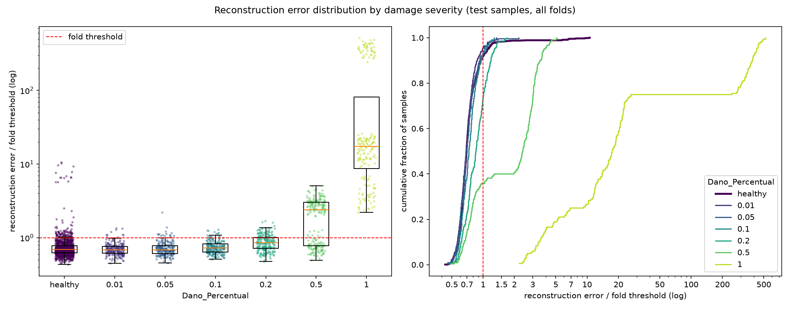

# E012: Configuração do E010 na GPU

| Campo | Valor |
|---|---|
| Status | Concluído |
| Pai (base de comparação) | [E010](../E010_nyquist-latente-4-canais/README.md) |
| Proposto em | 2026-11-09 |
| Executado em | 2026-11-09 |
| Código | commit `2b252e3` |

## 1. Motivação

**Rodar na GPU deixa os experimentos ~3× mais rápidos.** O TensorFlow 2.20 só usa GPU dentro do WSL2. Medição no notebook do autor (GTX 1650), com dados sintéticos no formato real (1260 × 1824 × 16), mediana das épocas 2–6:

| Modelo | CPU (notebook) | GPU, com determinismo |
|---|---|---|
| `[32, 32, 4]`, pools `[2, 2, 1]` (E010) | 5,6 s/época | 1,8 s/época |
| `[32, 16, 4]`, pools `[2, 2, 1]` (E011) | 4,6 s/época | 1,6 s/época |

Na outra máquina do autor, que não tem GPU NVIDIA, o E010 levou 5,2 s/época (~3 h de treino para 2112 épocas).

**A troca de dispositivo muda os números.** A GPU faz as contas em outra ordem que a CPU, e a diferença de arredondamento cresce ao longo do treino; o early stopping pode parar em outra época. Comparar um experimento rodado na GPU com um pai rodado na CPU mistura a troca de dispositivo com a mudança testada. O E011 seria o primeiro caso: o critério de adoção dele ("MSE não maior que o do E010") é sensível a diferenças pequenas.

**Ainda não há estimativa da variação entre treinos.** Todos os experimentos usaram uma única semente, então não se sabe quanto o resultado muda sem mudar nada do modelo. A diferença entre CPU e GPU com a mesma configuração dá uma primeira estimativa dessa variação.

## 2. Hipótese

> Se a configuração do E010 for treinada na GPU (com determinismo das operações ligado), então as medidas só com saudáveis ficam próximas das do E010 (mediana do MSE dos saudáveis de treino a até 10% de 0,0033), porque o modelo, os dados e a semente são os mesmos e só a aritmética muda.

## 3. Mudança em relação ao pai

| Item | E010 | E012 |
|---|---|---|
| Dispositivo | CPU (outra máquina do autor, Windows) | GPU NVIDIA GTX 1650 (notebook do autor, WSL2 Ubuntu 24.04) |
| Determinismo | Padrão da CPU (já determinística com semente fixa) | `tf.config.experimental.enable_op_determinism()`, ligado só quando há GPU |

O `config.yaml` é uma cópia exata do E010 (mesmo hash). O código ganhou duas linhas: o determinismo só na GPU (em `train_model`) e a linha `Device:` no `run.log`. Na CPU, o caminho do código não muda.

**Ambiente.** Mesmas versões travadas do `uv.lock` (TensorFlow 2.20.0, Python 3.13), mais as bibliotecas CUDA de `tensorflow[and-cuda]==2.20.0`, num ambiente separado no Ubuntu (`~/venvs/ifd-bridge-gpu`). Passos em `docs/experiments.md`, seção "Na GPU (WSL2)".

**Confundido: máquina e sistema operacional.** Além do dispositivo, mudam a máquina (notebook, e não a outra do autor) e o sistema (Linux no WSL2, e não Windows). Não dá para separar esses efeitos; todos são "trocar de ambiente de execução".

## 4. Previsões (escritas antes de rodar)

### 4.1 Critérios só com saudáveis

| Critério | E010 (CPU) | Previsão para o E012 (GPU) |
|---|---|---|
| Mediana, entre folds, do MSE médio dos saudáveis de treino | 0,0033 (0,0028–0,0047) | Entre 0,0030 e 0,0036 (±10%) |
| Diferença relativa do MSE por fold (E012 ÷ E010 − 1), mediana dos módulos | — | Até 10% |
| Canais ativos no latente | 4 de 4 em 13 folds; 3 de 4 nos folds 1 e 4 | Mediana 4 de 4; os folds com canal morto podem mudar |
| Parte não reconstruída de 16–20 Hz | 3,1% (2,7–4,4%) | Entre 2,8% e 3,4% |
| Erro do peso 0,90 ÷ outros pesos (mediana entre folds) | 1,27 (1,23–1,41) | ≈ 1,27 |
| Épocas no total | 2112 | Diferente por fold; total na mesma ordem |
| Duração do treino | ~3 h (5,2 s/época, outra máquina) | ~1h10 (1,8 s/época × ~2100 épocas, mais ~3–4 min de carregamento) |

### 4.2 Avaliação (só reporte)

Falsos negativos, FPR e AUC por severidade perto dos do E010 (FN 891, FPR 6,7%, AUC sev. 0,2 0,75). A diferença entre os dois runs nessas métricas também é registrada como variação de execução, e não como efeito de uma mudança no modelo.

### 4.3 Critério de decisão

Não há adoção: a configuração é a mesma da base. O E012 decide como comparar os próximos experimentos:
1. **Se a mediana do MSE dos saudáveis ficar a até 10% do E010:** os próximos experimentos rodam na GPU e usam o E012 como referência. A diferença medida entre E010 e E012 passa a ser a margem mínima para considerar uma mudança de MSE como efeito, e não variação de execução.
2. **Se ficar a mais de 10%:** a variação de execução é grande demais para os critérios usados até aqui (por exemplo, o "não maior" do E011). Antes de seguir, é preciso discutir com o autor como estimar essa variação (por exemplo, mais de uma semente).

Os 10% são **Arbitrário**: não há medição anterior da variação entre execuções.

## 5. Configuração e origem de cada escolha

Igual ao E010 (cópia exata do `config.yaml`); ver a seção 5 do [E010](../E010_nyquist-latente-4-canais/README.md). A única diferença é o ambiente de execução:

| Item | Valor | Origem | Justificativa / evidência |
|---|---|---|---|
| Dispositivo | GPU (GTX 1650) no WSL2 | Pedido / Medido | Pedido do autor (executar mais rápido); ~3× mais rápido com determinismo (seção 1) |
| Determinismo na GPU | Ligado | Pedido / Físico | Pedido do autor; sem ele, o cuDNN dá resultados diferentes a cada execução e a semente não basta |
| Margem de 10% (seção 4.3) | 10% | Arbitrário | Sem medição anterior da variação entre execuções |

## 6. Verificação da premissa não supervisionada

- [x] Modelo, normalização, filtros e limiar ajustados só com saudáveis do treino (configuração idêntica à do E010).
- [x] Nenhum parâmetro escolhido com danificados, métricas de teste ou AUC.
- [x] O critério de decisão usa só o MSE dos saudáveis.

## 7. Execução

Commitar esta pasta e o código antes. No terminal do Ubuntu (WSL2):

```bash
cd /mnt/c/Users/vitor/OneDrive/Documentos/GitHub/ifd-bridge-defects-detection
GIT_CONFIG_COUNT=1 GIT_CONFIG_KEY_0=core.autocrlf GIT_CONFIG_VALUE_0=true \
  ~/venvs/ifd-bridge-gpu/bin/python src/test_autoencoders.py outputs/autoencoders/E012_e010-na-gpu \
  > outputs/autoencoders/E012_e010-na-gpu/run.log 2>&1
```

A linha `Device:` do `run.log` deve dizer `GPU [...], op determinism on`. O teto é de 3000 épocas (15 folds × 200); o E010 somou 2112.

Verificações feitas antes do run (2026-11-09, no notebook):
- O ambiente do Ubuntu enxerga a GPU (`tf.config.list_physical_devices("GPU")`).
- Dois treinos seguidos com determinismo ligado (dados sintéticos, 3 épocas) deram erros idênticos.
- O carregamento completo dos dados no WSL levou ~3,5 min e chegou a 14,7 GB de pico; o limite do WSL foi aumentado para 24 GB.

**Execução real (2026-11-09), no notebook do autor (WSL2, GTX 1650):**
- Código: commit `2b252e3` (registrado no `run.log`), sem aviso de alterações pendentes em `src/`.
- `Device: GPU ['/physical_device:GPU:0'], op determinism on`. O TensorFlow reservou 2244 MB da GPU.
- Run completo, sem erros; gráfico e diagnóstico do resíduo gerados normalmente.
- Duração: de 13:50 a 14:48, **~58 min** no total (previsão: ~1h10). O treino somou 0,67 h: 1,14 s/época em média (mediana 1,0 s sem a primeira época de cada fold), mais rápido que os 1,8 s medidos com dados sintéticos. O E010 levou 5,2 s/época (~3 h de treino) na CPU da outra máquina: **~4,6× mais rápido**.
- Épocas por fold: 146, 150, 116, 150, 106, 143, 95, 129, 148, 146, 190, 187, 180, 124, 109 (2119 no total, contra 2112 no E010). O early stopping parou os 15 folds. Fold a fold, a parada mudou de −81 a +61 épocas em relação ao E010.

## 8. Resultados

### 8.1 Critérios só com saudáveis

| Critério | E010 (CPU) | Previsão | E012 (GPU) | Resultado |
|---|---|---|---|---|
| Mediana, entre folds, do MSE médio dos saudáveis de treino | 0,00334 (0,0028–0,0047) | Entre 0,0030 e 0,0036 | 0,00324 (0,0026–0,0042), −2,8% | Confirmada |
| Diferença relativa do MSE por fold, mediana dos módulos | — | Até 10% | 12,5% (máximo 42%; 10 de 15 folds acima de 10%) | Refutada |
| Canais ativos no latente | 4 de 4 em 13 folds; 3 de 4 nos folds 1 e 4 | Mediana 4 de 4 | 4 de 4 em 13 folds; 3 de 4 nos folds 1 e 4 | Confirmada (mesmos folds) |
| Parte não reconstruída de 16–20 Hz (mediana) | 3,1% (2,7–4,4%) | Entre 2,8% e 3,4% | 3,1% (2,3–4,2%) | Confirmada |
| Erro do peso 0,90 ÷ outros pesos (mediana entre folds) | 1,27 (1,23–1,41) | ≈ 1,27 | 1,28 (1,23–1,43) | Confirmada |
| Épocas no total | 2112 | Mesma ordem | 2119 | Confirmada |
| Duração | ~3 h de treino | ~1h10 | ~58 min | Confirmada |

`val_loss`: mediana do melhor valor dos 15 folds 0,0050 (0,0040–0,0061), igual ao E010 (0,0050).

**MSE por fold, E012 ÷ E010 − 1:**

| Fold | 1 | 2 | 3 | 4 | 5 | 6 | 7 | 8 | 9 | 10 | 11 | 12 | 13 | 14 | 15 |
|---|---|---|---|---|---|---|---|---|---|---|---|---|---|---|---|
| Diferença | +8% | −13% | −3% | +11% | +42% | −19% | +34% | +21% | −4% | −34% | −13% | −7% | −20% | +2% | +12% |

As diferenças se compensam (média +1%), por isso a mediana entre folds quase não mudou. A correlação entre o MSE por fold dos dois runs é −0,06: a ordem dos folds, do melhor ao pior, não se repete entre execuções.

Outras medidas, mediana dos 15 folds (E010 → E012): erro relativo 0,27% → 0,26%; energia criada fora da banda 0,02% → 0,02%; zeros no latente 29,3% → 29,5%; penalidade L1 ÷ MSE 0,38 → 0,38. Composição acima do limiar no treino, por fold (grupo das 15 / peso 0,90 / outros): 14 / 40,8 / 8,2 nos dois.

### 8.2 Métricas globais

| Métrica | E010 (CPU) | E012 (GPU) | Δ |
|---|---|---|---|
| Acurácia | 0,6301 ± 0,0205 | 0,6256 ± 0,0219 | −0,0045 |
| Recall | 0,3172 ± 0,0889 | 0,3226 ± 0,1029 | +0,0054 |
| FPR | 0,0674 (91) | 0,0815 (110) | +0,0141 |
| AUC agregada | 0,6600 | 0,6657 | +0,0057 |
| Matriz de confusão | TN 1259 · FP 91 · FN 891 · TP 414 | TN 1240 · FP 110 · FN 884 · TP 421 | |

Das 2655 passagens de teste, 52 (2,0%) mudaram de decisão (alarme ou não) entre os dois runs. A correlação do log do erro de teste entre os runs é 0,985.

### 8.3 Por severidade

| Severidade | n | Recall E010 | Recall E012 | AUC E010 | AUC E012 | FN E010 | FN E012 | Erro mediano danificado ÷ saudável (E010 / E012) |
|---|---|---|---|---|---|---|---|---|
| 0,01 | 225 | 0,031 | 0,044 | 0,456 | 0,469 ± 0,063 | 218 | 215 | 0,98 / 0,99 |
| 0,05 | 225 | 0,062 | 0,067 | 0,499 | 0,493 ± 0,049 | 211 | 210 | 1,01 / 0,99 |
| 0,10 | 225 | 0,062 | 0,067 | 0,598 | 0,603 ± 0,068 | 211 | 210 | 1,07 / 1,07 |
| 0,20 | 225 | 0,240 | 0,253 | 0,746 | 0,750 ± 0,065 | 171 | 168 | 1,26 / 1,24 |
| 0,50 | 225 | 0,644 | 0,640 | 0,846 | 0,854 ± 0,056 | 80 | 81 | 3,72 / 3,87 |
| 1,00 | 180 | 1,000 | 1,000 | 0,998 | 0,998 ± 0,004 | 0 | 0 | 26,2 / 27,0 |

FPR por peso de vagão do fold: 0,90 (folds 10–12) 16%–44% (E010: 10%–39%); demais pesos 0%–6% nos dois runs. Os folds 10–12 têm 86 dos 110 falsos positivos (E010: 68 de 91). O grupo irregularidade 2 × módulo 0,975 gerou os mesmos 15. FPR na irregularidade 1: 7,2% (E010: 5,8%).

### 8.4 Distribuição dos erros



## 9. Análise

**Hipótese (seção 2): confirmada no agregado, refutada fold a fold.** A mediana do MSE dos saudáveis mudou só 2,8% (0,00334 → 0,00324), e todas as medianas de espectro, latente e peso 0,90 ficaram praticamente iguais. Mas cada fold, isoladamente, mudou de −34% a +42%, e a ordem dos folds não se repetiu (correlação −0,06). O mecanismo provável é o early stopping: com arredondamentos diferentes, cada fold parou numa época diferente (−81 a +61 épocas), e o MSE de um fold depende de onde ele parou.

**Consequências para os experimentos anteriores:**
- **Comparações fold a fold não são confiáveis.** Diferenças de MSE de até ~40% num fold podem ser só variação de execução. Isso explica o fold 1 "atípico" do E008 (13º de 15) e do E009 (1º de 15): era, em boa parte, variação de execução, e não uma característica do fold. As conclusões tiradas só do fold 1 (E003–E009) já estavam marcadas como limitadas; este resultado reforça isso.
- **A mediana entre folds é estável.** As comparações de MSE dos saudáveis entre experimentos usaram a mediana dos 15 folds. As diferenças que levaram a adoções eram bem maiores que os 2,8% medidos aqui: E007 −35%, E008 −13%, E009 +13%, E010 −51%. A do E008 (−13%) é a menor, cerca de 4,6× a variação medida.
- **Canais mortos são do fold, não da execução.** Os folds 1 e 4 perderam um canal nos dois runs. A morte de canais parece depender dos dados do fold, e não do acaso do treino.
- **Métricas de detecção têm uma margem de ruído.** Só por trocar de dispositivo, o FPR mudou 1,4 ponto (91 → 110 FP, quase todo nos folds 10–12), os falsos negativos mudaram 7 (891 → 884) e a AUC por severidade mudou até 0,013. Diferenças dessa ordem entre experimentos, como os FN 884 → 891 do E010 ou parte da queda de FPR do E008 para o E010 (10,2% → 6,7%), não devem ser lidas como efeito da mudança testada.

**A margem para o E011.** Pela seção 4.3 do E011, a margem é a diferença entre as medianas do E010 e do E012: 0,00010 (3%). O critério 1 do E011 fica: mediana do MSE dos saudáveis ≤ 0,00324 + 0,00010 = **0,00334**. Essa margem vem de um único par de execuções. A variação fold a fold (12,5% de mediana) sugere que a mediana de 15 folds pode variar mais que 3% em outras execuções; a estimativa é otimista.

**Velocidade.** O run completo levou ~58 min, ~4,6× mais rápido por época que a CPU da outra máquina.

## 10. Decisão e próximos passos

- **Critério da seção 4.3: caso 1.** A mediana do MSE dos saudáveis ficou a 2,8% do E010, dentro dos 10%.
- **Decisão:** os próximos experimentos rodam na GPU e usam o E012 como referência numérica. A base de configuração continua sendo a do E010 (o E012 é a mesma configuração). Margem de variação de execução para a mediana do MSE dos saudáveis: 0,00010 (3%), com a ressalva da seção 9.
- **Comparações fold a fold** (MSE de um fold, medidas só do fold 1) deixam de ser usadas como evidência de efeito.
- **Variantes avaliadas nos folds de teste até aqui:** 11 (E001–E010 e E012; o E012 repete a configuração do E010, mas também foi avaliado nos folds de teste).

Próximos passos possíveis:
- **E011** já está rodando na GPU; o critério dele usa a margem acima.
- **Variação entre sementes.** Rodar a configuração base com 2 ou 3 sementes diferentes na GPU (~1 h cada) daria uma margem mais confiável que um único par CPU × GPU. A decisão é do autor.

## Notas posteriores
