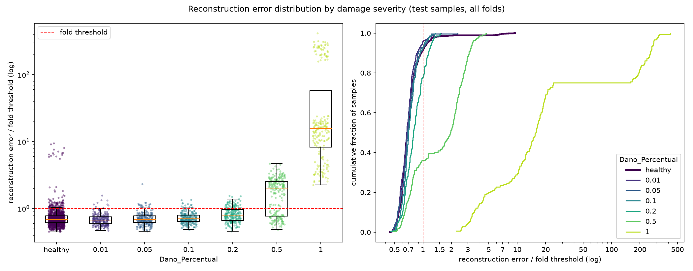

# E013: Kernel de 65 amostras na primeira camada do encoder

| Campo | Valor |
|---|---|
| Status | Concluído (não adotado) |
| Pai (base de comparação) | [E010](../E010_nyquist-latente-4-canais/README.md) (configuração); [E012](../E012_e010-na-gpu/README.md) (mesma configuração na GPU, referência numérica) |
| Proposto em | 2026-11-09 |
| Executado em | 2026-11-09 |
| Código | commit `0355d1e` |

## 1. Motivação

**A primeira camada vê uma janela curta demais para os modos.** Todas as convoluções usam kernel de 19 amostras desde o E004, escolhido para que o campo receptivo do encoder inteiro cobrisse 2 períodos do modo de ~4 Hz. Cada filtro da primeira camada, sozinho, vê só 19 amostras (74 ms):
- O modo de ~4 Hz tem período de 250 ms (64 amostras); o filtro cobre ~0,3 período dele.
- Um filtro de N amostras separa frequências com resolução da ordem de fs ÷ N. Com 19 amostras, ~13 Hz: um filtro da primeira camada não consegue isolar os picos modais medidos nos saudáveis (4; 12,5; 14 Hz), nem pequenos deslocamentos deles.
- Com 65 amostras (0,25 s, 1 período do modo de ~4 Hz), a resolução fica em ~4 Hz. A primeira camada passa a poder formar filtros seletivos por faixa, que separam os modos.

Um dano por perda de rigidez muda as frequências e as formas modais. Uma primeira camada que separa os modos é uma representação mais próxima da física do problema. Isso é raciocínio físico; não há medição de que o dano apareça assim nestes dados, e ela não deve ser feita com os danificados antes da avaliação.

**Literatura (pesquisada a pedido do autor).**
- O [WDCNN (Zhang et al., 2017)](https://pmc.ncbi.nlm.nih.gov/articles/PMC5336047/), referência para vibração bruta, usa um kernel largo na primeira camada e kernels pequenos nas seguintes. Os filtros aprendidos na primeira camada ficaram concentrados em uma ou duas frequências cada.
- [Hudson et al. (2024)](https://arxiv.org/abs/2411.15191) fizeram busca em grade em sete bases de rolamentos: o kernel da primeira camada foi o hiperparâmetro mais influente e o mais sensível à base de dados. Eles recomendam ajustá-lo primeiro. Nenhum dos dois trata de autoencoders nem de monitoramento estrutural.

**Por que só a primeira camada.** As camadas seguintes operam sobre sinais já reduzidos no tempo e já cobrem, juntas, o campo receptivo necessário. Mudar só a primeira camada é a mudança que a literatura acima isola.

## 2. Hipótese

> Se a primeira convolução do encoder passar de 19 para 65 amostras (1 período do modo de ~4 Hz), mantendo todas as outras camadas, então o erro dos saudáveis não aumenta e a distribuição do erro dos saudáveis não fica mais larga (razão p95 ÷ mediana), porque a primeira camada passa a ter resolução de ~4 Hz, suficiente para separar os modos da banda de 1–20 Hz.

## 3. Mudança em relação ao pai

| Item | E010 / E012 | E013 |
|---|---|---|
| Kernel da primeira convolução do encoder | 19 | 65 (`first_kernel_size`) |
| Demais convoluções (encoder, decoder e saída) | 19 | 19 (sem mudança) |

**Mudança de código.** Nova chave opcional `first_kernel_size` em `src/autoencoders_pipeline.py`; quando ausente, vale `kernel_size`, então os configs anteriores constroem exatamente o mesmo modelo. O `test_autoencoders.py` passa a registrar `first_kernel` na linha de hiperparâmetros do `run.log`.

**Por que 65, e não 64.** 65 amostras cobrem 64 intervalos, exatamente 0,25 s. Um kernel ímpar fica centrado na amostra de saída, como o de 19.

**Efeitos confundidos:**
- **Mais parâmetros.** A primeira convolução passa de 19 × 16 × 32 + 32 = 9760 para 65 × 16 × 32 + 32 = 33.312 parâmetros. O modelo vai de 63.688 para **87.240** (+37%; conferido com `build_model`).
- **Campo receptivo maior.** O encoder passa de 130 para **176 amostras** (0,69 s), mesma fórmula do E004.
- **Encoder e decoder com kernels diferentes.** O decoder continua com kernel 19 em todas as camadas. Ele já não era um espelho exato antes (tem 4 convoluções contra 3 do encoder, em outras resoluções); a camada que faz o papel inverso da primeira do encoder é a convolução de saída (32 → 16 canais, a 1824 instantes), que fica com 19.

Se o resultado mudar, não dá para separar a resolução em frequência da primeira camada desses três efeitos.

**Custo.** A primeira convolução roda em 1824 instantes e fica ~3,4× mais cara. O custo por época não foi medido; deve ficar acima de 1,14 s (E012).

## 4. Previsões (escritas antes de rodar)

### 4.1 Critérios só com saudáveis

A referência é o E012 (GPU). O E010 (CPU) aparece como contexto.

| Critério | E010 (CPU) | E012 (GPU, referência) | Previsão para o E013 |
|---|---|---|---|
| Mediana, entre folds, do MSE médio dos saudáveis de treino | 0,00334 | 0,00324 (0,0026–0,0042) | Igual ou menor (≤ 0,00334) |
| Razão p95 ÷ mediana do erro dos saudáveis (mediana entre folds) | 1,547 | 1,568 (1,499–1,689) | Sem previsão de direção |
| Parte não reconstruída de 16–20 Hz (mediana) | 3,1% | 3,1% (2,3–4,2%) | Sem previsão de direção |
| Energia criada fora da banda, relativa à entrada | 0,02% | 0,02% | Sem previsão |
| Canais ativos no latente | 3 de 4 nos folds 1 e 4 | 3 de 4 nos folds 1 e 4 | Sem previsão |
| Erro do peso 0,90 ÷ outros pesos (mediana entre folds) | 1,27 | 1,28 | ≈ 1,3 |
| Folds parados pelo early stopping | 15 de 15 | 15 de 15 | Maioria |

O `val_loss` usa o mesmo coeficiente L1 do E012 e pode ser comparado diretamente.

### 4.2 Avaliação (só reporte)

Sem previsão de direção para a AUC e os falsos negativos. Se a primeira camada separar melhor os modos, a severidade 0,2 é a mais provável de mudar (hoje 168 FN e AUC 0,75 no E012). Severidades até 0,05 devem continuar com AUC ≈ 0,5. Diferenças de FN da ordem de 7 e de AUC da ordem de 0,013 estão dentro do ruído de execução medido no E012.

### 4.3 Critério de adoção

Decidido pelo autor antes do run: adotar `first_kernel_size = 65` na base se as **duas** condições valerem.
1. A mediana, entre folds, do MSE médio dos saudáveis de treino for ≤ 0,00324 + 0,00010 = **0,00334** (valor do E012 mais a margem de variação de execução entre E010 e E012).
2. A mediana, entre folds, da razão p95 ÷ mediana do erro dos saudáveis de treino for ≤ 1,568 + 0,021 = **1,589** (mesmo método: valor do E012 mais a diferença entre E010 e E012).

Canais ativos são reportados, mas não entram no critério.

**Por que as duas.** O MSE sozinho tende a premiar mais capacidade (e este modelo tem 37% mais parâmetros); a razão p95 ÷ mediana impede que a adoção alargue a distribuição dos saudáveis, que define o limiar.

**Limite conhecido do critério.** Nenhuma das duas medidas diz quanto o dano aumenta o erro: o E011 passou na razão e piorou a separação. As margens vêm de um único par de execuções e são otimistas. A métrica de teste é só reportada e não decide.

## 5. Configuração e origem de cada escolha

Igual ao E010, exceto a linha marcada.

| Parâmetro | Valor | Origem | Justificativa / evidência |
|---|---|---|---|
| `nodes_to_use` | 8 nós (10654, 10659, 10664, 10669, 10658, 10663, 10668, 10673) | Herdado / Pedido | Mesmos nós dos pipelines OCSVM e Isolation Forest, para comparação direta |
| `axes_to_use` | X, Y | Herdado / Pedido | Idem |
| `filter_type`, `cutoff_low`, `cutoff_high` | Passa-banda 1–20 Hz (Butterworth ordem 4, `filtfilt`) | Medido / Físico | Ver E003 |
| Ordem filtro/recorte | Filtra o registro completo, depois recorta | Físico | Ver E003 |
| Comprimento do sinal | Recorte em 1824 amostras (7,12 s) | Medido / Físico | Ver E001 |
| Normalização | Padronização por canal, só com saudáveis do treino | Físico / premissa | Ver E003 |
| Seleção de features | Nenhuma | Físico | Colunas são instantes de tempo |
| `pool_sizes` | `[2, 2, 1]` | Físico / Medido | Adotado no E010 |
| `encoder_filters` | `[32, 32, 4]` | Arbitrário / controle | Adotado no E004; o E011 (`[32, 16, 4]`) não foi adotado |
| `kernel_size` | 19 (todas as convoluções, exceto a primeira) | Físico (heurística) | Adotado no E004 |
| ★ `first_kernel_size` | 65 | Pedido / Físico | Pedido do autor (kernel maior na primeira camada). 65 amostras = 1 período do modo de ~4 Hz, resolução de ~4 Hz (seção 1). A escolha de 1 período, e não 2, é Arbitrária |
| `l1_activity` | 1e-5 | Pedido / Arbitrário | Adotado no E008 |
| Ativações e camadas | ReLU; saída linear; `UpSampling1D` + Conv | Convenção | Ver E001 |
| `learning_rate` | 1e-3 (Adam) | Convenção | Padrão do Adam |
| `epochs` | 200 | Medido / Pedido | Adotado no E006, com early stopping |
| `early_stopping_patience` | 10 (com `restore_best_weights`) | Convenção | Valor comum |
| `batch_size` | 32 | Convenção | Valor comum |
| `validation_split` | 0,1, após embaralhar os saudáveis | Convenção | Ver E001 |
| Score de anomalia | MSE médio sobre 1824 × 16 | Convenção | Não inclui a penalidade |
| Regra do limiar | Percentil 95 do erro dos saudáveis de treino de cada fold | Pedido / Medido | Adotada no E005 (α = 5%) |
| `random_state` | 42 | Convenção | Semente fixa |
| Dispositivo | GPU (GTX 1650, WSL2), determinismo ligado | Pedido | Referência E012 |

## 6. Verificação da premissa não supervisionada

- [x] Modelo, normalização, filtros e limiar ajustados só com saudáveis do treino.
- [x] Nenhum parâmetro escolhido com danificados, métricas de teste ou AUC. O kernel de 65 vem do período do modo de ~4 Hz medido na PSD dos saudáveis e da literatura.
- [x] Os dois critérios de adoção usam só saudáveis.

## 7. Execução

Commitar o código e esta pasta antes. No terminal do Ubuntu (WSL2):

```bash
cd /mnt/c/Users/vitor/OneDrive/Documentos/GitHub/ifd-bridge-defects-detection
GIT_CONFIG_COUNT=1 GIT_CONFIG_KEY_0=core.autocrlf GIT_CONFIG_VALUE_0=true \
  ~/venvs/ifd-bridge-gpu/bin/python src/test_autoencoders.py outputs/autoencoders/E013_kernel-primeira-camada-65 \
  > outputs/autoencoders/E013_kernel-primeira-camada-65/run.log 2>&1
```

O `run.log` deve mostrar `Device: GPU [...], op determinism on` e `first_kernel=65` na linha de hiperparâmetros. O teto é de 3000 épocas (15 folds × 200); o E012 somou 2119 em ~58 min. Este run deve levar um pouco mais (seção 3).

**Execução real (2026-11-09), no notebook do autor (WSL2, GTX 1650):**
- Código: commit `0355d1e` (registrado no `run.log`), sem aviso de alterações pendentes em `src/`.
- `Device: GPU ['/physical_device:GPU:0'], op determinism on`; linha de hiperparâmetros com `kernel=19, first_kernel=65`. O modelo construído tem 87.240 parâmetros (conferido com `build_model` antes do run).
- O encoder e o decoder ficaram com kernels diferentes (kernel 65 só na primeira convolução do encoder), como proposto na seção 3.
- Run completo, sem erros; gráfico e diagnóstico do resíduo gerados normalmente.
- Duração: de 16:36 a 17:32, **~56 min**. Treino: 0,83 h, 1,51 s/época em média (E012: 1,14 s, +32%).
- Épocas por fold: 151, 132, 135, 167, 143, 110, 141, 113, 96, 108, 145, 180, 127, 100, 130 (1978 no total, contra 2119 no E012). O early stopping parou os 15 folds.

## 8. Resultados

A referência numérica é o E012 (mesma configuração do E010, na GPU).

### 8.1 Critérios só com saudáveis

| Critério | E012 (GPU, referência) | Previsão | E013 | Resultado |
|---|---|---|---|---|
| Mediana, entre folds, do MSE médio dos saudáveis de treino (critério 1) | 0,00324 (0,0026–0,0042) | ≤ 0,00334 | 0,00354 (0,0027–0,0044), +9% | Refutada; critério 1 falha |
| Razão p95 ÷ mediana do erro dos saudáveis (critério 2) | 1,568 (1,499–1,689) | Sem previsão; limite ≤ 1,589 | 1,599 (1,461–1,670) | Critério 2 falha (por 0,010) |
| Parte não reconstruída de 16–20 Hz (mediana) | 3,1% (2,3–4,2%) | Sem previsão | 3,3% (2,7–4,0%) | — |
| Energia criada fora da banda, relativa à entrada | 0,02% | Sem previsão | 0,02% | — |
| Canais ativos no latente | 3 de 4 nos folds 1 e 4; 4 de 4 nos outros | Sem previsão | 3 de 4 nos folds 9, 10 e 11; 4 de 4 nos outros | — |
| Zeros no latente (mediana) | 29,5% | — | 37,4% (32,8–45,8%) | — |
| Penalidade L1 ÷ MSE (mediana) | 0,38 | — | 0,40 (0,37–0,45) | — |
| Erro do peso 0,90 ÷ outros pesos (mediana entre folds) | 1,28 (1,23–1,43) | ≈ 1,3 | 1,27 (1,24–1,34) | Confirmada |
| Folds parados pelo early stopping | 15 de 15 | Maioria | 15 de 15 | Confirmada |

`val_loss`, mesmo coeficiente L1, comparável: mediana do melhor valor 0,0053 (0,0041–0,0068), contra 0,0050 no E012 (+6%).

A diferença de MSE (+9%) é cerca de 3 vezes a variação de execução medida no E012 (2,8%). A diferença da razão (+0,031) é cerca de 1,5 vez a variação de execução da razão (0,021).

Parte não reconstruída por faixa, mediana dos 15 folds:

| Faixa (Hz) | 0–1 | 1–4 | 4–8 | 8–12 | 12–16 | 16–20 |
|---|---|---|---|---|---|---|
| E012 | 0,48% | 0,27% | 0,29% | 0,13% | 0,37% | 3,1% |
| E013 | 0,48% | 0,30% | 0,30% | 0,16% | 0,39% | 3,3% |

Erro relativo total: 0,26% → 0,29%.

Composição acima do limiar no treino, por fold (grupo das 15 / peso 0,90 / outros): 14 / 40,3 / 8,7 (E012: 14 / 40,8 / 8,2).

### 8.2 Métricas globais

| Métrica | E012 (GPU) | E013 |
|---|---|---|
| Acurácia | 0,6256 ± 0,0219 | 0,6222 ± 0,0171 |
| Recall | 0,3226 ± 0,1029 | 0,3188 ± 0,1094 |
| FPR | 0,0815 (110) | 0,0844 (114) |
| AUC agregada | 0,6657 | 0,6490 |
| Matriz de confusão | TN 1240 · FP 110 · FN 884 · TP 421 | TN 1236 · FP 114 · FN 889 · TP 416 |

### 8.3 Por severidade

| Severidade | n | Recall E012 | Recall E013 | AUC E012 | AUC E013 | FN E012 | FN E013 | Erro mediano danificado ÷ saudável (E012 / E013) |
|---|---|---|---|---|---|---|---|---|
| 0,01 | 225 | 0,044 | 0,040 | 0,469 | 0,444 ± 0,046 | 215 | 216 | 0,99 / 0,98 |
| 0,05 | 225 | 0,067 | 0,071 | 0,493 | 0,487 ± 0,045 | 210 | 209 | 0,99 / 0,99 |
| 0,10 | 225 | 0,067 | 0,076 | 0,603 | 0,577 ± 0,060 | 210 | 208 | 1,07 / 1,04 |
| 0,20 | 225 | 0,253 | 0,222 | 0,750 | 0,708 ± 0,068 | 168 | 175 | 1,24 / 1,16 |
| 0,50 | 225 | 0,640 | 0,640 | 0,854 | 0,852 ± 0,051 | 81 | 81 | 3,87 / 2,75 |
| 1,00 | 180 | 1,000 | 1,000 | 0,998 | 0,998 ± 0,004 | 0 | 0 | 27,0 / 23,2 |

FPR por peso de vagão do fold: 0,90 (folds 10–12) 16%–43%; demais pesos 0%–13% (o máximo é o fold 7, peso 1,10 × módulo 0,975). Os folds 10–12 têm 82 dos 114 falsos positivos. O grupo irregularidade 2 × módulo 0,975 gerou os mesmos 15. FPR na irregularidade 1: 7,5% (E012: 7,2%).

### 8.4 Distribuição dos erros



## 9. Análise

**Hipótese (seção 2): refutada.** Com 37% mais parâmetros, o modelo reconstruiu um pouco pior os saudáveis (+9% de MSE, ~3 vezes a variação de execução) e a distribuição do erro dos saudáveis ficou um pouco mais larga (razão 1,568 → 1,599). A perda subiu levemente em todas as faixas, sem concentrar em nenhuma. A resolução de ~4 Hz da primeira camada não trouxe ganho de reconstrução que o MSE ou o espectro do resíduo mostrem.

**Por que mais parâmetros não reduziram o erro.** Não foi verificado. Uma explicação possível: um filtro de 0,25 s responde ao conteúdo médio de um trecho longo e suaviza variações rápidas, e as camadas seguintes precisam recuperar esse detalhe; outra, mais simples, é que o otimizador encontra uma solução pior com o kernel maior nas mesmas 200 épocas. Não há medida neste run que separe as duas.

**Os canais mortos mudaram de fold.** No E012, os folds 1 e 4 tinham um canal morto (nos dois runs com a configuração do E010); no E013, foram os folds 9, 10 e 11. A morte de canais depende da combinação de dados e arquitetura, e não só dos dados do fold.

**Avaliação (seção 4.2): só reporte.** A separação entre danificados e saudáveis piorou: o erro mediano da severidade 0,5 caiu de 3,87× para 2,75× o dos saudáveis, e o da 0,2, de 1,24× para 1,16×. A AUC da severidade 0,2 caiu de 0,750 para 0,708 (−0,042, cerca de 3 vezes o ruído de execução de 0,013); a da 0,5 ficou igual. Os falsos negativos mudaram pouco (884 → 889), dentro do ruído.

**Folds 10–12 (peso 0,90), diagnóstico de avaliação.** Como em todos os experimentos desde o E004, esses folds têm o maior recall (41–60%) e também o maior FPR (16–43%). O motivo não é detectar melhor: os saudáveis de teste do peso 0,90 têm erro ~1,36 vez maior que os saudáveis de treino do mesmo fold (nos outros pesos, ~1,04), então o limiar fica perto da mediana dos saudáveis de teste (1,11–1,32×, contra 1,20–1,79× nos outros folds) e mais passagens de qualquer tipo passam dele. A AUC desses folds é a mais baixa (0,61–0,67), e o recall menos o FPR fica abaixo dos outros (0,16–0,26, contra 0,21–0,29).

## 10. Decisão e próximos passos

- **Critério da seção 4.3: não atendido.** O critério 1 falhou (MSE 0,00354 > 0,00334) e o critério 2 também (razão 1,599 > 1,589).
- **Decisão: não adotada.** A base continua sendo a configuração do E010, com o E012 como referência numérica na GPU.
- **Kernel 65 também na convolução de saída** (variante simétrica, discutida antes do run): sem motivação, já que a versão só no encoder não melhorou a reconstrução.
- **Variantes avaliadas nos folds de teste até aqui:** 13 (E001–E013).

Com E011 e E013, as duas mudanças de arquitetura restantes que tinham motivação própria pioraram a reconstrução dos saudáveis. O eixo de compressão e arquitetura está esgotado para os critérios só com saudáveis disponíveis. Os caminhos que atacam a causa principal dos falsos negativos (variação das condições operacionais no erro, dano pequeno) são os reservados pelo autor: limiar ou normalização por condição operacional, e entrada espectral (PSD).

## Notas posteriores
