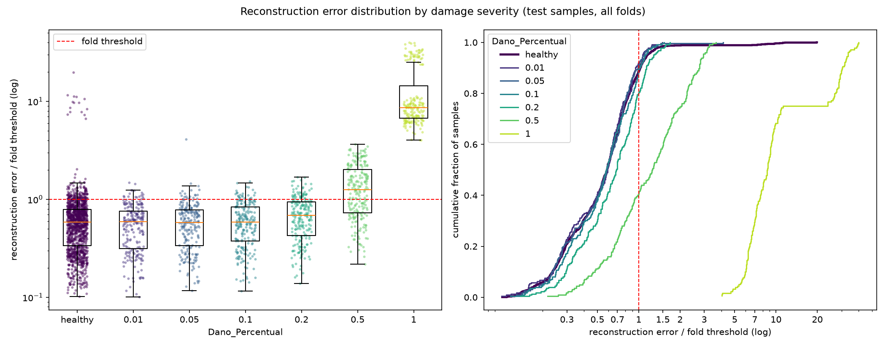

# E014: Entrada no domínio da frequência (log-PSD por canal)

| Campo | Valor |
|---|---|
| Status | Concluído (não adotado) |
| Pai (base de comparação) | [E010](../E010_nyquist-latente-4-canais/README.md) (configuração); [E012](../E012_e010-na-gpu/README.md) (mesma configuração na GPU, referência numérica) |
| Proposto em | 2026-11-09 |
| Executado em | 2026-11-09 |
| Código | commit `24a9613` (o run partiu de `f4217f6` com alterações pendentes em `src/`, commitadas 2 s depois; ver seção 7) |

## 1. Motivação

**O eixo de arquitetura está esgotado.** Com E011 e E013, as duas mudanças de arquitetura que tinham motivação própria pioraram a reconstrução dos saudáveis. Os falsos negativos que restam vêm de o dano mudar pouco o erro e de a variação das condições operacionais definir o limiar, e não da compressão. O autor decidiu mudar a representação da entrada para o domínio da frequência: log-PSD por canal (representação A), modelo Conv1D (o mesmo `build_model`).

**Exploração só com saudáveis** (`psd_exploration.txt`, 1350 passagens saudáveis, mesmo pré-processamento do E012). "Combinação" é velocidade × peso × módulo × irregularidade; η² é a fração da variação explicada por um fator.

**1. A PSD remove a maior fonte de variação entre passagens da mesma condição.**

| Medida (irregularidade 1, 45 combinações de 29 passagens) | Tempo (amostras brutas) | log-PSD (nperseg 512) |
|---|---|---|
| η² da combinação (mediana entre colunas) | 0,124 | 0,993 |
| Dispersão dentro da combinação (desvio-padrão, mediana) | — | 0,16 dB |

No tempo, só 12% da variação de cada amostra é explicada pela condição operacional, porque cada simulação tem um atraso aleatório de até ~130 ms que embaralha a comparação instante a instante. A PSD descarta a fase: 99,3% da variação de cada frequência é explicada pela condição operacional, e passagens da mesma condição diferem em ~0,16 dB.

**2. A velocidade domina o espectro.** η² da velocidade por frequência: mediana 0,91 (0,75–0,96 entre faixas); peso 0,008; módulo 0,003; irregularidade 0,001. A energia total por canal no tempo já era dominada pela velocidade (η² 0,75 do log-RMS).

**3. Picos e resolução.**
- Picos do espectro médio: 10,5 Hz (o maior), 4,0 Hz (−4,3 dB), 12,5 Hz (−6,3 dB), 6,0 Hz, 9,0 Hz e 14,0 Hz.
- O pico de 10,5 Hz aparece nas três velocidades; os outros mudam de posição ou de ordem entre velocidades (3,5–4,0 Hz, 6,0–6,5 Hz).
- Largura: o pico de 4 Hz tem 5 frequências a menos de 3 dB do máximo; o de 10,5 Hz, 3. A janela de Hann com 512 amostras tem lóbulo principal de 4 frequências (2 Hz).

**4. O espectro enxerga a mudança global de rigidez no modo de ~4 Hz.** Por interpolação parabólica dos espectros médios por módulo de elasticidade, o pico de ~4 Hz vai de 3,981 Hz (módulo 0,975) a 4,046 Hz (1,000) e 4,106 Hz (1,025): +3,1% de ponta a ponta, perto dos +2,5% previstos por f ∝ √E. Os picos de 10,5 Hz e 12,5 Hz não se deslocam com o módulo (10,49 e 12,43 Hz nos três). Possível explicação, não verificada: esses dois picos vêm do veículo ou da excitação, e não da rigidez da ponte. Consequência: a variação de rigidez considerada saudável (módulo ±2,5%) e uma perda de rigidez por dano podem mexer no mesmo pico, e o mascaramento continua possível.

**5. O peso 0,90 é o mais distante no espectro.** Distância RMS do espectro médio de cada peso ao do peso 1,00: 0,90 → 1,69 dB; 0,95 → 0,82; 1,05 → 0,48; 1,10 → 1,03. É coerente com o peso 0,90 ser o mais difícil desde o E004.

**6. O grupo irregularidade 2 × módulo 0,975 continua discrepante.** Ele fica a 4,45 dB da média das passagens de irregularidade 1 da mesma combinação, contra 0,32–0,47 dB nos outros módulos e 0,36 dB de uma passagem de irregularidade 1 até a média da própria combinação (~12×). Deve continuar dominando a cauda do erro dos saudáveis.

**Escolha da resolução (nperseg).** Medida só com saudáveis, dispersão dentro da combinação:

| nperseg | Frequências em 1–20,5 Hz | Resolução | Dispersão (mediana) |
|---|---|---|---|
| 256 | 20 | 1,0 Hz | 0,136 dB |
| **512** | **40** | **0,5 Hz** | **0,159 dB** |
| 1024 | 79 | 0,25 Hz | 0,244 dB |

512 dobra a resolução de 256 com +17% de dispersão; 1024 tem só 2 segmentos de Welch no trecho de 1824 amostras e +54% de dispersão.

**Literatura.** Não foi pesquisada para este registro; a escolha da representação seguiu a discussão com o autor (PSD é a entrada espectral mais comum em monitoramento estrutural baseado em vibração, por conhecimento geral).

## 2. Hipótese

> Se a entrada do autoencoder passar a ser o log10 da PSD de Welch de cada canal (1,0–20,5 Hz, resolução de 0,5 Hz), trocando só os hiperparâmetros que dependem do eixo de entrada, então a distribuição do erro dos saudáveis não fica mais larga que no E012 (razão p95 ÷ mediana ≤ 1,589), porque a PSD descarta o atraso aleatório entre simulações e é quase toda determinada pelas condições operacionais (η² da combinação 0,993, contra 0,124 nas amostras no tempo), o que deixa ao modelo uma variação mais regular para reproduzir.

## 3. Mudança em relação ao pai

| Item | E012 | E014 |
|---|---|---|
| Entrada | Sinal filtrado no tempo, 1824 × 16 = 29.184 valores | log10 da PSD de Welch (nperseg 512, Hann, 50% de sobreposição) de cada canal, 1,0–20,5 Hz: 40 × 16 = 640 valores |
| `kernel_size` | 19 amostras (74 ms) | 5 frequências (2,5 Hz) |
| `pool_sizes` | `[2, 2, 1]` sobre o tempo (1824 → 456) | `[2, 2, 1]` sobre a frequência (40 → 10) |
| Latente | 456 × 4 = 1824 valores | 10 × 4 = 40 valores |
| Compressão (entrada ÷ latente) | 16× | 16× (igual) |
| Parâmetros | 63.688 | 16.872 (conferido com `build_model`) |
| Campo receptivo do encoder | 130 amostras (0,51 s) | 32 frequências (16 Hz, 80% do eixo) |

**Mudanças de código** (em `src/autoencoders_pipeline.py` e `src/test_autoencoders.py`; a classe base não muda):
- Chaves novas no config: `input_domain` (`"time"`, padrão, ou `"psd"`), `psd_nperseg` e `psd_band`. Configs anteriores constroem a mesma entrada e o mesmo modelo de antes (conferido: E012 continua com 29.184 colunas e 63.688 parâmetros).
- `log_psd`: transformação fixa, sem nada ajustado aos dados, aplicada depois do filtro e do recorte. Colunas `{eixo}_N{nó}_f{Hz}`.
- Diagnóstico do resíduo com PSD: `residual_by_frequency` mede o MSE de cada faixa (`mse_<faixa>`), em unidades do log-PSD padronizado, em vez de aplicar Welch ao resíduo. Medidas do latente iguais às de antes.
- Verificação: `src/check_residual_spectrum.py` passou a conferir também `log_psd` (senos de 10 e 5 Hz geram picos nas frequências certas, com a potência do seno) e `residual_by_frequency`. Um teste curto com dados reais (só `v2_healthy`, 3 épocas, sem teste) rodou de ponta a ponta.

**O que se mantém.** Nós, eixos, passa-banda de 1–20 Hz antes da PSD (evita vazamento da faixa de 64–128 Hz pelos lóbulos laterais da janela), o mesmo trecho de 1824 amostras, a padronização por canal só com saudáveis de treino, filtros `[32, 32, 4]`, L1 1e-5, limiar no percentil 95, épocas e early stopping.

**Efeitos confundidos (inevitáveis na troca de domínio):**
- **Kernel.** O kernel de 19 cobriria 9,5 Hz, metade do espectro; 5 frequências corresponde à largura de um pico (seção 1). A troca de kernel não pode ser separada da troca de domínio.
- **Capacidade.** O modelo tem 74% menos parâmetros e o latente tem 40 valores, embora a compressão continue em 16×.
- **Informação no tempo.** A PSD descarta quando, durante a passagem, cada frequência aparece. Um dano que muda a resposta só num trecho da passagem fica diluído no espectro do trecho inteiro.
- **O que o erro mede.** O score continua sendo o MSE, agora entre espectros em log padronizados (equivale a uma razão de potências por frequência). Ele não é comparável com o MSE no tempo.

## 4. Previsões (escritas antes de rodar)

### 4.1 Critérios só com saudáveis

A referência é o E012 (GPU). Medidas com unidade (MSE) não são comparáveis entre os domínios e são só reportadas.

| Critério | E012 (tempo, GPU) | Previsão para o E014 |
|---|---|---|
| Razão p95 ÷ mediana do erro dos saudáveis de treino (mediana entre folds; critério) | 1,568 (1,499–1,689) | ≤ 1,589 |
| MSE dos saudáveis de treino e MSE por faixa | 0,00324 (outra unidade) | Reportado, sem comparação |
| η² do erro dos saudáveis: velocidade / peso / módulo / irregularidade | 0,043 / 0,125 / 0,089 / 0,173 | Sem previsão de direção |
| Erro do peso 0,90 ÷ outros pesos (mediana entre folds) | 1,28 | Continua acima de 1 (o peso 0,90 é o mais distante no espectro) |
| Grupo irregularidade 2 × módulo 0,975 acima do limiar no treino, por fold | 14 | ~14 (o grupo fica ~12× mais longe que a dispersão normal) |
| Canais ativos no latente | 3 de 4 nos folds 1 e 4 | Sem previsão |
| Folds parados pelo early stopping | 15 de 15 | Maioria |

### 4.2 Avaliação (só reporte)

Sem previsão de direção para a AUC e os falsos negativos. Há dois cenários:
- **O espectro expõe pequenas mudanças de rigidez:** o pico de ~4 Hz se desloca de forma mensurável com ±2,5% de rigidez global (seção 1), e a dispersão dentro da condição operacional é de só ~0,16 dB. Se o dano local mexer nos picos mais que isso, a separação das severidades 0,1–0,2 melhora.
- **O dano continua mascarado:** a velocidade explica ~91% da variação de cada frequência e a variação de módulo mexe no mesmo pico de ~4 Hz; sem a informação de quando o efeito aparece na passagem, a separação pode piorar, inclusive nas severidades 0,5 e 1,0.

A severidade 0,01 deve continuar com AUC ≈ 0,5: ela está no limite do dano < 1% do `slightly_damaged`, que é 93% dos saudáveis de treino. Diferenças de FN da ordem de 7 e de AUC da ordem de 0,013 estão dentro do ruído de execução medido no E012.

### 4.3 Critério de adoção

Decidido pelo autor antes do run: adotar a entrada log-PSD na base se a mediana, entre folds, da razão p95 ÷ mediana do erro dos saudáveis de treino for ≤ 1,568 + 0,021 = **1,589** (valor do E012 mais a variação de execução entre E010 e E012). As outras medidas da seção 4.1 são observadas e reportadas, mas não decidem.

**Limites conhecidos do critério.**
- A razão descreve só a largura da distribuição dos saudáveis. No E011 ela passou e a separação piorou.
- A margem de 0,021 foi medida no domínio do tempo, com um único par de execuções; a variação de execução no domínio da frequência não é conhecida.
- A razão é adimensional, mas compara distribuições de erros de quantidades diferentes (sinal no tempo e espectro).
- A métrica de teste é só reportada e não decide.

## 5. Configuração e origem de cada escolha

Igual ao E010, exceto as linhas marcadas.

| Parâmetro | Valor | Origem | Justificativa / evidência |
|---|---|---|---|
| `nodes_to_use` | 8 nós (10654, 10659, 10664, 10669, 10658, 10663, 10668, 10673) | Herdado / Pedido | Mesmos nós dos pipelines OCSVM e Isolation Forest, para comparação direta |
| `axes_to_use` | X, Y | Herdado / Pedido | Idem |
| `filter_type`, `cutoff_low`, `cutoff_high` | Passa-banda 1–20 Hz (Butterworth ordem 4, `filtfilt`) | Medido / Físico | Ver E003; com PSD, também evita vazamento da faixa de 64–128 Hz pelos lóbulos laterais da janela |
| Ordem filtro/recorte | Filtra o registro completo, depois recorta | Físico | Ver E003 |
| Comprimento do sinal | Recorte em 1824 amostras (7,12 s) | Herdado | Mesmo trecho dos experimentos no tempo, para comparar |
| ★ `input_domain` | `psd` | Pedido | Decisão do autor (representação A) |
| ★ `psd_nperseg` | 512 (resolução de 0,5 Hz, 6 segmentos de Welch) | Medido | Compromisso entre resolução e dispersão nos saudáveis (seção 1) |
| ★ `psd_band` | 1,0–20,5 Hz (40 frequências) | Físico / Convenção | Banda do passa-banda; 20,5 Hz completa 40 frequências, múltiplo da redução de 4× dos pools |
| Escala | log10 da PSD | Físico / Convenção | Sem log, o MSE seria dominado pela faixa de 8–12 Hz (~50% da energia); com log, todos os picos pesam parecido |
| Normalização | Padronização por canal, só com saudáveis do treino | Herdado | Ver E003; preserva a forma do espectro |
| Seleção de features | Nenhuma | Físico | Colunas são frequências contíguas |
| `pool_sizes` | `[2, 2, 1]` (sobre a frequência) | Herdado | Mantém a compressão de 16× do E010 |
| `encoder_filters` | `[32, 32, 4]` | Herdado | Adotado no E004/E010 |
| ★ `kernel_size` | 5 frequências (2,5 Hz) | Medido / Físico | Largura do pico de ~4 Hz (5 frequências a menos de 3 dB) e do lóbulo principal da janela de Hann (4 frequências) |
| `l1_activity` | 1e-5 | Pedido / Arbitrário | Adotado no E008 |
| Ativações e camadas | ReLU; saída linear; `UpSampling1D` + Conv | Convenção | Ver E001 |
| `learning_rate` | 1e-3 (Adam) | Convenção | Padrão do Adam |
| `epochs` | 200 | Medido / Pedido | Adotado no E006, com early stopping |
| `early_stopping_patience` | 10 (com `restore_best_weights`) | Convenção | Valor comum |
| `batch_size` | 32 | Convenção | Valor comum |
| `validation_split` | 0,1, após embaralhar os saudáveis | Convenção | Ver E001 |
| Score de anomalia | MSE médio sobre 40 × 16 do log-PSD padronizado | Convenção | Erro de reconstrução usual; não inclui a penalidade |
| Regra do limiar | Percentil 95 do erro dos saudáveis de treino de cada fold | Pedido / Medido | Adotada no E005 (α = 5%) |
| `random_state` | 42 | Convenção | Semente fixa |
| Dispositivo | GPU (GTX 1650, WSL2), determinismo ligado | Pedido | Mesmo ambiente da referência E012 |

## 6. Verificação da premissa não supervisionada

- [x] Modelo, normalização, filtros e limiar ajustados só com saudáveis do treino. A PSD é uma transformação fixa, sem nada ajustado aos dados, então calculá-la antes da divisão em folds não vaza informação.
- [x] Nenhum parâmetro escolhido com danificados, métricas de teste ou AUC. `psd_nperseg` e `kernel_size` vêm da exploração só com saudáveis (`psd_exploration.txt`).
- [x] O critério de adoção usa só saudáveis.

## 7. Execução

Commitar o código e esta pasta antes. No terminal do Ubuntu (WSL2):

```bash
cd /mnt/c/Users/vitor/OneDrive/Documentos/GitHub/ifd-bridge-defects-detection
GIT_CONFIG_COUNT=1 GIT_CONFIG_KEY_0=core.autocrlf GIT_CONFIG_VALUE_0=true \
  ~/venvs/ifd-bridge-gpu/bin/python src/test_autoencoders.py outputs/autoencoders/E014_entrada-log-psd \
  > outputs/autoencoders/E014_entrada-log-psd/run.log 2>&1
```

O `run.log` deve mostrar `Device: GPU [...], op determinism on`, `Input domain: psd (nperseg=512, band=(1.0, 20.5))` e a linha `Input: log10 PSD (Welch, nperseg=512, 1-20.5 Hz, 40 frequencies)`.

Duração estimada: o teto é de 3000 épocas (15 folds × 200); o E012 somou 2119. Na CPU do notebook, o modelo levou 0,46 s/época com 1260 × 40 × 16 (dados sintéticos); na GPU não foi medido. Estimativa: ~20–30 min, incluindo ~3–4 min de carregamento dos dados.

**Execução real (2026-11-09), no notebook do autor (WSL2, GTX 1650):**
- Código: o `run.log` registra `f4217f6 (WARNING: uncommitted changes in src/)`. O run começou às 19:50:56 e o commit `24a9613` (código do log-PSD em `src/autoencoders_pipeline.py`, `src/test_autoencoders.py`, `src/check_residual_spectrum.py`) foi feito às 19:50:58. O código executado é, muito provavelmente, o de `24a9613`, mas isso não pode ser conferido pelo log.
- `Device: GPU ['/physical_device:GPU:0'], op determinism on`; `Input domain: psd (nperseg=512, band=(1.0, 20.5))`; `Input: log10 PSD (Welch, nperseg=512, 1-20.5 Hz, 40 frequencies)`; entrada `(40, 16)`; hiperparâmetros com `kernel=5, first_kernel=5`.
- Run completo, sem erros; gráfico e diagnóstico do resíduo gerados normalmente.
- Duração: de 19:50:56 a ~20:57, **~66 min** (previsão: 20–30 min). Carregamento e montagem da matriz: ~3,5 min. Treino: 1,04 h, 1,29 s/época em média (mediana 1,15 s sem a primeira época de cada fold; E012: 1,14 s). A entrada 46× menor não deixou a época mais rápida na GPU: o tempo por passo (~32 ms, 36 passos) não depende do tamanho da entrada nesta faixa.
- Épocas por fold: 200, 151, 169, 200, 200, 200, 200, 200, 200, 200, 180, 200, 200, 200, 200 (2900 no total, contra 2119 no E012). **O early stopping parou só 3 dos 15 folds** (2, 3 e 11); os outros 12 chegaram ao teto de 200 épocas.

## 8. Resultados

A referência numérica é o E012. Medidas com unidade (MSE, `val_loss`, MSE por faixa) estão em unidades do log-PSD padronizado e não são comparáveis com as do E012.

### 8.1 Critérios só com saudáveis

| Critério | E012 (tempo, GPU) | Previsão | E014 | Resultado |
|---|---|---|---|---|
| Razão p95 ÷ mediana do erro dos saudáveis de treino (mediana entre folds; critério) | 1,568 (1,499–1,689) | ≤ 1,589 | **2,078 (1,946–2,243)** | Refutada; critério falha |
| Mediana, entre folds, do MSE médio dos saudáveis de treino | 0,00324 (outra unidade) | Só reporte | 0,00331 (0,00322–0,00384) | — |
| η² do erro dos saudáveis: velocidade / peso / módulo / irregularidade | 0,043 / 0,125 / 0,089 / 0,173 | Sem previsão de direção | **0,566** / 0,059 / 0,046 / 0,066 | — |
| Erro do peso 0,90 ÷ outros pesos (mediana entre folds) | 1,28 (1,23–1,43) | Acima de 1 | 1,47 (1,36–1,79) | Confirmada (e maior que no E012) |
| Grupo irregularidade 2 × módulo 0,975 acima do limiar no treino, por fold | 14 | ~14 | 14 (todas as passagens do grupo em todos os folds) | Confirmada |
| Canais ativos no latente | 3 de 4 nos folds 1 e 4 | Sem previsão | 4 de 4 em todos os folds | — |
| Folds parados pelo early stopping | 15 de 15 | Maioria | **3 de 15** | Refutada |

Outras medidas, mediana dos 15 folds: zeros no latente 40,8% (36,1–46,8%; E012: 29,5%); penalidade L1 ÷ MSE 0,106 (0,097–0,115; E012: 0,38, outra unidade); melhor `val_loss` 0,0042 (0,0037–0,0049).

**O treino não convergiu em 200 épocas.** Nos 12 folds que chegaram ao teto, a melhor época foi entre a 186ª e a 198ª, e o `val_loss` caiu de 7% a 13% nas últimas 50 épocas (mediana ~11%).

**Erro dos saudáveis de treino por velocidade** (mediana ÷ mediana geral): 45 km/h 1,47; 50 km/h 1,02; 55 km/h 0,47. O erro a 45 km/h é ~3× o erro a 55 km/h (E012: 1,07 / 0,95 / 0,99). Diagnóstico só com saudáveis de treino, irregularidade 1, mediana entre folds:

| Razão p95 ÷ mediana | Todas as velocidades | Só 45 | Só 50 | Só 55 | Sem o nível de cada velocidade¹ |
|---|---|---|---|---|---|
| E012 | 1,527 | 1,578 | 1,358 | 1,302 | 1,438 |
| E014 | 1,999 | 1,536 | 1,766 | 1,698 | 1,661 |

¹ Erro dividido pela média geométrica do erro da sua velocidade, no fold.

A diferença de nível entre velocidades explica parte do alargamento (1,999 → 1,661), mas a distribuição continua mais larga que a do E012 mesmo dentro de cada velocidade de 50 e 55 km/h.

**MSE por faixa** (log-PSD padronizado, mediana dos 15 folds). As faixas seguem `RESIDUAL_BANDS`; a de 0–1 Hz contém só a frequência de 1,0 Hz e a de 20–32 Hz, só a de 20,5 Hz:

| Faixa (Hz) | 0–1 | 1–4 | 4–8 | 8–12 | 12–16 | 16–20 | 20–32 |
|---|---|---|---|---|---|---|---|
| MSE | 0,0009 | 0,0015 | 0,0019 | 0,0040 | 0,0038 | 0,0052 | 0,0044 |

O erro cresce com a frequência: 16–20 Hz tem ~3,5× o erro de 1–4 Hz.

Composição acima do limiar no treino, por fold (grupo das 15 / peso 0,90 / outros): 14 / 27,0 / 22,0 (E012: 14 / 40,8 / 8,2). Por velocidade, média por fold: 45 km/h 48,5; 50 km/h 9,8; 55 km/h 4,7.

### 8.2 Métricas globais

| Métrica | E012 (GPU) | E014 |
|---|---|---|
| Acurácia | 0,6256 ± 0,0219 | 0,6090 ± 0,0212 |
| Recall | 0,3226 ± 0,1029 | 0,3211 ± 0,0921 |
| FPR | 0,0815 (110) | 0,1126 (152) |
| AUC agregada | 0,6657 | 0,6364 |
| Matriz de confusão | TN 1240 · FP 110 · FN 884 · TP 421 | TN 1198 · FP 152 · FN 886 · TP 419 |

### 8.3 Por severidade

| Severidade | n | Recall E012 | Recall E014 | AUC E012 | AUC E014 | FN E012 | FN E014 | Erro mediano danificado ÷ saudável² (E012 / E014) |
|---|---|---|---|---|---|---|---|---|
| 0,01 | 225 | 0,044 | 0,080 | 0,469 | 0,478 ± 0,035 | 215 | 207 | 0,99 / 0,97 |
| 0,05 | 225 | 0,067 | 0,089 | 0,493 | 0,495 ± 0,031 | 210 | 205 | 0,99 / 0,99 |
| 0,10 | 225 | 0,067 | 0,102 | 0,603 | 0,515 ± 0,026 | 210 | 202 | 1,06 / 1,02 |
| 0,20 | 225 | 0,253 | 0,200 | 0,750 | 0,609 ± 0,047 | 168 | 180 | 1,23 / 1,15 |
| 0,50 | 225 | 0,640 | 0,591 | 0,854 | 0,824 ± 0,030 | 81 | 92 | 3,85 / 1,96 |
| 1,00 | 180 | 1,000 | 1,000 | 0,998 | 0,994 ± 0,009 | 0 | 0 | 26,9 / 14,0 |

² Mediana, entre folds, da razão entre o erro mediano dos danificados da severidade e o dos saudáveis de teste do fold. Recalculada para o E012 com a mesma conta (o E013 registrou 3,87 e 27,0 para o E012; a diferença vem da forma de agregar).

**Por velocidade** (avaliação, só reporte):

| | 45 km/h | 50 km/h | 55 km/h |
|---|---|---|---|
| FPR E012 / E014 | 18,4% / 26,2% | 3,8% / 6,2% | 2,2% / 1,3% |
| Recall sev. 0,2, E012 / E014 | 32,0% / 40,0% | 17,3% / 18,7% | 26,7% / **1,3%** |
| Recall sev. 0,5, E012 / E014 | 68,0% / 80,0% | 61,3% / 54,7% | 62,7% / 42,7% |
| FN E012 / E014 | 264 / 232 | 314 / 312 | 306 / 342 |

FPR por peso de vagão do fold: 0,90 (folds 10–12) 7,8%–40%; demais pesos 0%–14,4% (o máximo é o fold 4, peso 1,05 × módulo 0,975). Os folds 10–12 têm 78 dos 152 falsos positivos. O grupo irregularidade 2 × módulo 0,975 gerou os mesmos 15. FPR na irregularidade 1: 10,3% (E012: 7,2%).

### 8.4 Distribuição dos erros



## 9. Análise

**Hipótese (seção 2): refutada.** A distribuição do erro dos saudáveis de treino ficou bem mais larga que no E012 (razão p95 ÷ mediana 1,568 → 2,078, em todos os 15 folds acima de 1,94). A diferença é ~24 vezes a margem de variação de execução (0,021), que foi medida no domínio do tempo, então a conclusão não depende dessa margem. O argumento da hipótese era que uma entrada quase toda determinada pelas condições operacionais deixaria uma variação mais regular para o modelo reproduzir. Ela deixou, mas o erro passou a depender da condição operacional: a velocidade explica 57% da variação do erro dos saudáveis (E012: 4%).

**De onde vem o alargamento.** Duas partes, medidas só com saudáveis (seção 8.1):
- **Nível por velocidade.** O modelo reconstrói o espectro de 45 km/h com ~3× o erro do de 55 km/h. Como o limiar é um único percentil por fold, as passagens a 45 km/h ocupam ~49 dos ~63 lugares acima dele. Tirar o nível de cada velocidade reduz a razão de 2,00 para 1,66.
- **Largura dentro da velocidade.** Mesmo assim, a 50 e 55 km/h a razão (1,77 e 1,70) é maior que no E012 (1,36 e 1,30).

Por que o espectro a 45 km/h é mais difícil de reconstruir não foi verificado. Uma possibilidade é a velocidade mudar a forma do espectro (os picos principais trocam de posição e de ordem entre velocidades, seção 1, ponto 3), e o modelo pequeno (16.872 parâmetros, latente de 40 valores) representar melhor algumas formas que outras. Outra é o próprio treino: ver o próximo parágrafo.

**O treino não terminou.** O early stopping parou só 3 dos 15 folds, e o `val_loss` ainda caía ~11% nas últimas 50 épocas. O número de épocas foi herdado do domínio do tempo (seção 5) e não se mostrou suficiente para este modelo. Não se sabe se a razão diminuiria com mais épocas; o MSE ainda caía, mas a razão mede a forma da distribuição, e não o nível. Essa limitação vale para todas as medidas deste run.

**Previsões que se confirmaram.** O peso 0,90 continua acima dos outros (1,47; no E012, 1,28), coerente com ele ser o mais distante no espectro. O grupo irregularidade 2 × módulo 0,975 continua inteiro acima do limiar (14 por fold). Nenhum canal do latente morreu.

**Avaliação (seção 4.2): só reporte.** O resultado se aproxima do segundo cenário (dano continua mascarado):
- A separação piorou nas severidades em que havia sinal: o erro mediano da severidade 0,5 caiu de 3,85× para 1,96× o dos saudáveis, e a AUC da 0,2, de 0,750 para 0,609 (−0,14, ~11 vezes o ruído de execução de 0,013). A AUC da 0,1 caiu de 0,603 para 0,515.
- O total de falsos negativos quase não mudou (884 → 886), mas mudou de lugar: caiu a 45 km/h (264 → 232) e subiu a 55 km/h (306 → 342). A 55 km/h, o recall da severidade 0,2 foi de 27% para 1%. O limiar fica alto por causa das passagens de 45 km/h, e o dano nas passagens de 55 km/h, com erro saudável ~3× menor, não chega a ele.
- O FPR subiu de 8,2% para 11,3%, concentrado a 45 km/h (26%).
- A severidade 0,01 continuou com AUC ≈ 0,5 (0,478), como previsto. O recall maior nas severidades até 0,1 (8–10%, contra 4–7%) acompanha o FPR maior (11%) e não indica detecção: recall menos FPR continua negativo.

**Folds 10–12 (peso 0,90), diagnóstico de avaliação.** Os saudáveis de teste têm erro 2,10×, 1,16× e 1,51× o dos saudáveis de treino (outros folds: 0,72–1,74×), e o limiar fica a 1,11×, 1,59× e 1,16× a mediana dos saudáveis de teste. Os folds 10 e 12 repetem o padrão dos experimentos no tempo (FPR 40% e 39%, recall menos FPR 0,16 e 0,12, os menores); o fold 11 não.

## 10. Decisão e próximos passos

- **Critério da seção 4.3: não atendido** (razão 2,078 > 1,589).
- **Decisão: não adotada.** A base continua sendo a configuração do E010, com o E012 como referência numérica na GPU.
- **Limite da decisão:** o treino não convergiu em 12 de 15 folds; o critério foi avaliado num modelo ainda em treino.
- **Variantes avaliadas nos folds de teste até aqui:** 14 (E001–E014).

Opções para o próximo experimento, para o autor escolher (cada uma precisa de registro e aprovação antes do run):
1. **Mesmo E014 com mais épocas** (por exemplo, teto de 500, mesmo early stopping). Motivação só com saudáveis: 12 de 15 folds no teto e `val_loss` ainda caindo. Responde se a falha do critério vem do treino incompleto. Custo: até ~2,7 h de treino na GPU (15 × 500 × 1,29 s).
2. **Normalização ou limiar por velocidade** (caminho reservado pelo autor para a variação das condições operacionais). Motivação só com saudáveis: 57% da variação do erro vem da velocidade, e tirar esse nível reduz a razão de 2,00 para 1,66. Supõe que a velocidade é medida em operação.
3. **Voltar à entrada no tempo** e encerrar o eixo da representação, se o autor considerar que a perda de separação já basta para descartar a PSD.

Recomendação: a opção 1, porque é a única que separa o efeito da representação do efeito do treino incompleto; sem ela, a conclusão sobre a PSD fica em aberto.

## Notas posteriores
