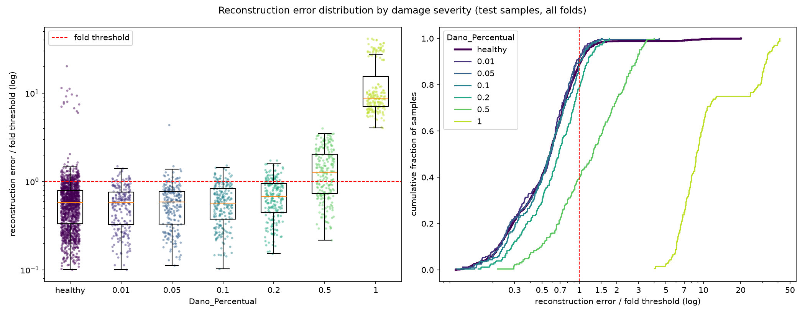

# E015: Entrada log-PSD com teto de 500 épocas

| Campo | Valor |
|---|---|
| Status | Concluído (não adotado) |
| Pai (base de comparação) | [E014](../E014_entrada-log-psd/README.md) |
| Proposto em | 2026-11-11 |
| Executado em | 2026-11-11 |
| Código | commit `3e604f9` (sem alterações pendentes em `src/`; a pasta do E015 ainda não estava commitada no momento do run) |

## 1. Motivação

**O E014 foi avaliado com o treino incompleto** (`E014_entrada-log-psd/run.log`, seção 7 do README do E014):
- O early stopping parou só 3 dos 15 folds (2, 3 e 11, nas épocas 151, 169 e 180). Os outros 12 chegaram ao teto de 200 épocas.
- Nesses 12 folds, a melhor época foi entre a 186ª e a 198ª, e o `val_loss` caiu de 7% a 13% nas últimas 50 épocas (mediana ~11%).
- O teto de 200 épocas foi herdado do domínio do tempo (adotado no E006). Lá, o modelo tinha 63.688 parâmetros e o early stopping agia em todos os folds; o modelo do E014 tem 16.872 parâmetros e outra entrada.

**O critério de adoção falhou num modelo ainda em treino.** A razão p95 ÷ mediana do erro dos saudáveis de treino foi 2,078, contra o limite de 1,589. Não se sabe se a razão diminui com mais treino:
- O MSE mede o nível do erro, e o `val_loss` mostra que ele ainda caía.
- A razão mede a forma da distribuição. Ela só cai se as passagens com erro mais alto (45 km/h e peso 0,90) melhorarem mais que as outras.

Sem essa resposta, não dá para atribuir a falha do E014 à representação (PSD) ou ao treino interrompido. O E014 apontou esta opção como recomendada (seção 10), e o autor a escolheu.

**O que já se sabe que não depende do treino.** Uma parte do alargamento vem da diferença de nível do erro entre velocidades: o erro mediano a 45 km/h foi ~3× o de 55 km/h. Dividir o erro de cada passagem pelo nível da sua velocidade reduziu a razão de 2,00 para 1,66, que ainda é maior que a do E012 medida da mesma forma (1,44). Isso foi medido no E014, com o modelo ainda em treino.

## 2. Hipótese

> Se o teto de épocas passar de 200 para 500, com o mesmo early stopping, então o early stopping para a maioria dos folds e a razão p95 ÷ mediana do erro dos saudáveis de treino fica ≤ 1,589, porque a largura medida no E014 vinha, em parte, de um modelo que ainda não tinha terminado de aprender os espectros mais difíceis (45 km/h e peso 0,90).

## 3. Mudança em relação ao pai

| Item | E014 | E015 |
|---|---|---|
| `epochs` (teto) | 200 | 500 |

Todo o resto é igual ao E014: entrada log-PSD (nperseg 512, 1,0–20,5 Hz, 40 × 16), modelo de 16.872 parâmetros, early stopping com paciência 10 e `restore_best_weights`, limiar no percentil 95, GPU com determinismo ligado, semente 42.

**Sem mudança de código.** Só o `config.yaml` muda.

**Efeito esperado nos folds que já pararam.** O teto não muda o otimizador (Adam com taxa fixa), então as primeiras 200 épocas de cada fold devem ser iguais às do E014. Os folds 2, 3 e 11 pararam antes de 200 e devem repetir o E014. Se não repetirem, a GPU não é determinística entre execuções nesta configuração, e a comparação fold a fold com o E014 deixa de valer. Isso não foi medido antes: o E012 comparou GPU com CPU, e não duas execuções na GPU.

## 4. Previsões (escritas antes de rodar)

### 4.1 Critérios só com saudáveis

| Critério | E014 | Previsão para o E015 |
|---|---|---|
| Razão p95 ÷ mediana do erro dos saudáveis de treino (mediana entre folds; critério) | 2,078 (1,946–2,243) | Menor que 2,078. Chegar a ≤ 1,589 exige uma queda de 0,49; a previsão de que ela chega lá é a hipótese, não uma expectativa forte |
| Mediana, entre folds, do MSE médio dos saudáveis de treino | 0,00331 | Menor (o `val_loss` ainda caía ~11% em 50 épocas) |
| Melhor `val_loss` (mediana) | 0,0042 | Menor |
| Folds parados pelo early stopping | 3 de 15 | Maioria (≥ 8 de 15) |
| Folds 2, 3 e 11 | Pararam em 151, 169 e 180 | Mesmas épocas e mesmos erros |
| η² do erro dos saudáveis: velocidade | 0,566 | Sem previsão de direção |
| Razão sem o nível de cada velocidade (irregularidade 1) | 1,661 | Sem previsão de direção |
| Erro do peso 0,90 ÷ outros pesos (mediana) | 1,47 | Sem previsão de direção |
| Grupo irregularidade 2 × módulo 0,975 acima do limiar, por fold | 14 | 14 |
| Canais ativos no latente | 4 de 4 em todos os folds | Sem previsão |

### 4.2 Avaliação (só reporte)

Sem previsão de direção para a AUC e os falsos negativos. Se a razão cair por causa de as passagens a 45 km/h terem passado a ser mais bem reconstruídas, o limiar desce e a severidade 0,2 a 55 km/h (recall de 1% no E014) é a mais provável de mudar. A severidade 0,01 deve continuar com AUC ≈ 0,5. Diferenças de FN da ordem de 7 e de AUC da ordem de 0,013 estão dentro do ruído de execução medido no E012.

### 4.3 Critério de adoção

O mesmo do E014, que o autor decidiu antes daquele run: adotar a entrada log-PSD (com teto de 500 épocas) na base se a mediana, entre folds, da razão p95 ÷ mediana do erro dos saudáveis de treino for ≤ **1,589** (1,568 do E012 mais a variação de execução de 0,021). As outras medidas da seção 4.1 são observadas e reportadas, mas não decidem.

**Limites conhecidos do critério** (os mesmos do E014): a razão descreve só a largura da distribuição dos saudáveis (no E011 ela passou e a separação piorou); a margem de 0,021 foi medida no domínio do tempo, com um único par de execuções; a métrica de teste não decide.

## 5. Configuração e origem de cada escolha

Igual ao E014, exceto a linha marcada.

| Parâmetro | Valor | Origem | Justificativa / evidência |
|---|---|---|---|
| `nodes_to_use` | 8 nós (10654, 10659, 10664, 10669, 10658, 10663, 10668, 10673) | Herdado / Pedido | Mesmos nós dos pipelines OCSVM e Isolation Forest, para comparação direta |
| `axes_to_use` | X, Y | Herdado / Pedido | Idem |
| `filter_type`, `cutoff_low`, `cutoff_high` | Passa-banda 1–20 Hz (Butterworth ordem 4, `filtfilt`) | Medido / Físico | Ver E003 e E014 |
| Ordem filtro/recorte | Filtra o registro completo, depois recorta | Físico | Ver E003 |
| Comprimento do sinal | Recorte em 1824 amostras (7,12 s) | Herdado | Ver E014 |
| `input_domain` | `psd` | Pedido | Ver E014 |
| `psd_nperseg` | 512 | Medido | Ver E014 |
| `psd_band` | 1,0–20,5 Hz (40 frequências) | Físico / Convenção | Ver E014 |
| Escala | log10 da PSD | Físico / Convenção | Ver E014 |
| Normalização | Padronização por canal, só com saudáveis do treino | Herdado | Ver E003 |
| Seleção de features | Nenhuma | Físico | Colunas são frequências contíguas |
| `pool_sizes` | `[2, 2, 1]` (sobre a frequência) | Herdado | Ver E014 |
| `encoder_filters` | `[32, 32, 4]` | Herdado | Adotado no E004/E010 |
| `kernel_size` | 5 frequências (2,5 Hz) | Medido / Físico | Ver E014 |
| `l1_activity` | 1e-5 | Pedido / Arbitrário | Adotado no E008 |
| Ativações e camadas | ReLU; saída linear; `UpSampling1D` + Conv | Convenção | Ver E001 |
| `learning_rate` | 1e-3 (Adam) | Convenção | Padrão do Adam |
| ★ `epochs` | 500 | Medido / Pedido / Arbitrário | Medido: no E014, 12 de 15 folds chegaram ao teto de 200 com o `val_loss` ainda caindo. Pedido: escolha do autor. O valor 500 em si é Arbitrário (2,5× o teto anterior); com o early stopping, ele só define até onde o treino pode ir |
| `early_stopping_patience` | 10 (com `restore_best_weights`) | Convenção | Valor comum; mantido para que o critério de parada seja o mesmo do E014 |
| `batch_size` | 32 | Convenção | Valor comum |
| `validation_split` | 0,1, após embaralhar os saudáveis | Convenção | Ver E001 |
| Score de anomalia | MSE médio sobre 40 × 16 do log-PSD padronizado | Convenção | Ver E014 |
| Regra do limiar | Percentil 95 do erro dos saudáveis de treino de cada fold | Pedido / Medido | Adotada no E005 (α = 5%) |
| `random_state` | 42 | Convenção | Semente fixa |
| Dispositivo | GPU (GTX 1650, WSL2), determinismo ligado | Pedido | Mesmo ambiente do E014 |

## 6. Verificação da premissa não supervisionada

- [x] Modelo, normalização, filtros e limiar ajustados só com saudáveis do treino.
- [x] Nenhum parâmetro escolhido com danificados, métricas de teste ou AUC. O aumento do teto vem do `val_loss` (calculado só com saudáveis de treino) e do número de folds que chegaram ao teto no E014.
- [x] O critério de adoção usa só saudáveis.

## 7. Execução

Commitar esta pasta antes (o código não muda; o `run.log` deve registrar o commit sem aviso de alterações pendentes em `src/`). No terminal do Ubuntu (WSL2):

```bash
cd /mnt/c/Users/vitor/OneDrive/Documentos/GitHub/ifd-bridge-defects-detection
GIT_CONFIG_COUNT=1 GIT_CONFIG_KEY_0=core.autocrlf GIT_CONFIG_VALUE_0=true \
  ~/venvs/ifd-bridge-gpu/bin/python src/test_autoencoders.py outputs/autoencoders/E015_log-psd-500-epocas \
  > outputs/autoencoders/E015_log-psd-500-epocas/run.log 2>&1
```

O `run.log` deve mostrar `Device: GPU [...], op determinism on`, `Input domain: psd (nperseg=512, band=(1.0, 20.5))` e linhas `Epoch k/500`.

Duração estimada, com 1,29 s/época (E014):
- Teto: 7500 épocas (15 × 500), ~2,7 h de treino.
- Piso: as mesmas 2900 épocas do E014 (os folds 2, 3 e 11 repetem 151 + 169 + 180; os outros 12 rodam pelo menos 200), ~1 h.
- Mais ~4 min de carregamento dos dados.

**Execução real (2026-11-11), no notebook do autor (WSL2, GTX 1650):**
- Código: `Code revision: 3e604f9`, sem aviso de alterações pendentes em `src/`. O código é o mesmo do E014 (`24a9613`); os commits seguintes só mudaram `outputs/`. O `config.yaml` do E015 não estava commitado quando o run começou; o arquivo da pasta é o mesmo que foi usado.
- `Device: GPU ['/physical_device:GPU:0'], op determinism on`; `Input domain: psd (nperseg=512, band=(1.0, 20.5))`; linhas `Epoch k/500`; entrada `(40, 16)`.
- Run completo, sem erros; gráfico e diagnóstico do resíduo gerados normalmente.
- Duração: de 22:00:49 a ~23:21, **~80 min** (previsão: entre ~1 h e ~2,7 h). Treino: 1,28 h, 1,28 s/época em média (mediana 1,15 s sem a primeira época de cada fold), igual ao E014.
- Épocas por fold: 264, 151, 169, 288, 230, 273, 228, 224, 260, 288, 180, 296, 300, 241, 213 (3605 no total, contra 2900 no E014). **O early stopping parou os 15 folds**; o mais longo parou na época 300, longe do teto de 500.

## 8. Resultados

A referência é o E014 (mesma entrada e mesmo modelo, teto de 200 épocas). Os números do E012 (domínio do tempo) aparecem só como contexto; medidas com unidade não são comparáveis entre os domínios.

### 8.1 Critérios só com saudáveis

| Critério | E014 | Previsão | E015 | Resultado |
|---|---|---|---|---|
| Razão p95 ÷ mediana do erro dos saudáveis de treino (mediana entre folds; critério) | 2,078 (1,946–2,243) | Menor que 2,078; hipótese: ≤ 1,589 | **2,113 (1,946–2,243)** | Refutada; critério falha |
| Mediana, entre folds, do MSE médio dos saudáveis de treino | 0,00331 (0,00322–0,00384) | Menor | 0,00314 (0,00285–0,00384), −5% | Confirmada |
| Melhor `val_loss` (mediana) | 0,0042 (0,0037–0,0049) | Menor | 0,0038 (0,0034–0,0047), −10% | Confirmada |
| Folds parados pelo early stopping | 3 de 15 | ≥ 8 de 15 | 15 de 15 | Confirmada |
| Folds 2, 3 e 11 | Pararam em 151, 169 e 180 | Mesmas épocas e mesmos erros | Mesmas épocas; erro de cada passagem idêntico ao do E014 (diferença 0) | Confirmada |
| η² do erro dos saudáveis: velocidade / peso / módulo / irregularidade | 0,566 / 0,059 / 0,046 / 0,066 | Sem previsão de direção | 0,578 / 0,056 / 0,045 / 0,063 | — |
| Razão sem o nível de cada velocidade (irregularidade 1) | 1,661 | Sem previsão de direção | 1,681 (1,585–1,830) | — |
| Erro do peso 0,90 ÷ outros pesos (mediana) | 1,47 (1,36–1,79) | Sem previsão de direção | 1,46 (1,34–1,78) | — |
| Grupo irregularidade 2 × módulo 0,975 acima do limiar, por fold | 14 | 14 | 14 (todas as passagens do grupo) | Confirmada |
| Canais ativos no latente | 4 de 4 em todos os folds | Sem previsão | 4 de 4 em todos os folds | — |

Outras medidas, mediana dos 15 folds: zeros no latente 40,8% (36,0–46,8%; E014: 40,8%); penalidade L1 ÷ MSE 0,102 (E014: 0,106).

**Convergência.** Nos 12 folds que no E014 chegaram ao teto, a melhor época ficou entre a 194ª e a 290ª. O `val_loss` desses folds caiu 0%–14% (mediana ~10%) entre a época 200 e a melhor época.

**Erro dos saudáveis de treino por velocidade** (mediana ÷ mediana geral): 45 km/h 1,49; 50 km/h 1,02; 55 km/h 0,47 (E014: 1,47 / 1,02 / 0,47). Razão p95 ÷ mediana dentro de cada velocidade, irregularidade 1, mediana entre folds:

| | Todas as velocidades | Só 45 | Só 50 | Só 55 | Sem o nível de cada velocidade |
|---|---|---|---|---|---|
| E012 (tempo) | 1,527 | 1,578 | 1,358 | 1,302 | 1,438 |
| E014 | 1,999 | 1,536 | 1,766 | 1,698 | 1,661 |
| E015 | 2,050 | 1,549 | 1,801 | 1,660 | 1,681 |

**MSE por faixa** (log-PSD padronizado, mediana dos 15 folds; 0–1 Hz é só a frequência de 1,0 Hz e 20–32 Hz, só a de 20,5 Hz):

| Faixa (Hz) | 0–1 | 1–4 | 4–8 | 8–12 | 12–16 | 16–20 | 20–32 |
|---|---|---|---|---|---|---|---|
| E014 | 0,0009 | 0,0015 | 0,0019 | 0,0040 | 0,0038 | 0,0052 | 0,0044 |
| E015 | 0,0008 | 0,0013 | 0,0017 | 0,0037 | 0,0036 | 0,0050 | 0,0041 |

Composição acima do limiar no treino, por fold (grupo das 15 / peso 0,90 / outros): 14 / 27,0 / 22,0 (E014: 14 / 27,0 / 22,0). Por velocidade, média por fold: 45 km/h 48,1; 50 km/h 10,1; 55 km/h 4,7.

### 8.2 Métricas globais

| Métrica | E012 (tempo, GPU) | E014 | E015 |
|---|---|---|---|
| Acurácia | 0,6256 ± 0,0219 | 0,6090 ± 0,0212 | 0,6113 ± 0,0211 |
| Recall | 0,3226 ± 0,1029 | 0,3211 ± 0,0921 | 0,3241 ± 0,0877 |
| FPR | 0,0815 (110) | 0,1126 (152) | 0,1111 (150) |
| AUC agregada | 0,6657 | 0,6364 | 0,6377 |
| Matriz de confusão | TN 1240 · FP 110 · FN 884 · TP 421 | TN 1198 · FP 152 · FN 886 · TP 419 | TN 1200 · FP 150 · FN 882 · TP 423 |

34 das 2655 decisões de teste mudaram em relação ao E014, todas nos 12 folds que treinaram mais.

### 8.3 Por severidade

| Severidade | n | Recall E014 | Recall E015 | AUC E014 | AUC E015 | FN E014 | FN E015 | Erro mediano danificado ÷ saudável¹ (E012 / E014 / E015) |
|---|---|---|---|---|---|---|---|---|
| 0,01 | 225 | 0,080 | 0,080 | 0,478 | 0,479 ± 0,036 | 207 | 207 | 0,99 / 0,97 / 0,96 |
| 0,05 | 225 | 0,089 | 0,084 | 0,495 | 0,496 ± 0,030 | 205 | 206 | 0,99 / 0,99 / 0,98 |
| 0,10 | 225 | 0,102 | 0,107 | 0,515 | 0,518 ± 0,026 | 202 | 201 | 1,06 / 1,02 / 1,03 |
| 0,20 | 225 | 0,200 | 0,209 | 0,609 | 0,612 ± 0,044 | 180 | 178 | 1,23 / 1,15 / 1,18 |
| 0,50 | 225 | 0,591 | 0,600 | 0,824 | 0,827 ± 0,028 | 92 | 90 | 3,85 / 1,96 / 2,07 |
| 1,00 | 180 | 1,000 | 1,000 | 0,994 | 0,996 ± 0,006 | 0 | 0 | 26,9 / 14,0 / 14,9 |

¹ Mediana, entre folds, da razão entre o erro mediano dos danificados da severidade e o dos saudáveis de teste do fold (mesma conta do E014).

**Por velocidade** (avaliação, só reporte):

| | 45 km/h | 50 km/h | 55 km/h |
|---|---|---|---|
| FPR E014 / E015 | 26,2% / 26,2% | 6,2% / 5,8% | 1,3% / 1,3% |
| Recall sev. 0,2, E014 / E015 | 40,0% / 41,3% | 18,7% / 20,0% | 1,3% / 1,3% |
| Recall sev. 0,5, E014 / E015 | 80,0% / 81,3% | 54,7% / 54,7% | 42,7% / 44,0% |
| FN E014 / E015 | 232 / 230 | 312 / 311 | 342 / 341 |

FPR por peso de vagão do fold: 0,90 (folds 10–12) 7,8%–37,8%; demais pesos 0%–15,6% (o máximo é o fold 13, peso 0,95 × módulo 0,975). Os folds 10–12 têm 75 dos 150 falsos positivos. O grupo irregularidade 2 × módulo 0,975 gerou os mesmos 15. FPR na irregularidade 1: 10,1% (E014: 10,3%).

### 8.4 Distribuição dos erros



## 9. Análise

**Hipótese (seção 2): refutada.** O treino convergiu (15 de 15 folds parados, nenhum perto do teto de 500), o MSE dos saudáveis caiu 5% e o `val_loss`, 10%. A razão p95 ÷ mediana, porém, subiu de 2,078 para 2,113, em vez de cair. A falha do critério no E014 não vinha do treino incompleto.

**Por que a razão não caiu.** O treino extra reduziu o erro de forma parecida em todas as passagens, e um pouco menos na cauda:
- A diferença de nível entre velocidades não mudou (45 km/h continua com ~3× o erro de 55 km/h; η² da velocidade 0,566 → 0,578).
- O peso 0,90 e o grupo irregularidade 2 × módulo 0,975 continuam acima dos outros na mesma proporção (1,47 → 1,46; 14 passagens do grupo por fold).
- A composição acima do limiar ficou idêntica (14 / 27 / 22 por fold).

Ou seja, a largura da distribuição é uma propriedade da representação com este modelo, e não do ponto em que o treino parou. Não foi verificado por que o espectro a 45 km/h é mais difícil de reconstruir; as duas explicações do E014 (forma do espectro muda com a velocidade; modelo pequeno) continuam em aberto, mas a do treino incompleto foi descartada.

**Determinismo da GPU entre execuções: confirmado.** Os folds 2, 3 e 11, que pararam antes de 200 épocas, repetiram as mesmas épocas e o mesmo erro em cada uma das passagens. É a primeira medida de que duas execuções na GPU, com a mesma configuração, dão o mesmo resultado. Consequência: diferenças entre runs na GPU com a mesma configuração e o mesmo código são zero; a variação de execução medida no E012 (CPU contra GPU) não se aplica a comparações GPU contra GPU. Isso só vale enquanto o código, as versões das bibliotecas e o hardware forem os mesmos.

**Avaliação (seção 4.2): só reporte.** Quase nada mudou em relação ao E014: FN 886 → 882, FP 152 → 150, AUC da severidade 0,2 0,609 → 0,612, razão danificado ÷ saudável da 0,5 1,96 → 2,07. O recall da severidade 0,2 a 55 km/h continua em 1%. Em relação ao E012 (tempo), a separação continua pior: AUC da severidade 0,2 0,750 contra 0,612, e razão da 0,5 3,85 contra 2,07, com o mesmo total de falsos negativos e mais falsos positivos.

**Folds 10–12 (peso 0,90), diagnóstico de avaliação.** Mesmo padrão do E014: saudáveis de teste com erro 2,14×, 1,16× e 1,55× o dos saudáveis de treino; limiar a 1,13×, 1,59× e 1,20× a mediana dos saudáveis de teste; FPR de 38% nos folds 10 e 12.

## 10. Decisão e próximos passos

- **Critério da seção 4.3: não atendido** (razão 2,113 > 1,589).
- **Decisão: não adotada.** A base continua sendo a configuração do E010, com o E012 como referência numérica na GPU.
- **Conclusão sobre a entrada log-PSD (E014 + E015):** com este modelo, a entrada espectral alarga a distribuição do erro dos saudáveis (razão ~2,1, contra 1,57 no tempo) e faz o erro depender da velocidade (η² ~0,57, contra 0,04). Mais treino não resolve.
- **Achado de método:** duas execuções na GPU com a mesma configuração dão resultados idênticos. Em comparações futuras GPU contra GPU, a margem de variação de execução pode ser revista; a escolha da margem cabe ao autor, antes do próximo run.
- **Variantes avaliadas nos folds de teste até aqui:** 15 (E001–E015).

Opções para o próximo experimento, para o autor escolher (cada uma precisa de registro e aprovação antes do run):
1. **Limiar por velocidade, sem retreino** (caminho reservado pelo autor para a variação das condições operacionais). Um percentil 95 por velocidade, calculado só com os saudáveis de treino daquela velocidade, aplicado aos erros já salvos do E012 (`src/rethreshold.py`). Motivação só com saudáveis: no E012, as passagens a 45 km/h ocupam ~49 dos ~63 lugares acima do limiar. Custo: minutos. Supõe que a velocidade é medida em operação.
2. **O mesmo limiar por velocidade sobre o E015.** Na PSD a dependência da velocidade é bem maior (η² 0,58), então é onde o efeito seria maior; mas a separação de base no E015 é pior que no E012. Custo: minutos.
3. **Encerrar o eixo da representação** e voltar a trabalhar no domínio do tempo com outro eixo.

Recomendação: a opção 1. Ela parte da base atual, que tem a melhor separação, ataca a causa dos falsos negativos apontada desde o E013 (a variação das condições operacionais define o limiar) e não exige retreino.

## Notas posteriores

</content>
