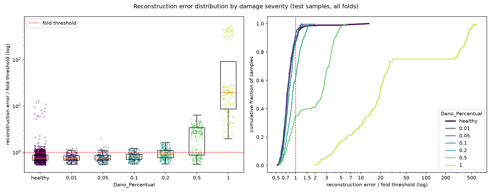

# E016: Limiar por velocidade (entrada no tempo, sem retreino)

| Campo | Valor |
|---|---|
| Status | Concluído (critério atendido; adoção pendente de decisão do autor) |
| Pai (base de comparação) | [E012](../E012_e010-na-gpu/README.md) (configuração do E010, na GPU) |
| Proposto em | 2026-11-12 |
| Executado em | 2026-11-12 |
| Código | commit `a0a4688` |

## 1. Motivação

**Um único limiar por fold dá alarmes falsos de forma desigual entre as velocidades.** O limiar do E012 é o percentil 95 de todos os 1260 saudáveis de treino do fold, misturando as três velocidades (420 passagens de cada). Medido só com os saudáveis de treino do E012 (`train_errors.parquet`):

| Velocidade | Passagens acima do limiar, por fold (média) | Irregularidade 1 acima do limiar |
|---|---|---|
| 45 km/h | 49,0 | 10,9% |
| 50 km/h | 6,9 | 0,6% |
| 55 km/h | 7,1 | 0,6% |

- O α de 5% escolhido pelo autor (E005) vale para o fold como um todo, mas, na prática, as passagens a 45 km/h operam com ~11% e as de 50 e 55 km/h com ~0,6%.
- No teste do E012, isso aparece como FPR de 18,4% a 45 km/h, contra 3,8% e 2,2% (E015, seção 8.3, só reporte).
- A 50 e 55 km/h, o limiar está acima de quase todos os saudáveis daquela velocidade. Um dano que suba o erro dessas passagens precisa subir mais do que subiria se o limiar fosse calibrado para elas.

**A velocidade é a condição operacional mais simples de medir.** O peso do vagão e a rigidez da ponte exigem instrumentação específica (pesagem em movimento) ou não são medidos em operação. A velocidade de um trem pode, em princípio, ser estimada pelo tempo de passagem entre dois sensores ao longo da ponte. Isso é raciocínio físico; não foi verificado para esta ponte nem para o sistema de monitoramento.

**O autor escolheu este teste** como alternativa caso as mudanças no modelo não resolvam os falsos negativos (E015, seção 10).

## 2. Hipótese

> Se cada fold usar um limiar por velocidade (o percentil 95 dos saudáveis de treino daquela velocidade), em vez de um único limiar, então a fração de saudáveis de treino acima do limiar passa a ser 5% em cada velocidade, porque o percentil é calculado separadamente sobre os saudáveis de cada uma.

Como no E005, a hipótese vale por construção. O objetivo é medir e reportar o efeito de igualar o α entre velocidades no detector da base, sem mudar o score.

## 3. Mudança em relação ao pai

| Item | E012 | E016 |
|---|---|---|
| Limiar de cada fold | 1 limiar: percentil 95 dos 1260 saudáveis de treino | 3 limiares: percentil 95 dos 420 saudáveis de treino de cada velocidade (45, 50 e 55 km/h) |
| Limiar aplicado a cada passagem de teste | O do fold | O da velocidade da passagem, no fold |

Nada mais muda: o modelo, o pré-processamento e os erros de reconstrução são os do E012.

### Como o limiar por velocidade é implementado

1. **Erros reaproveitados.** O `src/rethreshold.py` lê os erros já salvos do E012 (`train_errors.parquet` e `test_errors.parquet`). O modelo não é retreinado. As duas execuções na GPU do E014 e do E015 mostraram que o treino é determinístico, então um run completo reproduziria os mesmos erros.
2. **Limiares só com saudáveis de treino.** Para cada fold, os 1260 saudáveis de treino são separados pela coluna `Velocidade` (420 em cada uma). O limiar de cada velocidade é o percentil 95 dos erros desses 420, com a mesma função `compute_threshold` do pipeline. Nenhum dado de teste e nenhum danificado entra nessa conta.
3. **Aplicação no teste.** Cada passagem de teste recebe o limiar do seu fold e da sua velocidade, e é marcada como dano se o erro for maior que esse limiar. Se uma velocidade de teste não tiver saudáveis de treino no fold, o script para com erro (não acontece nesta base: as três velocidades estão no treino de todos os folds).
4. **Em operação**, isso equivale a: medir a velocidade do trem, escolher o limiar da velocidade e comparar com o erro de reconstrução.

**Mudanças de código:**
- `src/rethreshold.py`: chave opcional `threshold_group` no config (aqui, `"Velocidade"`). Sem ela, o comportamento é o de antes (um limiar por fold). A chave entra na lista de chaves do limiar, então o script continua recusando configs que mudem algo além do limiar.
- `src/test_autoencoders.py`: na tabela de diagnóstico por fold do `run.log`, a coluna `threshold` fica vazia quando o fold tem mais de um limiar (antes mostraria só o limiar da primeira passagem). O resto do relatório não muda; o gráfico de distribuição já usa o erro ÷ limiar de cada passagem.
- Verificação feita antes do registro: com o config do próprio E012 (sem `threshold_group`), o script reproduz exatamente os limiares, as decisões e a matriz de confusão do E012 (TN 1240, FP 110, FN 884, TP 421). Com `threshold_group: "Velocidade"`, cada fold recebe 3 limiares, iguais ao percentil 95 dos saudáveis de treino de cada velocidade, com 5,0% de saudáveis de treino acima em cada uma. As métricas de teste dessa verificação não foram olhadas, e a saída foi apagada.

**Limites da implementação:**
- Os dados têm só 3 velocidades, exatamente iguais entre passagens. Em operação, a velocidade é contínua e medida com erro; seria preciso definir faixas de velocidade ou interpolar o limiar entre elas, e as passagens perto da fronteira de duas faixas ficam com um limiar menos adequado. Isso não é testável com estes dados.
- Cada limiar é estimado com 420 passagens, e não 1260. Acima do percentil 95 ficam ~21 por velocidade, e não ~63 por fold, então o limiar de cada velocidade é mais sensível a poucas passagens.

## 4. Previsões (escritas antes de rodar)

### 4.1 Critérios só com saudáveis

Calculado antes do registro, só com os saudáveis de treino do E012 (é a própria definição do limiar, e não depende do teste):

| Critério | E012 | E016 (calculado) |
|---|---|---|
| Saudáveis de treino acima do limiar, por velocidade | 11,7% / 1,6% / 1,7% (49,0 / 6,9 / 7,1 de 420) | 5,0% em cada velocidade (21 de 420) |
| Irregularidade 1 acima do limiar, por velocidade | 10,9% / 0,6% / 0,6% | 4,0% em cada |
| Limiar por velocidade ÷ limiar único (mediana entre folds) | 1 | 45 km/h 1,09; 50 km/h 0,85; 55 km/h 0,85 |
| Acima do limiar no treino, por fold (grupo das 15 / peso 0,90 / outros) | 14 / 40,8 / 8,2 | 14 / 34,3 / 14,7 |
| Grupo irregularidade 2 × módulo 0,975 acima do limiar | Todo, em todas as velocidades | Todo, em todas as velocidades (~4,7 por velocidade e fold) |

O grupo irregularidade 2 × módulo 0,975 ocupa ~4,7 dos 21 lugares acima do limiar de cada velocidade (~22%).

### 4.2 Avaliação (só reporte)

- **AUC por severidade e AUC agregada do `run.log`: idênticas às do E012, por construção.** Elas usam o erro bruto, que não muda. A separação que a decisão realmente usa passa a ser a do erro ÷ limiar da velocidade; a AUC desse score será calculada na análise e reportada como diagnóstico.
- **FPR por velocidade:** cai a 45 km/h (18,4% no E012) e sobe a 50 e 55 km/h (3,8% e 2,2%), aproximando as três.
- **FPR total:** perto do E012 (8,2%), porque a fração total de saudáveis de treino acima do limiar continua 5% por fold. Os folds de peso 0,90 devem continuar com o maior FPR.
- **Falsos negativos:** sem previsão de direção no total. Por velocidade, devem subir a 45 km/h (limiar mais alto) e cair a 50 e 55 km/h (limiar ~15% mais baixo).
- Severidades até 0,05 devem continuar com recall perto do FPR (AUC ≈ 0,5).

### 4.3 Critério de adoção

Proposto, a confirmar pelo autor antes do run. Como no E005, o critério só com saudáveis é a regra entregar o α escolhido: 5% dos saudáveis de treino acima do limiar **em cada velocidade** de cada fold. Ele vale por construção, então a adoção é, na prática, uma decisão de projeto do autor, que inclui aceitar a suposição de que a velocidade é medida em operação. As métricas de teste são reportadas e não entram nessa decisão.

## 5. Configuração e origem de cada escolha

Igual ao E012 (configuração do E010), exceto a linha marcada.

| Parâmetro | Valor | Origem | Justificativa / evidência |
|---|---|---|---|
| `nodes_to_use` | 8 nós (10654, 10659, 10664, 10669, 10658, 10663, 10668, 10673) | Herdado / Pedido | Mesmos nós dos pipelines OCSVM e Isolation Forest |
| `axes_to_use` | X, Y | Herdado / Pedido | Idem |
| `filter_type`, `cutoff_low`, `cutoff_high` | Passa-banda 1–20 Hz (Butterworth ordem 4, `filtfilt`) | Medido / Físico | Ver E003 |
| Ordem filtro/recorte | Filtra o registro completo, depois recorta | Físico | Ver E003 |
| Comprimento do sinal | Recorte em 1824 amostras (7,12 s) | Medido / Físico | Ver E001 |
| Normalização | Padronização por canal, só com saudáveis do treino | Físico / premissa | Ver E003 |
| `pool_sizes` | `[2, 2, 1]` | Físico / Medido | Adotado no E010 |
| `encoder_filters` | `[32, 32, 4]` | Arbitrário / controle | Adotado no E004 |
| `kernel_size` | 19 | Físico (heurística) | Adotado no E004 |
| `l1_activity` | 1e-5 | Pedido / Arbitrário | Adotado no E008 |
| Ativações e camadas | ReLU; saída linear; `UpSampling1D` + Conv | Convenção | Ver E001 |
| `learning_rate` | 1e-3 (Adam) | Convenção | Padrão do Adam |
| `epochs`, `early_stopping_patience` | 200, 10 (com `restore_best_weights`) | Medido / Pedido / Convenção | Mantidos do E012, porque os erros são reaproveitados |
| `batch_size` | 32 | Convenção | Valor comum |
| `validation_split` | 0,1, após embaralhar os saudáveis | Convenção | Ver E001 |
| Score de anomalia | MSE médio sobre 1824 × 16 | Convenção | Não inclui a penalidade |
| Regra do limiar | Percentil 95 dos saudáveis de treino | Pedido / Medido | Adotada no E005 (α = 5%) |
| ★ `threshold_group` | `Velocidade` (um limiar por velocidade, em cada fold) | Pedido / Medido / Físico | Pedido: escolha do autor. Medido: com um limiar único, 45 km/h opera com α ≈ 11% e 50/55 km/h com ≈ 0,6% (seção 1, só saudáveis de treino). Físico: a velocidade é a condição operacional mais simples de medir em operação (suposição, não verificada) |
| `random_state` | 42 | Convenção | Semente fixa |
| Dispositivo dos erros | GPU (GTX 1650, WSL2), determinismo ligado | Herdado | Erros do E012 |

## 6. Verificação da premissa não supervisionada

- [x] Modelo, normalização, filtros e limiar ajustados só com saudáveis do treino. Cada limiar é um percentil dos saudáveis de treino de uma velocidade do fold.
- [x] Nenhum parâmetro escolhido com danificados, métricas de teste ou AUC. A separação por velocidade vem da composição dos saudáveis de treino acima do limiar. O FPR de teste por velocidade citado na seção 1 é contexto de um experimento já reportado, e não decide nada. As métricas de teste da verificação do código não foram olhadas.
- [x] O critério de adoção usa só saudáveis (e uma decisão de projeto do autor).
- A velocidade é um metadado de condição operacional, e não um rótulo de dano; usá-la no limiar não usa informação de dano.

## 7. Execução

Commitar o código e esta pasta antes. No PowerShell, em menos de um minuto (não usa GPU):

```powershell
.venv\Scripts\python.exe src\rethreshold.py outputs\autoencoders\E012_e010-na-gpu outputs\autoencoders\E016_limiar-por-velocidade-tempo *> outputs\autoencoders\E016_limiar-por-velocidade-tempo\run.log
```

O `run.log` deve mostrar `threshold_group=Velocidade` e 45 linhas de limiar (15 folds × 3 velocidades), cada uma com `healthy train above: 0.050`.

**Execução real (2026-11-12):** `Code revision: a0a4688`, sem aviso de alterações pendentes; esse commit contém as mudanças em `src/rethreshold.py` e `src/test_autoencoders.py`. `threshold_group=Velocidade` e 45 linhas de limiar, todas com `healthy train above: 0.050`. Menos de um minuto, sem erros. Os parquets desta pasta têm os mesmos erros do E012 (conferido passagem a passagem), com a coluna `threshold` recalculada. O aviso do TensorFlow no início do `run.log` (oneDNN) vem só da importação e não afeta o resultado.

## 8. Resultados

### 8.1 Critérios só com saudáveis

| Critério | E012 | Previsão (calculada) | E016 | Resultado |
|---|---|---|---|---|
| Saudáveis de treino acima do limiar, por velocidade | 11,7% / 1,6% / 1,7% | 5,0% em cada | 5,0% em cada uma das 45 combinações fold × velocidade | Confirmada (critério atendido) |
| Irregularidade 1 acima do limiar, por velocidade | 10,9% / 0,6% / 0,6% | 4,0% em cada | 4,0% em cada | Confirmada |
| Limiar por velocidade ÷ limiar único (mediana) | 1 | 1,09 / 0,85 / 0,85 | 1,09 / 0,85 / 0,85 | Confirmada |
| Acima do limiar no treino, por fold (grupo das 15 / peso 0,90 / outros) | 14 / 40,8 / 8,2 | 14 / 34,3 / 14,7 | 14 / 34,3 / 14,7 | Confirmada |

Limiares por velocidade (faixa entre folds): 45 km/h 0,0042–0,0062; 50 km/h 0,0031–0,0048; 55 km/h 0,0032–0,0046.

### 8.2 Métricas globais

| Métrica | E012 | E016 | Δ |
|---|---|---|---|
| Acurácia | 0,6256 ± 0,0219 | 0,6271 ± 0,0376 | +0,0015 |
| Recall | 0,3226 ± 0,1029 | 0,3724 ± 0,1501 | +0,0498 |
| FPR | 0,0815 (110) | 0,1267 (171) | +0,0452 |
| AUC agregada (erro bruto) | 0,6657 | 0,6657 | 0 (por construção) |
| AUC agregada do erro ÷ limiar da passagem | 0,6684 | 0,6648 | −0,0036 |
| Matriz de confusão | TN 1240 · FP 110 · FN 884 · TP 421 | TN 1179 · FP 171 · FN 819 · TP 486 | FN −65 |

250 das 2655 decisões de teste mudaram (125 saudáveis, 125 danificados): 188 alarmes novos e 62 retirados.

### 8.3 Por severidade

| Severidade | n | Recall E012 | Recall E016 | Recall − FPR E012 | Recall − FPR E016 | FN E012 | FN E016 | AUC do erro bruto | AUC do erro ÷ limiar (E012 / E016) |
|---|---|---|---|---|---|---|---|---|---|
| 0,01 | 225 | 0,044 | 0,071 | −0,037 | −0,056 | 215 | 209 | 0,469 | 0,469 / 0,447 |
| 0,05 | 225 | 0,067 | 0,120 | −0,015 | −0,007 | 210 | 198 | 0,493 | 0,493 / 0,486 |
| 0,10 | 225 | 0,067 | 0,133 | −0,015 | +0,007 | 210 | 195 | 0,603 | 0,603 / 0,590 |
| 0,20 | 225 | 0,253 | 0,382 | +0,172 | +0,256 | 168 | 139 | 0,750 | 0,750 / 0,745 |
| 0,50 | 225 | 0,640 | 0,653 | +0,559 | +0,527 | 81 | 78 | 0,854 | 0,854 / 0,844 |
| 1,00 | 180 | 1,000 | 1,000 | +0,919 | +0,873 | 0 | 0 | 0,998 | 0,997 / 0,997 |

A AUC do erro ÷ limiar é calculada dentro de cada fold (média dos 15), como a do `run.log`. No E012, ela é igual à do erro bruto, porque o limiar é o mesmo para todas as passagens do fold.

**Por velocidade:**

| | 45 km/h | 50 km/h | 55 km/h |
|---|---|---|---|
| FPR E012 / E016 | 18,4% / 11,3% | 3,8% / 12,0% | 2,2% / 14,7% |
| Falsos positivos E012 / E016 | 83 / 51 | 17 / 54 | 10 / 66 |
| Recall sev. 0,2, E012 / E016 | 32,0% / 18,7% | 17,3% / 49,3% | 26,7% / 46,7% |
| Recall sev. 0,5, E012 / E016 | 68,0% / 64,0% | 61,3% / 64,0% | 62,7% / 68,0% |
| FN E012 / E016 | 264 / 294 | 314 / 270 | 306 / 255 |

**Falsos positivos por fold.** Os folds 10–12 (peso 0,90) passaram de 86 para 112 dos 171 (FPR 32% → 42%). O fold 7 (peso 1,10 × módulo 0,975) passou de 4 para 33: as 30 passagens saudáveis de teste a 55 km/h desse fold ficaram todas acima do limiar. Fora dos folds 10–12 e do grupo irregularidade 2 × módulo 0,975, o FPR foi de 1,1% para 4,4%. O grupo gerou os mesmos 15 falsos positivos. FPR na irregularidade 1: 7,2% → 11,8%.

Erro mediano dos saudáveis de teste ÷ erro mediano dos saudáveis de treino da mesma velocidade, no fold:

| Fold | 45 km/h | 50 km/h | 55 km/h |
|---|---|---|---|
| 7 (1,10 × 0,975) | 1,16 | 1,17 | 1,41 |
| 10 (0,90 × 0,975) | 1,79 | 1,55 | 1,31 |
| 12 (0,90 × 1,025) | 1,64 | 1,46 | 1,28 |
| Mediana dos outros 11 folds | 1,02 | 1,00 | 0,97 |

### 8.4 Distribuição dos erros

O gráfico usa o erro ÷ limiar de cada passagem, ou seja, o limiar da sua velocidade.



## 9. Análise

**Hipótese (seção 2): confirmada, por construção.** 5,0% dos saudáveis de treino ficaram acima do limiar em cada velocidade de cada fold. As previsões calculadas da seção 4.1 se confirmaram exatamente, como esperado: elas usam só os saudáveis de treino, que não mudam.

**Previsões de avaliação (seção 4.2):**
- AUC do erro bruto idêntica à do E012: confirmada.
- FPR por velocidade caindo a 45 km/h e subindo a 50 e 55 km/h, aproximando as três: confirmada (11,3% / 12,0% / 14,7%, contra 18,4% / 3,8% / 2,2%).
- FPR total perto do E012: **refutada** (8,2% → 12,7%). Ver abaixo.
- FN subindo a 45 km/h e caindo a 50 e 55 km/h: confirmada (264 → 294; 314 → 270; 306 → 255).
- Severidades até 0,05 com recall perto do FPR: confirmada.

**Por que o FPR total subiu, se o α de treino continuou 5% por fold.** O limiar único deixava 50 e 55 km/h com α ≈ 0,6% no treino. Essa folga absorvia a diferença entre treino e teste nos folds cuja combinação de peso × módulo fica na borda da grade (folds 7, 10 e 12): neles, os saudáveis de teste têm erro 1,3–1,8 vez o dos saudáveis de treino da mesma velocidade (nos outros folds, ~1,0). Com o limiar por velocidade, a folga a 50 e 55 km/h acabou, e esses folds passaram a gerar alarmes falsos nessas velocidades também. No fold 7, todos os 30 saudáveis de teste a 55 km/h ficaram acima do limiar. Nos outros folds, o FPR (4,4% sem o grupo das 15) ficou perto do α escolhido de 5%, o que é o comportamento pretendido; antes era 1,1%.

**De onde veio a queda de falsos negativos.** O total caiu 65 (884 → 819, ~9 vezes o ruído de execução de ~7 medido no E012; entre execuções na GPU o ruído é zero). Quase todo o ganho está na severidade 0,2 a 50 e 55 km/h, em que o recall foi de ~17–27% para ~47–49%, enquanto a 45 km/h ele caiu de 32% para 19%. A AUC do erro ÷ limiar quase não mudou (sev. 0,2: 0,750 → 0,745). Ou seja, o score não separa melhor os danificados; o limiar por velocidade troca alarmes entre velocidades e, no total, alarma mais (FPR +4,5 pontos). A queda de FN vem junto com mais alarmes falsos, e não de detecção melhor.

**O que o resultado mostra sobre o problema.** No domínio do tempo, a velocidade já pesava pouco no erro dos saudáveis (η² 0,043), e o limiar único concentrava os alarmes a 45 km/h. O limiar por velocidade corrige essa concentração, como pretendido, mas expõe o outro problema já conhecido: as combinações de peso × módulo da borda da grade generalizam pior (E005, E013).

## 10. Decisão e próximos passos

- **Critério da seção 4.3: atendido, por construção** (5% dos saudáveis de treino acima do limiar em cada velocidade de cada fold).
- **Decisão: pendente do autor.** Como no E005, adotar é uma decisão de projeto. Ela inclui aceitar duas suposições: a velocidade é medida em operação, e, em operação, as velocidades contínuas serão agrupadas em faixas (seção 3, limites). As métricas de teste da seção 8 são reportadas e não entram nessa decisão.
- Se adotado, a base passa a ser a configuração do E010 com limiar no percentil 95 por velocidade.
- **Variantes avaliadas nos folds de teste até aqui:** 17 (E001–E017).

Próximos experimentos possíveis, motivados só por saudáveis ou por raciocínio físico (para o autor escolher):
1. **Limiar por velocidade × peso do vagão** (reserva do autor, com pesagem em movimento). Motivação só com saudáveis: das 63 passagens acima do limiar de treino por fold, 34 continuam sendo de peso 0,90. Supõe o peso medido em operação, o que é mais difícil que a velocidade. Cada limiar seria estimado com 84 passagens (56 para o peso do fold de teste), com ~3–4 acima do percentil 95, o que deixa a estimativa do percentil 95 instável; isso precisa ser avaliado antes, só com saudáveis.
2. **Generalização nas bordas da grade de condições operacionais.** O problema dos folds 7, 10 e 12 é do modelo, e não do limiar: o erro dos saudáveis sobe quando a combinação de peso × módulo não está no treino. Sem medida só com saudáveis que já aponte uma mudança no modelo para isso; precisaria de uma análise à parte.

## Notas posteriores

