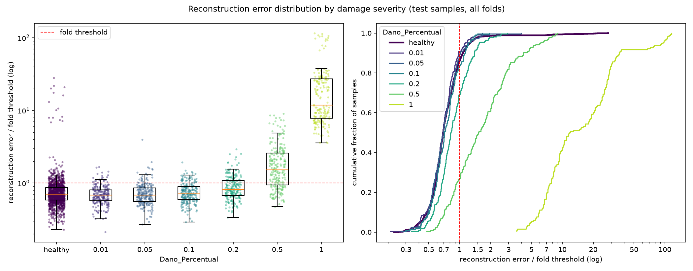

# E017: Limiar por velocidade (entrada log-PSD, sem retreino)

| Campo | Valor |
|---|---|
| Status | Concluído (diagnóstico; não é candidato à base) |
| Pai (base de comparação) | [E015](../E015_log-psd-500-epocas/README.md) |
| Proposto em | 2026-11-12 |
| Executado em | 2026-11-12 |
| Código | commit `a0a4688` (mesmo código do E016) |

## 1. Motivação

**Na entrada log-PSD, a dependência do erro em relação à velocidade é bem maior que no tempo.** Medido só com os saudáveis de treino do E015 (`train_errors.parquet`):
- A velocidade explica 58% da variação do erro dos saudáveis (η² 0,578; no E012, 0,043).
- O erro mediano a 45 km/h é ~3× o de 55 km/h.
- Com um limiar único por fold, as passagens acima dele são, em média por fold, 48,1 a 45 km/h, 10,1 a 50 km/h e 4,7 a 55 km/h. Na irregularidade 1, a fração acima do limiar é 10,3%, 1,3% e 0,0%.

A 55 km/h, o limiar único fica acima de todos os saudáveis de irregularidade 1 daquela velocidade. No teste do E015, o recall da severidade 0,2 a 55 km/h foi de 1% (só reporte).

**Por que testar também na PSD, se ela não foi adotada.** O E015 descartou a entrada log-PSD porque a distribuição do erro dos saudáveis ficou larga (razão p95 ÷ mediana 2,113). Boa parte dessa largura vem da diferença de nível entre velocidades, que é justamente o que o limiar por velocidade compensa. Este experimento mede o mesmo procedimento do E016 onde o efeito da velocidade é maior. É um diagnóstico, não um candidato à base (seção 4.3).

## 2. Hipótese

> Se cada fold usar um limiar por velocidade (o percentil 95 dos saudáveis de treino daquela velocidade), em vez de um único limiar, então a fração de saudáveis de treino acima do limiar passa a ser 5% em cada velocidade, porque o percentil é calculado separadamente sobre os saudáveis de cada uma.

A hipótese vale por construção, como no E005 e no E016.

## 3. Mudança em relação ao pai

| Item | E015 | E017 |
|---|---|---|
| Limiar de cada fold | 1 limiar: percentil 95 dos 1260 saudáveis de treino | 3 limiares: percentil 95 dos 420 saudáveis de treino de cada velocidade |
| Limiar aplicado a cada passagem de teste | O do fold | O da velocidade da passagem, no fold |

Nada mais muda: os erros de reconstrução são os do E015.

**Implementação:** a mesma do E016 (seção 3 do [E016](../E016_limiar-por-velocidade-tempo/README.md)): `src/rethreshold.py` com `threshold_group: "Velocidade"`, sobre os erros salvos do E015. Os limites também são os mesmos (velocidade contínua em operação; ~21 passagens acima de cada limiar).

## 4. Previsões (escritas antes de rodar)

### 4.1 Critérios só com saudáveis

Calculado antes do registro, só com os saudáveis de treino do E015:

| Critério | E015 | E017 (calculado) |
|---|---|---|
| Saudáveis de treino acima do limiar, por velocidade | 11,5% / 2,4% / 1,1% (48,1 / 10,1 / 4,7 de 420) | 5,0% em cada velocidade (21 de 420) |
| Irregularidade 1 acima do limiar, por velocidade | 10,3% / 1,3% / 0,0% | 3,7% / 4,0% / 3,8% |
| Limiar por velocidade ÷ limiar único (mediana entre folds) | 1 | 45 km/h 1,13; 50 km/h 0,89; 55 km/h 0,38 |
| Acima do limiar no treino, por fold (grupo das 15 / peso 0,90 / outros) | 14 / 27,0 / 22,0 | 14 / 36,4 / 12,6 |
| Grupo irregularidade 2 × módulo 0,975 acima do limiar | Todo | Todo (~4,7 por velocidade e fold) |

O limiar de 55 km/h cai para ~38% do limiar único, uma mudança muito maior que no E016 (85%).

### 4.2 Avaliação (só reporte)

- **AUC por severidade e AUC agregada do `run.log`: idênticas às do E015, por construção** (erro bruto). A AUC do erro ÷ limiar da velocidade será calculada na análise como diagnóstico.
- **FPR por velocidade:** cai a 45 km/h (26,2% no E015) e sobe a 55 km/h (1,3%), aproximando as três.
- **Recall a 55 km/h:** deve subir mais que no E016, porque o limiar dessa velocidade cai ~62%.
- **Falsos negativos:** sem previsão de direção no total; devem subir a 45 km/h e cair a 55 km/h.
- Severidades até 0,05 devem continuar com recall perto do FPR.

### 4.3 Critério de adoção

**Nenhum: este experimento não é candidato à base.** A entrada log-PSD foi descartada no E015 pelo critério só com saudáveis decidido antes daquele run. Escolher entre E016 e E017 pelos resultados de teste violaria a premissa não supervisionada. Os resultados servem para mostrar quanto da dependência da velocidade o limiar compensa em cada representação.

Para reabrir a PSD seria preciso um critério só com saudáveis, decidido antes, que leve em conta o limiar por velocidade. A medida natural já existe: a razão p95 ÷ mediana do erro dos saudáveis sem o nível de cada velocidade, que foi 1,681 no E015, contra 1,438 no E012. Com ela, a PSD continua mais larga que o tempo.

## 5. Configuração e origem de cada escolha

Igual ao E015, exceto a linha marcada. Ver a tabela completa no [E015](../E015_log-psd-500-epocas/README.md), seção 5.

| Parâmetro | Valor | Origem | Justificativa / evidência |
|---|---|---|---|
| Entrada, modelo e treino | Os do E015 (log-PSD 40 × 16, kernel 5, `[32, 32, 4]`, `[2, 2, 1]`, teto de 500 épocas) | Herdado | Os erros são reaproveitados |
| Regra do limiar | Percentil 95 dos saudáveis de treino | Pedido / Medido | Adotada no E005 (α = 5%) |
| ★ `threshold_group` | `Velocidade` | Pedido / Medido / Físico | Mesma justificativa do E016; aqui, com um limiar único, 55 km/h opera com α ≈ 0% na irregularidade 1 (seção 1) |

## 6. Verificação da premissa não supervisionada

- [x] Modelo, normalização, filtros e limiar ajustados só com saudáveis do treino.
- [x] Nenhum parâmetro escolhido com danificados, métricas de teste ou AUC.
- [x] Não há critério de adoção; os resultados de teste não serão usados para escolher entre E016 e E017.

## 7. Execução

Commitar o código e esta pasta antes. No PowerShell, em menos de um minuto:

```powershell
.venv\Scripts\python.exe src\rethreshold.py outputs\autoencoders\E015_log-psd-500-epocas outputs\autoencoders\E017_limiar-por-velocidade-psd *> outputs\autoencoders\E017_limiar-por-velocidade-psd\run.log
```

O `run.log` deve mostrar `threshold_group=Velocidade` e 45 linhas de limiar, cada uma com `healthy train above: 0.050`.

**Execução real (2026-11-12):** `Code revision: a0a4688`, sem aviso de alterações pendentes. `threshold_group=Velocidade` e 45 linhas de limiar, todas com `healthy train above: 0.050`. Menos de um minuto, sem erros. Os erros são os do E015 (conferido passagem a passagem), com a coluna `threshold` recalculada.

## 8. Resultados

### 8.1 Critérios só com saudáveis

| Critério | E015 | Previsão (calculada) | E017 | Resultado |
|---|---|---|---|---|
| Saudáveis de treino acima do limiar, por velocidade | 11,5% / 2,4% / 1,1% | 5,0% em cada | 5,0% em cada uma das 45 combinações fold × velocidade | Confirmada |
| Irregularidade 1 acima do limiar, por velocidade | 10,3% / 1,3% / 0,0% | 3,7% / 4,0% / 3,8% | 3,7% / 4,0% / 3,8% | Confirmada |
| Limiar por velocidade ÷ limiar único (mediana) | 1 | 1,13 / 0,89 / 0,38 | 1,13 / 0,89 / 0,38 | Confirmada |
| Acima do limiar no treino, por fold (grupo das 15 / peso 0,90 / outros) | 14 / 27,0 / 22,0 | 14 / 36,4 / 12,6 | 14 / 36,4 / 12,6 | Confirmada |

Limiares por velocidade (faixa entre folds): 45 km/h 0,0058–0,0072; 50 km/h 0,0045–0,0058; 55 km/h 0,0018–0,0030.

### 8.2 Métricas globais

| Métrica | E015 | E017 | E016 (tempo, contexto) |
|---|---|---|---|
| Acurácia | 0,6113 ± 0,0211 | 0,6245 ± 0,0336 | 0,6271 ± 0,0376 |
| Recall | 0,3241 ± 0,0877 | 0,3793 ± 0,1432 | 0,3724 ± 0,1501 |
| FPR | 0,1111 (150) | 0,1385 (187) | 0,1267 (171) |
| AUC agregada (erro bruto) | 0,6377 | 0,6377 (por construção) | 0,6657 |
| AUC agregada do erro ÷ limiar da passagem | 0,6376 | 0,6565 | 0,6648 |
| Matriz de confusão | TN 1200 · FP 150 · FN 882 · TP 423 | TN 1163 · FP 187 · FN 810 · TP 495 | TN 1179 · FP 171 · FN 819 · TP 486 |

311 das 2655 decisões de teste mudaram em relação ao E015 (149 saudáveis, 162 danificados): 210 alarmes novos e 101 retirados.

### 8.3 Por severidade

| Severidade | n | Recall E015 | Recall E017 | FN E015 | FN E017 | AUC do erro bruto | AUC do erro ÷ limiar (E015 / E017) | E016, contexto (AUC do erro ÷ limiar) |
|---|---|---|---|---|---|---|---|---|
| 0,01 | 225 | 0,080 | 0,093 | 207 | 204 | 0,479 | 0,479 / 0,462 | 0,447 |
| 0,05 | 225 | 0,084 | 0,107 | 206 | 201 | 0,496 | 0,496 / 0,490 | 0,486 |
| 0,10 | 225 | 0,107 | 0,164 | 201 | 188 | 0,518 | 0,518 / 0,544 | 0,590 |
| 0,20 | 225 | 0,209 | 0,307 | 178 | 156 | 0,612 | 0,612 / 0,685 | 0,745 |
| 0,50 | 225 | 0,600 | 0,729 | 90 | 61 | 0,827 | 0,827 / 0,889 | 0,844 |
| 1,00 | 180 | 1,000 | 1,000 | 0 | 0 | 0,996 | 0,996 / 0,996 | 0,997 |

**Por velocidade:**

| | 45 km/h | 50 km/h | 55 km/h |
|---|---|---|---|
| FPR E015 / E017 | 26,2% / 13,8% | 5,8% / 9,6% | 1,3% / 18,2% |
| Recall sev. 0,2, E015 / E017 | 41,3% / 26,7% | 20,0% / 22,7% | 1,3% / 42,7% |
| Recall sev. 0,5, E015 / E017 | 81,3% / 72,0% | 54,7% / 64,0% | 44,0% / 82,7% |
| FN E015 / E017 | 230 / 275 | 311 / 294 | 341 / 241 |

**Falsos positivos por fold.** Os folds 10–12 passaram de 75 para 120 dos 187 (FPR 28% → 44%), e o fold 7, de 10 para 23 (19 deles a 55 km/h). Nesses folds, o erro dos saudáveis de teste a 55 km/h é 1,7–2,2 vezes o dos saudáveis de treino da mesma velocidade (outros folds: ~1,1). Fora dos folds 10–12 e do grupo irregularidade 2 × módulo 0,975, o FPR foi de 5,9% para 5,2%.

### 8.4 Distribuição dos erros



## 9. Análise

**Hipótese (seção 2): confirmada, por construção.** As previsões da seção 4.1 se confirmaram exatamente.

**Previsões de avaliação (seção 4.2):**
- AUC do erro bruto idêntica à do E015: confirmada.
- FPR caindo a 45 km/h e subindo a 55 km/h: confirmada (26,2% → 13,8%; 1,3% → 18,2%). As três ficaram mais próximas, mas 55 km/h passou a ter o maior FPR.
- Recall a 55 km/h subindo mais que no E016: confirmada (sev. 0,2: 1% → 43%, +41 pontos; no E016, +20 pontos).
- FN subindo a 45 km/h e caindo a 55 km/h: confirmada (230 → 275; 341 → 241).
- Severidades até 0,05 com recall perto do FPR: confirmada.

**Na PSD, o limiar por velocidade melhora a separação, e não só troca alarmes.** A AUC do erro ÷ limiar subiu nas severidades 0,2 (0,612 → 0,685) e 0,5 (0,827 → 0,889), ao contrário do E016, em que ficou igual. É o esperado pela física do score: na PSD, a velocidade explica 58% da variação do erro dos saudáveis, então dividir pelo limiar da velocidade remove uma variação grande que não tem relação com dano; no tempo, ela explicava só 4%.

**O mesmo problema de borda do E016, maior.** O limiar de 55 km/h caiu para 38% do limiar único, e os folds da borda da grade (7, 10 e 12) passaram a gerar a maior parte dos alarmes falsos a 55 km/h. Fora deles, o FPR ficou perto do α escolhido.

**Comparação com o E016 (só reporte).** Os dois ficaram parecidos no total (FN 810 contra 819; FPR 13,9% contra 12,7%). Com o erro ÷ limiar, a PSD separa melhor a severidade 0,5 (0,889 contra 0,844) e pior as severidades 0,1 e 0,2 (0,544 e 0,685 contra 0,590 e 0,745). Pela premissa não supervisionada, essa comparação não pode decidir qual representação usar (seção 4.3).

## 10. Decisão e próximos passos

- **Sem critério de adoção** (seção 4.3). A entrada log-PSD continua descartada pelo critério só com saudáveis do E015.
- **Variantes avaliadas nos folds de teste até aqui:** 17 (E001–E017).
- **Se o autor quiser reabrir a PSD com limiar por velocidade**, o critério só com saudáveis, decidido antes de qualquer novo run, seria a razão p95 ÷ mediana do erro dos saudáveis dentro de cada velocidade. Ela já foi medida nos saudáveis de treino: 1,681 na PSD (E015) contra 1,438 no tempo (E012), mediana entre folds, irregularidade 1, com o nível de cada velocidade removido. Por essa medida, a PSD continua com a distribuição dos saudáveis mais larga, e não seria adotada. Reabrir exigiria outro argumento só com saudáveis ou físico.

## Notas posteriores

